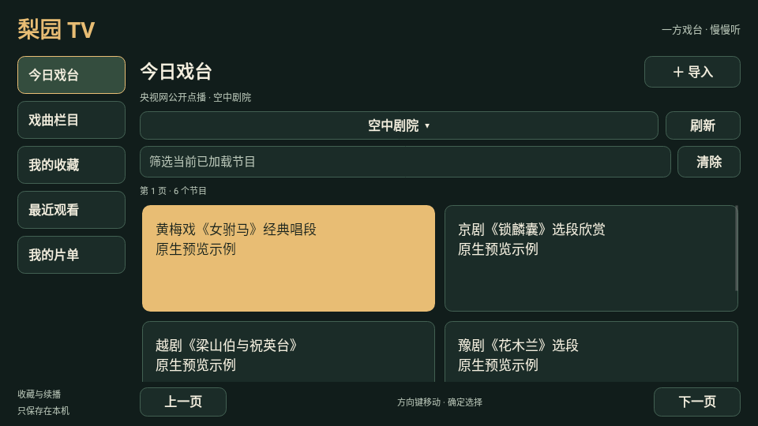

# 梨园 TV · Opera TV

[English](README.en.md) · [原创 SVG 图标](logo.svg) · [源码](src/main/) · [公开内容来源](docs/research/SOURCES.md)

**[下载梨园 TV 0.1.0 APK](https://raw.githubusercontent.com/ecojust/pureTV/master/resource/apps/opera/opera-0.1.0.apk)** · 54,011 字节（约53 KiB） · Android 4.4+ · [校验清单](SHA256SUMS.txt) · [验证记录](docs/VALIDATION.md)



面向电视遥控器的独立戏曲播放器。提供央视网公开戏曲栏目，以及自己的视频链接、M3U/JSON片单和本机视频；支持收藏、最近观看与续播。包名 `com.ecojust.operatv`，首版0.1.0，最低Android4.4/API19。界面随系统显示中文或英文。

安装后即可浏览并联网播放内置栏目，无需自行添加节目源；导入功能用于补充自己的内容。当前内置内容是上述央视栏目，未复刻七星原版的完整片库。

应用不包含第三方原生 `.so`，使用Android系统播放器，避免把某一种CPU架构的播放器库带入安装包。能否播放某种视频仍取决于系统解码器、网络及来源是否可用。它与七星戏曲使用不同包名，不是原应用的更新包，也不会迁移其数据。

## 使用

- 「今日戏台」「戏曲栏目」浏览《空中剧院》《角儿来了》《跟我学》《梨园闯关我挂帅》《名家书场》的公开节目，通过栏目选择和上一页/下一页浏览。
- 搜索框**筛选当前已经加载的节目标题和分组**，不是全网或整个栏目历史搜索。没有结果时可清除筛选、换栏目或翻页。
- 在节目详情选择播放或收藏。播放后在「最近观看」继续；收藏与进度保存在当前设备，不需要账号。
- 「导入」支持直接视频链接、网络播放列表和系统文件选择器。文件选择器不可用的电视可使用视频/片单URL。
- 在「我的片单」详情移除条目，不删除原视频。导入失败不替换现有片单。

使用方向键移动焦点，确定键选择，返回键关闭详情或返回上一页。播放器提供暂停/继续和进度控制，播放时控制栏会隐藏，上键可唤出；返回会保存实际播放进度并退出播放器。视频无法加载时显示错误并可重试，不把点击播放当作已经播放成功。

## 导入格式

直接视频支持 `http://`、`https://` 链接，包括自己局域网中的服务。文件由系统文件选择器授予访问权；不要求扫描整个磁盘的权限。网络片单最大1MiB、最多500条；本机收藏最多200项、最近记录最多100项。

```m3u
#EXTM3U
#EXTINF:-1 group-title="我的戏曲",我的视频
https://example.com/my-opera.mp4
```

```json
{"items":[{"title":"我的视频","url":"https://example.com/my-opera.mp4","group":"我的戏曲"}]}
```

上方域名仅示意格式，需要替换为自己的真实地址。JSON也接受同结构的数组。网络片单中的相对地址以片单最终地址为基准；HLS主/媒体清单视为一个视频，不把分片导入成节目列表。本地HLS清单不能凭一个文件授权访问相邻分片，需改用完整网络HLS地址。

## 内容与验证范围

内置目录来自央视公开栏目，播放时请求该节目的公开点播信息，不缓存临时流地址。来源返回限制、失效或没有有效内容时显示提示；没有访问收费内容、登录账户或受保护资源的流程。节目与媒体权利属于各内容提供者。

0.1.0为正式签名的首版预览包。本地与CI各73项测试通过；Linux上的Android TV 16/API36模拟器已验证安装、M3U导入、收藏、播放/暂停和进程重启后续播，并实际播放《空中剧院》黄梅戏《五月的鲜花》选场至4秒。没有进行整期播放、声音听测、Mac Apple Silicon模拟器或实体电视测试。

上方首页图片来自Robolectric原生界面，使用预览测试数据。[实际模拟器节目画面](docs/validation/ci-42825506718/runtime/06-public-paused.png)与[原始运行报告](docs/validation/ci-42825506718/runtime/report.json)单独保留。

## 开发

沿用仓库JDK17、SDK35、BuildTools34.0.0和Gradle Wrapper：

```sh
cd resource/launcher/puretv
./gradlew :opera:assembleDebug :opera:verifyReleaseSize :opera:testDebugUnitTest :opera:lintDebug
```

设置 `OPERA_UI_CAPTURE_DIR` 可由Robolectric原生图形测试导出预览；真实Android检查脚本为 `tools/test-opera-emulator.py`，只用于独立测试AVD，会安装并卸载本次测试包。正式发布使用既有pureTV证书，由定向CI在构建、测试和lint通过后隔离签名。
