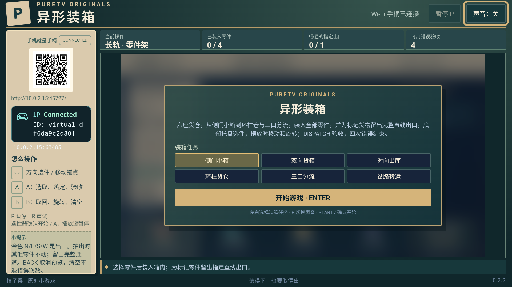
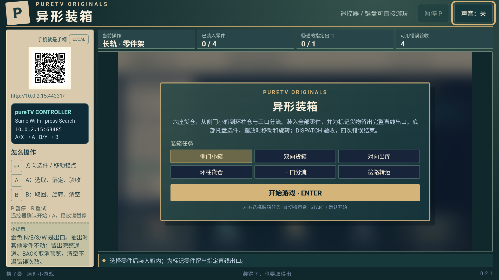

# 异形装箱 / Packing Sculptor

<!-- apk-resource:start -->
[Android 0.2.3 APK](../../../joystick-games/packing-sculptor/packing-sculptor-0.2.3.apk?raw=1) · [图标与安装验证](docs/releases/0.2.3/android-icon-receipt.json) · [文件校验](SHA256SUMS.txt) · [0.2.1 实玩录像](docs/releases/0.2.1/gameplay.mp4?raw=1)
<!-- apk-resource:end -->

<!-- controller-client-status:start -->
## 历史版本 0.2.2 · 手柄连接标识

[下载签名 APK](packing-sculptor-0.2.2.apk?raw=1) · [校验值](SHA256SUMS.txt) · [签名与来源](resource.json) · [源码](src/) · [图标](logo.svg)

Android **0.2.2 / versionCode 4**：手柄连接后，侧边显示手柄图标、玩家席位（按游戏人数显示 1P/2P）和设备完整连接 ID；断开后隐藏。默认 TCP 端口仍为 **63485**。当前手柄固件未上报 RSSI，因此不显示信号强弱。

[连接截图](docs/releases/0.2.2/connected.png) · [连接状态专项录像](docs/releases/0.2.2/controller-status.mp4?raw=1) · [版本验证](docs/releases/0.2.2/verification.json) · [20 款更新记录](../../../docs/controller-client-status/README.md)

安装包沿用原发布证书。本轮在 Android TV 模拟器中验证连接身份、断开／重连状态及同证书覆盖安装；截图和录像记录菜单中的连接状态专项，没有重做完整玩法验收。未改规则模型按精确哈希复用历史依据，旧版报告继续保留。尚未验证实体电视、手机、ESP32 或带已有存档的升级与数据保留。


<!-- controller-client-status:end -->

历史 0.2.0：[签名安装包](packing-sculptor-0.2.0.apk) · [六关实际游玩录像](docs/gameplay-0.2.0.mp4) · [旧版验证记录](https://github.com/ecojust/pureTV/blob/bf58393ba8fa8bb3bdf731ab24f9ab09d90f5075/resource/apps/packing-sculptor/docs/verification.json)。这些旧版记录作为未改变规则的回归依据，不代表本轮界面、手柄链路或 Android 实包验收。

把不同轮廓的零件装进缺角箱体。零件可以顺时针旋转，每次移动一格；贴边允许，重叠和穿墙不允许。标有出口的零件还必须能保持当前朝向，沿箭头直线滑出指定门洞。检查某一零件时，其他零件都保持原位。

全部零件各装入一次，并为所有必抽零件留下畅通通道后，在 CHECK 验收。放得下并不等于拿得出；不能只靠总面积或出口附近的一小段空隙通过检查。第四次错误验收结束本局，前三次错误后仍可正确提交获胜。没有倒计时。

## 操作

| 位置 | 方向 | A | B |
| --- | --- | --- | --- |
| 零件架 | 上/左选前项，下/右选后项，不循环 | 选取该件，进入摆放 | 取回该件；空槽不变 |
| 摆放中 | 移动预览锚点，一次一格 | 合法位置落定并返回零件架 | 顺时针转 90° |
| 摆放区右侧 BACK 栏 | 上下移动，向左返回箱体 | 取消预览，保留原摆放 | 仍可旋转预览 |
| 零件架末尾 CHECK | 与其他架位相同 | 验收全部零件和抽出通道 | 清空箱体，保留错误记录 |

摆放预览可以暂时越过墙或覆盖别的零件，红色预览不能落定，也不会扣验收次数。已装入的零件可以再次选取；取消预览会保留它原来的位置。旋转以当前朝向的包围框左上角为锚点，锚点不移动。只有落定才改变实际摆放。

长按不连动；每次操作后松开再按。同时触发时 B 优先于 A，A 优先于方向，其他新输入不排队。

- 键盘：方向键 / WASD；空格 / Z / Enter 为 A；X / B 为 B。
- 暂停：P / Escape / START；重试：R / SELECT，均由宿主独立提供。
- 手机：右侧整个三分之一区域分为上方 A、下方 B。开始、恢复或取消输入后，先松开控制。

## 六个任务（0.2.0）

| 任务 | 箱体网格 | 零件数 | 必须保留的出口 |
| --- | --- | --- | --- |
| 侧门小箱 / SIDE HATCH | 5×4，两个缺角 | 4 | 长轨向右 |
| 双向货箱 / TWO WAY CRATE | 5×5，左下和右下缺角 | 5 | 弯角向上；长轨向下 |
| 对向出库 / OPPOSITE DISPATCH | 6×5，四角缺格 | 6 | 折板向右；长轨向左 |
| 环柱货仓 / PILLAR RING | 6×6，中央 2×2 固定柱 | 6 | 短条向上；长轨向右 |
| 三口分流 / THREE PORT | 7×5，上下缺口分隔门洞 | 6 | 丁板向窄北门；折板向下；方块向右 |
| 岔路转运 / FORKED DEPOT | 7×6，中央隔柱与四角缺格 | 6 | 弯角向左；丁板可向上或向右；折板向右 |

箱体、零件轮廓、朝向、门洞和必抽箭头始终公开。不同零件独立验收通道，不能暗中先拿走另一件腾路。没有隐藏目标摆放图或预设操作路线；满足规则的任何摆放都可以通过。

完整坐标与连续扫掠规则见 [公开设计](docs/public-design.md)，精确状态与输入行为见 [模型契约](docs/model-contract.md)，宿主和验证约定见 [公共接口](docs/public-interface.md)。这些文件描述静态规则；不宣称已经完成实现、测试或发布。

## 0.2.0 的装箱工作台

中央俯视箱体显示真实墙体和门洞，底部横向托盘显示全部零件轮廓，左侧装货单给出装入量、占用面积与验收额度，右侧逐条检查出库路线。桌面外的手机二维码和简明操作改为左侧窄工作条，不再使用与其他游戏相同的右侧栏。

```bash
node --test resource/apps/packing-sculptor/tests/model.test.cjs resource/apps/packing-sculptor/tests/campaign-test.mjs
node resource/apps/packing-sculptor/tests/browser-checks.mjs --assets /absolute/built-assets --output /absolute/qa-output
```

0.2.0 的构建、六关普通输入录像和签名验收见上方历史入口及 `docs/releases/0.2.0/`；历史 0.1.0 报告与产物继续保留。

采用仓库的 [MIT 许可证](LICENSE)。

## pureTV Wi-Fi 手柄

从 0.2.1 起，电视游戏提供 pureTV TCP 手柄服务，默认端口 **63485**。电视和手柄连同一个局域网，在游戏显示连接地址后按手柄 GPIO23 搜索键；同网仅保留一个目标游戏服务，固件才会自动选中。若端口被占用，以游戏显示的实际端口为准。

- 方向键：对应游戏内方向操作和菜单选关。
- START：开始、暂停或继续。
- A / X：选取 / 落定 / 验收。
- B / Y：取回 / 旋转 / 清空。

断线或切换控制来源会暂停并清除旧输入；重新连接后松开按键，再按 START 继续。临时失焦时保留TCP连接并隔离输入，真正退出游戏时关闭服务。遥控器、键盘和扫码手机入口继续可用。

虚拟手柄联调：`python3 puretv-joystick/bridge.py 电视IP --port 63485`，再打开 `http://127.0.0.1:8767/`。使用备用端口时替换命令中的端口。验证范围见[20款游戏接入记录](../../../docs/readme-controller-support/README.md)。

<!-- controller-client-status-history:start -->
<details>
<summary>历史 0.2.1 安装包与验收记录</summary>

以下为旧版发布记录，其测试与画面不代表本次连接 ID 界面验收。[原提交中的完整说明](https://github.com/ecojust/pureTV/blob/9af9f197855eb7a0ce7174c0e6295c8974b3250d/resource/apps/packing-sculptor/README.md)。

**0.2.1 · pureTV 手柄更新：** [签名安装包](packing-sculptor-0.2.1.apk) · [Android 实包手柄回归录像](docs/releases/0.2.1/gameplay.mp4) · [版本验证](docs/releases/0.2.1/verification.json) · [当时接入记录](../../../docs/readme-controller-support/README.md)

新增 pureTV Wi-Fi 手柄支持，默认端口 **63485**，显示真实连接状态，断线时暂停并清除输入。保留原六关及规则，遥控器和扫码手机仍可使用。

该历史版 APK 已签名，并在 Android TV API 36 模拟器中完成同证书覆盖安装验证，通过全部 8 项手柄验收，覆盖开始、实际游戏操作、暂停恢复、断线重连、九键输入及逐消息 ACK。下图和上方录像来自该历史版本实际 APK；录像记录手柄回归过程，不是六关通关录像。尚未进行实体电视、手机或 ESP32 测试。



</details>
<!-- controller-client-status-history:end -->
