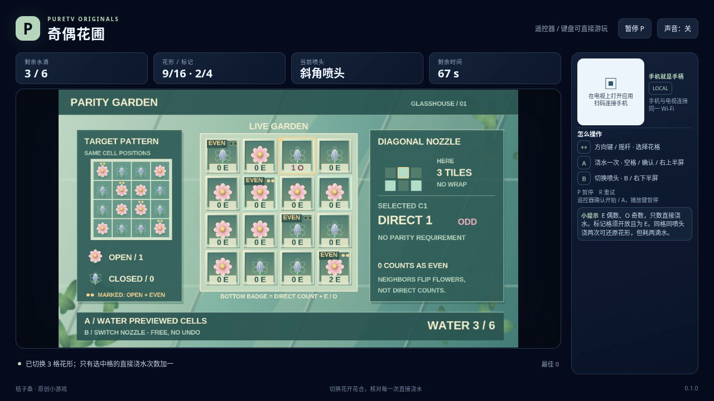

# 奇偶花圃 / Parity Garden

用有限的水滴，把 4×4 花圃变成左侧的目标图案。每次浇水会翻转一片花朵；带 EVEN 标记的花还必须保持开放，并且被直接浇水偶数次。

- 作者：ecojust / 桔子桑
- 包名：`com.ecojust.paritygardentv`
- 版本：`0.1.0`
- 电视系统：Android 8.0 / API 26 及以上
- 图标：[logo.svg](logo.svg)

发布产物：[APK](parity-garden-0.1.0.apk) · [实际游玩视频](docs/gameplay-0.1.0.mp4) · [验证记录](docs/verification.json)



## 操作

手机与电视接入同一局域网，扫描电视画面的二维码。左侧摇杆移动选择框，右侧上半区 A 浇水，下半区 B 切换喷头。十字喷头影响当前格与上下左右四格，斜角喷头影响当前格与四个斜角；边缘只影响棋盘内的格子。画面预览显示下一滴水会翻转的实际范围。

键盘方向键或 WASD 选择，空格或 Enter 浇水，B 切换喷头，P 暂停，R 重试。电视遥控器方向键选择、确认键浇水、菜单键切换喷头。手机 START 开始或暂停；开始与结算菜单可用左右方向选择关卡，B 切换声音。浇水和切换喷头都按每次按下触发，持续按住不会连发。

一滴水只给选中的格子增加一次**直接浇水次数**，但会翻转整个喷洒范围内的花。邻格受到翻转，不增加直接次数。EVEN 条件检查的是直接次数：零次也算偶数；次数为偶数但花仍关闭，也不满足条件。普通花没有直接次数限制，仍须与目标图案一致。

切换喷头免费，不撤销之前的浇水，也不退水。在同一格用同一种喷头连续浇两次，整片花图案与奇偶性都会恢复，但该格的直接次数增加二，实际消耗两滴水。次数会完整保留，不会只记录成一个奇偶位。

三关分别提供 6、8、10 滴水，每局有 90 秒有效时间。必须同时满足全部 16 格目标图案和所有 EVEN 条件才能通关；最后一滴可以获胜，否则水用尽立即失败。时间耗尽优先结束本局。暂停不消耗有效时间，恢复或断线时的输入清理不会补发浇水。R 重试会重新开始当前固定关卡，恢复全部水量、次数、时间、十字喷头和初始选择框。

## 源码与验证

整数格坐标、喷头邻域、奇偶条件、按键顺序和评分见 [模型契约](docs/model-contract.md)。生产模型保存公开花圃和实际计数，不保存参考操作路线或强制通关接口。

```bash
node --test resource/apps/parity-garden/tests/game-model.test.cjs
node resource/apps/parity-garden/tests/independent-parity-review.mjs
node resource/apps/parity-garden/tests/independent-pilot-review.mjs \
  --expected-pilot 89acd12fa755184b94729c7c6e2f7883c6f7ac8a59e45cbe2aa27de5bd742b4b \
  --output /tmp/parity-garden-pilot-review.json
```

[独立规则报告](docs/independent-parity-review.json)将喷头翻转与直接奇偶性分别建模，以分半枚举搜索公开的 32 种浇水动作，独立验证最少水量和普通按键解法。另有真实操作得到的反例：全部花形已经匹配，但标记格的直接次数仍为奇数，因此不能通关。合成边界夹具、纯模型解法和软件浏览器录像分别标注，不把它们当成实体电视或手机测试。具体通过结果随发布验证记录提供。

[操作脚本独立报告](docs/independent-pilot-review.json)使用小型合成花圃，检查公开观察、输入释放、双滴不退水、特效过期后的动作确认和独立实例。它执行操作脚本的公开规划器，不执行生产模型，也不作为三关通关或录像证据。

手机手柄与 Android 宿主组件见 [game-kit](../../game-kit/README.md)。源码与原创素材遵循仓库 [MIT 许可证](../../../LICENSE)。
