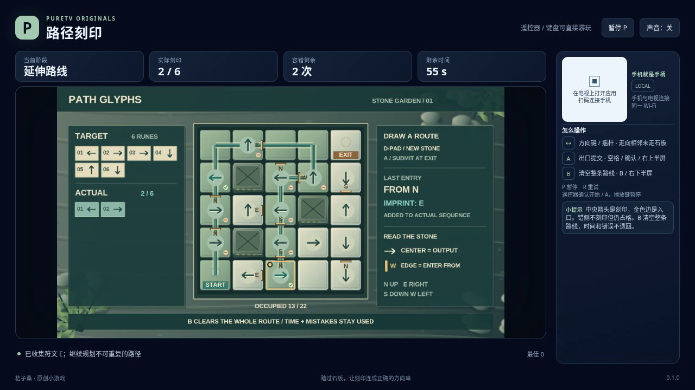

# 路径刻印 / Path Glyphs

在 5×5 石板上走出一条不重复经过格子的路径，让沿途刻下的方向符号与目标顺序完全一致。石板上的大箭头表示它会刻下什么符号，入边标记则表示必须从哪一侧走进来；两者并不是同一个方向。

- 作者：ecojust / 桔子桑
- 包名：`com.ecojust.pathglyphstv`
- 版本：`0.1.0`
- 电视系统：Android 8.0 / API 26 及以上
- 图标：[logo.svg](logo.svg)

发布产物：[APK](path-glyphs-0.1.0.apk) · [实际游玩视频](docs/gameplay-0.1.0.mp4) · [验证记录](docs/verification.json)



## 操作

手机与电视接入同一局域网，扫描电视画面的二维码。左侧摇杆沿上下左右延伸路径，右侧上半区 A 在出口提交刻印，下半区 B 清空整条路径、回到起点重画。

键盘方向键或 WASD 移动，空格或 Enter 提交，B 清空，P 暂停，R 重试。电视遥控器方向键移动、确认键提交、菜单键清空。手机 START 开始或暂停；开始与结算菜单可用左右方向选择关卡，B 切换声音。

三关的目标分别包含 6、7、8 个方向符号。所有石板、墙、条件和目标都公开可见。没有入边限制的刻印，走进格子就会生效；有条件的刻印必须从指定侧进入。例如标记西侧 W，意味着从左边向右走进该格。入边不符时不会刻下符号，但该格仍已被走过，本条路径不能再进入它。

每个格子只能走一次，不能原路退回。走到出口后停止移动，按 A 检查实际符号串；提前到达、顺序错误或多收集符号都不会通关。必须在出口提交完全一致的符号串。出口外按 A 只显示提示，不会提交。

在出口提交错误串，或进入出口以外的死路，会记一次失败，并保留当前路径供检查。此时反复按 A 或移动不会继续扣次数，按 B 才能清空重画。B 也可以提前使用；它清除本条路径的占用、符号和进度分数，不退回已用时间、失败次数或历史记录。累计三次失败，或 90 秒有效游戏时间耗尽，本局结束。暂停不消耗有效时间，R 重试会重新开始当前关卡。

## 源码与验证

规则、入边定义、按键优先级、计时及评分公式见 [模型契约](docs/model-contract.md)。模型只保存公开棋盘与目标，不包含供操作脚本读取的参考路线或强制通关接口。

```bash
node --test resource/apps/path-glyphs/tests/game-model.test.cjs
node resource/apps/path-glyphs/tests/independent-path-review.mjs
node resource/apps/path-glyphs/tests/independent-pilot-review.mjs --output /tmp/path-glyphs-pilot-review
```

[独立规则报告](docs/independent-path-review.json)采用另写的公开棋盘搜索与入边判定，检查不可重复访问、出口精确比较、失败记录和清空后的计时行为。搜索不导入生产模型的规则助手或操作脚本；找到路线后，再用普通输入逐步核对模型的实际路径和发符号记录。合成边界用例与三关全新模型的普通输入解法分别标注，不作为浏览器录像或实体设备验证。

[操作脚本独立报告](docs/independent-pilot-review.json)使用合成公开观察检查私有字段访问、状态写入、独立实例和按键释放。这些观察用例不执行生产模型，也不作为三关通关证明。软件浏览器的实际游玩、完整录像和布局检查随发布产物提供；实体电视或手机未经测试时不会标记为通过。

手机手柄与 Android 宿主组件见 [game-kit](../../game-kit/README.md)。源码与原创素材遵循仓库 [MIT 许可证](../../../LICENSE)。
