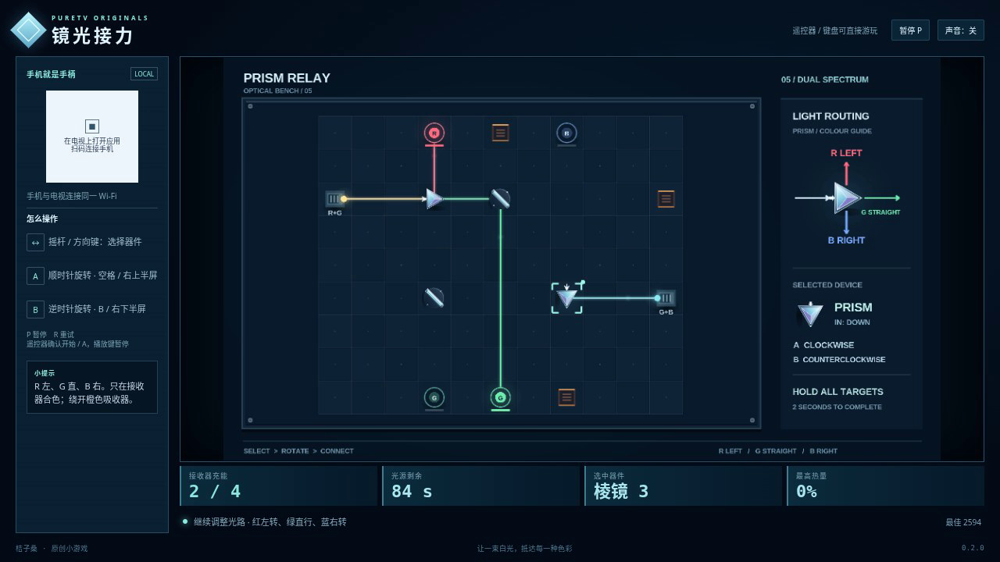

# 镜光接力 / Prism Relay

转动镜片与棱镜，把光送到指定颜色的接收器。三关依次介绍反射、白光分色，以及让红、蓝两束光共同照亮紫色目标。光束交叉不会混色；缺少或多出颜色都会打断充能，持续照射危险吸收器则会使其过热。

- 作者：ecojust / 桔子桑
- 包名：`com.ecojust.prismrelaytv`
- 版本：`0.1.0`
- 电视系统：Android 8.0 / API 26 及以上
- 图标：[logo.svg](logo.svg)

[下载安装包](prism-relay-0.1.0.apk) · [实际游玩视频](docs/gameplay-0.1.0.mp4) · [验证记录](docs/verification.json)



## 操作

手机与电视接入同一局域网，扫描电视画面中的二维码。左侧任意位置拖动摇杆选择器件，右侧上半区顺时针旋转，下半区逆时针旋转。每次按下旋转一次，长按不会连续转动。开始和结算菜单可用左右方向选择关卡，START 开始或暂停。

键盘方向键或 WASD 选择器件，空格顺时针转，B 逆时针转，Enter 开始，P 暂停，R 重试。电视遥控器方向键选择，确认键旋转，菜单键反向旋转。菜单中的 B 切换声音；游玩中的 B 只负责旋转。

镜片以 90° 旋转，在两个反射方向间切换。棱镜只接收小箭头指向的入射光，随后让红光向左转、绿光直行、蓝光向右转，均相对于入射方向。全部目标连续获得准确颜色两秒即可过关。三关可以分别选择，光源耗尽或吸收器过热会结束本关。

## 实现与验证

规则模型独立于画面，以 10 Hz 计算充能、热量和限时；只有转动器件时才重新计算光路。原创镜片、棱镜和光晕共用一张图集，场景合批绘制，画面采用平滑金属与玻璃效果。

```bash
node --test resource/apps/prism-relay/tests/game-model.test.cjs
```

20 组规则测试覆盖镜面方向、分色、接收器混色、回路终止、连续充能、热量冷却、终局顺序、输入边沿、暂停步长与三关正常操作通关；146 种器件方向组合还与独立光学计算交叉核对。构建方法与手机手柄组件见 [game-kit](../../game-kit/README.md)。最终浏览器流程、录像与 APK 签名验证结果保存在本目录中。

录像使用当前打包资源在 Chromium 中实际运行，通过普通键盘输入操作。此次没有连接实体电视或手机，软件渲染的帧率不代表电视性能。

源码与原创素材遵循仓库 [MIT 许可证](../../../LICENSE)。
