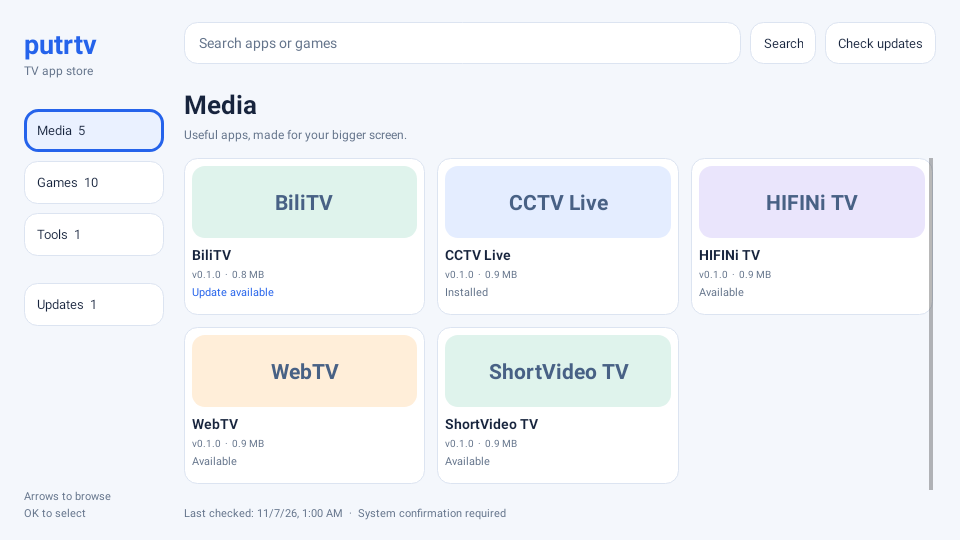

# putrtv Store

[中文](README.md) · [64×64 SVG icon](logo.svg) · [Build instructions](docs/BUILD.md)

Browse, install and check app updates directly on your TV. Native remote-friendly interface, no ads or account. Package `com.ecojust.putrtvstore`; Android 4.4 / API 19 or later. The interface follows the system language, in Chinese or English.

## Download and preview

[Download putrtv Store 0.1.0 APK](putrtv-store-0.1.0.apk?raw=1) · [Checksums](SHA256SUMS.txt) · [Validation](docs/VALIDATION.md)

This is the actual Android UI rendered with a fixture catalog, not a physical TV capture. Install the store once using the desktop manager, a USB drive, or your TV's installation method; subsequent app downloads and update checks run on the TV.

## Use

Install the store on your TV once, then open it to refresh the catalog and check installed versions. Browse Media, Games and Tools, search by name, or select Updates. Launchers are not listed in the store.

Select an app to download it, then confirm installation in the TV's system installer. On Android 8 or later you may first need to allow putrtv Store to install unknown apps in system settings. TV manufacturers can impose additional restrictions. On return, the store checks the actual installed package before reporting success.

Updates compare exact package IDs and integer version codes. A newer local version is identified explicitly. A different signing certificate blocks replacement; the store never automatically uninstalls existing apps.

## Add to your custom home screen

After installation, select **Add to home** in app details. Your current launcher opens a confirmation page where you select a free position on the Home or Apps page with the remote. The launcher saves the app's actual name and icon, using white text, without rearranging existing tiles.

This requires an updated pureTV family launcher supporting the add-to-home entry point. Update older launchers using this repository’s [launcher resources](../../README.md). These launchers require Android 8 or later, independently of the store's Android 4.4 minimum. Manufacturer launchers use their own app list or pinning controls.

The store passes only the installed package ID and catalog SVG. The launcher validates and saves its own layout; the ADB layout provider remains protected. If there is no free position or the layout contains removed apps, the launcher reports the issue instead of overwriting or deleting tiles.

## Catalog and updates

The catalog contains this project's verified app APK resources. Launchers are excluded from online, cached and bundled offline catalogs. Each refresh pins one GitHub commit for both catalog and APKs. Downloads check file size, SHA256, Git blob, package ID, version and signing certificate. Offline browsing is marked stale and does not imply a fresh update check.

Checks run when opening the store or refreshing manually. There is no automatic background installation. Store updates use the same catalog. The desktop manager's Gitee marketplace is a separate publication channel and may differ.

Old Android devices still depend on their system trust store and network for HTTPS. The minimum installation version is not a claim that every TV model has been tested. Installation always requires user confirmation.

## Build and verification

Source is in `src/`; fixed-certificate builds are documented in [BUILD.md](docs/BUILD.md). Native UI tests use fixture catalogs and a simulated package manager, not a physical TV. See [validation results](docs/VALIDATION.md) for the tested scope and physical-device limitations.

Source and the original store icon are MIT licensed. Downloaded applications retain their own licenses.
