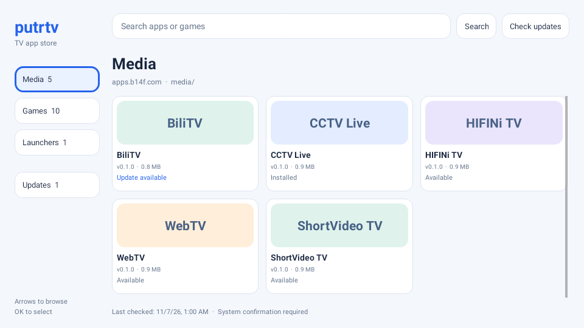

# putrtv Store

[中文](README.md) · [64×64 SVG icon](logo.svg) · [Build instructions](docs/BUILD.md)

Browse, install and check app updates directly on your TV. Native remote-friendly interface, no ads or account. Package `com.ecojust.putrtvstore`; Android 4.4 / API 19 or later. The interface follows the system language, in Chinese or English.

## Download and preview

[Download putrtv Store 0.1.2 APK](putrtv-store-0.1.2.apk?raw=1) · [Checksums](SHA256SUMS.txt) · [Validation](docs/VALIDATION.md)

This is the actual Android UI rendered with a fixture catalog, not a physical TV capture. Install the store once using the desktop manager, a USB drive, or your TV's installation method; subsequent app downloads and update checks run on the TV.

## Use

The TV store and the desktop manager use the same APK market at `https://apps.b14f.com/`. Browse Media, Games or Launchers. Each card shows the latest version by default. If several versions are available, select **Choose version** in the details to see up to five APKs. Search by name, file path or provider.

Select an app to download it, then confirm installation in the TV's system installer. On Android 8 or later you may first need to allow putrtv Store to install unknown apps in system settings. TV manufacturers can impose additional restrictions. On return, the store checks the actual installed package before reporting success.

Updates compare exact package IDs and integer version codes. A newer local version is identified explicitly. A different signing certificate blocks replacement; the store never automatically uninstalls existing apps.

## Add to your custom home screen

After installation, select **Add to home** in app details. Your current launcher opens a confirmation page where you select a free position on the Home or Apps page with the remote. The launcher saves the app's actual name and icon, using white text, without rearranging existing tiles.

This requires an updated pureTV family launcher supporting the add-to-home entry point. Look for a compatible version under **Launchers** in the store. These launchers require Android 8 or later, independently of the store's Android 4.4 minimum. Manufacturer launchers use their own app list or pinning controls.

The store passes only the installed package ID and catalog SVG. The launcher validates and saves its own layout; the ADB layout provider remains protected. If there is no free position or the layout contains removed apps, the launcher reports the issue instead of overwriting or deleting tiles.

## Catalog and updates

The store reads the server’s `media/`, `game/` and `launcher/` directories and displays available cover art. If a refresh fails, the store shows the last successful catalog or the bundled market snapshot and labels it offline.

Version labels from filenames are used for browsing and sorting. **Updates** lists updates with a verified package ID, signing certificate and Android version code. You can still download an entry with missing metadata. The store reads the downloaded APK and checks the signer and installed version before opening the Android installer. Installation requires your confirmation.

Old Android devices still depend on their system trust store and network for HTTPS. The minimum installation version is not a claim that every TV model has been tested. Installation always requires user confirmation.

## Build and verification

Source is in `src/`; fixed-certificate builds are documented in [BUILD.md](docs/BUILD.md). Native UI tests use fixture catalogs and a simulated package manager, not a physical TV. See [validation results](docs/VALIDATION.md) for the tested scope and physical-device limitations.

Source and the original store icon are MIT licensed. Downloaded applications retain their own licenses.
