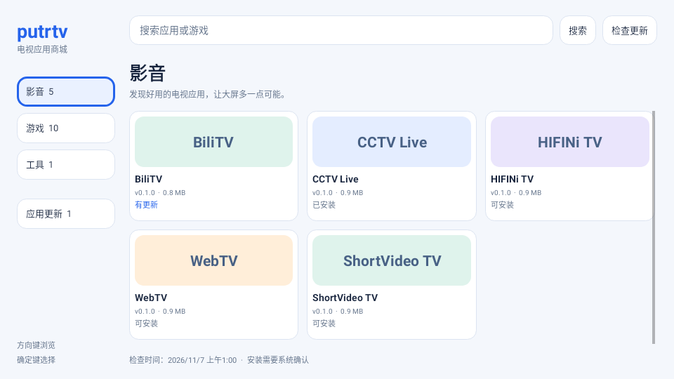

# putrtv商城

[English](README.en.md) · [64×64 SVG 图标](logo.svg) · [构建说明](docs/BUILD.md)

直接在电视上浏览、下载安装应用，查看本机已安装应用的更新。原生遥控器界面，无广告、无账号。包名 `com.ecojust.putrtvstore`，最低 Android 4.4 / API 19；界面随系统显示中文或英文。

## 下载与预览

[下载 putrtv商城 0.1.1 APK](putrtv-store-0.1.1.apk?raw=1) · [校验清单](SHA256SUMS.txt) · [验证记录](docs/VALIDATION.md)

这是应用原生界面的测试渲染，使用演示目录，非实体电视截图。首次安装需要电脑管理器、U盘或电视自带的安装方式；之后即可在电视上下载安装和检查更新。

## 使用

首次安装商城需要把 APK 安装到电视；之后打开商城即可刷新目录和检查版本，分类依次为影音、游戏、工具，商城不收录启动器。可以搜索名称，在「更新」中查看有新版的已安装应用。

选择应用进入详情，下载安装后由电视系统确认安装。Android 8 及以上首次安装可能需要在系统设置允许「putrtv商城」安装未知应用；部分电视厂商会额外限制此操作。商城返回前台后重新读取实际安装版本，只有确认安装完成才显示成功。

更新按实际包名和整数版本号比较；如果已安装版本更高，会明确提示。签名不同的安装包不能覆盖，商城不会自动卸载现有应用。

## 添加到自定义桌面

安装完成后，在应用详情选择「添加到桌面」，由当前启动器打开确认页面。使用遥控器选择首页或应用页的空位并确认，启动器保存真实应用名称、图标和白色文字。已有布局不会自动重排或被替换。

这需要支持添加入口的新版 pureTV 系列启动器；旧版本请通过本仓库的[启动器资源](../../README.md)下载更新。启动器本身最低 Android 8，与商城的最低系统要求不同。原厂桌面没有该接口时，使用原厂应用列表或其自带的添加方式。

商城只传递目标应用包名与目录提供的 SVG 图标；布局仍由启动器自己校验和保存。商城不读取或开放仅供 ADB 使用的布局 Provider。桌面没有可用空位或布局含已卸载应用时，会提示处理，不擅自覆盖或删除原有块。

## 目录、下载与检查

目录来自本项目已验证的官方应用 APK 资源，在线目录、缓存和内置离线目录均不展示启动器。一次刷新固定同一个 GitHub 提交，目录与 APK 使用同一版本；下载校验文件大小、SHA256、Git blob、包名、版本和发布证书。网络不可用时允许浏览缓存，并明确标记过期状态；缓存不代表刚刚检查到的最新版。

商城在打开和手动刷新时检查更新，不会在后台自动安装。新版商城自身也通过同一目录提供更新。电脑管理器的 Gitee 市场是另一份发布目录，两者上架时间可能不同。

旧 Android 的 HTTPS 连接仍受电视系统证书和网络条件影响；最低安装版本不代表所有型号都已完成实机验收。旧系统使用兼容的系统安装入口，安装始终需要用户确认。

## 构建与验证

源码见 `src/`，构建和固定证书签名见 [BUILD.md](docs/BUILD.md)。原生界面测试使用演示目录和模拟包管理器；不能当作实体电视下载、安装和桌面添加的验收。具体结果与实机限制见 [验证记录](docs/VALIDATION.md)。

源码和原创商城图标采用 MIT 许可。商城下载的各应用保留各自许可证。
