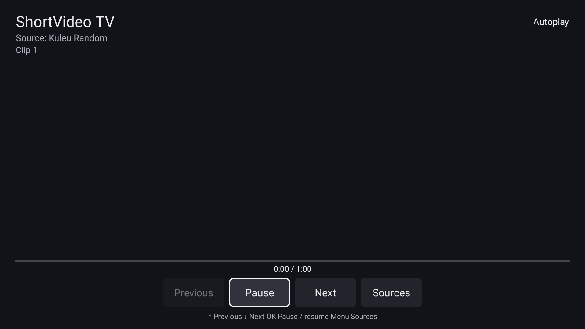

# ShortVideo TV

English | [Chinese](README.md)

<!-- apk-resource:start -->
[Download APK](shortvideo-0.5.0.apk?raw=1) · [Checksums](SHA256SUMS.txt) · [Signing and build provenance](resource.json) · [Source code](src/) · [64×64 SVG icon](logo.svg)

The APK in this directory is signed with the pureTV release certificate. Android cannot update an existing installation of the same package if it uses a different signing certificate. Back up its data and uninstall the old package first.
<!-- apk-resource:end -->

## 0.5.0 and signature migration

The current release is **0.5.0**, using the new pureTV release certificate shared by the project's own apps and launchers. Its certificate differs from the previously published APK, so Android cannot install it over the old version. Back up any data you can export before uninstalling the old app and installing 0.5.0. Uninstalling clears local settings and private app data. This project provides no automatic migration tool and does not guarantee that all local data can be exported.

Use the links above for the 0.5.0 APK, checksums and build provenance in `resource.json`.

A lightweight native Android TV short-video player designed for a remote control. Requires Android 8.0 (API 26) or later. Package: `com.ecojust.shortvideo`. No account or API key is required.

The interface follows the TV's system language and supports English and Simplified Chinese. English includes playback status, errors, source names, and the source picker. Videos come from third-party providers and are not translated.



## Using the player

Opening the app fetches and plays a random short video. When it ends, the next video starts automatically. Portrait videos are centered with empty space at the sides; landscape videos fit the screen while preserving their aspect ratio. Videos are neither cropped nor stretched. Controls hide automatically during playback.

| Remote control | Action |
| --- | --- |
| Up / Down | Previous / next video |
| OK while controls are hidden | Pause / resume and show controls |
| Left / Right and OK while controls are visible | Move focus and activate buttons |
| Menu / Sources button | Choose a video source |
| Back | Close the dialog or exit the app |
| Media play, pause, previous, and next keys | Corresponding playback controls |
| Media fast-forward / rewind | Seek forward / backward by 10 seconds |

A native MediaSession handles system media keys. The player respects audio focus from other audio apps. Leaving the screen releases the player; background video playback is not supported. Network and decoder failures stop playback and offer retry and source selection without repeatedly requesting videos.

After installation, open the app from the system app list or from a launcher. The launcher and this player are installed separately.

## Video sources

- [Kuleu Random](https://api.kuleu.com/api/MP4_xiaojiejie?type=json): the default source; its response contains `mp4_video`.
- [Dwo Random](https://openapi.dwo.cc/api/4qb_sp): an alternative source available in the source picker; its response contains `data.video.url`.

Both endpoints worked without a key or login during verification. Providers determine their content. The checked samples came from the Kuaishou CDN and mainly featured people. This app does not provide an official recommendation feed, guaranteed Douyin content, personalized recommendations, or a specific category. It displays the provider name and a generic clip number, without inventing authors, titles, or engagement counts. The selected source is saved locally.

Free services may change, limit requests, or stop working. [Source research notes (Chinese)](docs/source-research.md) document the checked endpoints and other candidates.

## Size and memory

- Three Java source files using the repository's Gradle build, with no production third-party dependencies, WebView, or bundled decoder library.
- One native MediaPlayer and SurfaceView. Only one video is decoded at a time; the next video is not decoded in advance.
- Up to 10 recent video addresses in memory for previous / next navigation. No video files or history are saved to disk, and no storage permission is requested.
- One network worker and a bounded task queue. JSON responses are limited to 64 KiB and addresses to 8,192 characters.
- At least 1.5 seconds between source requests. A duplicate address triggers at most one additional request. Switching sources clears the current session history. Network requests can be cancelled, and loading or buffering stops after a 25-second timeout.
- No cover artwork, blurred video background, or persistent animation. Leaving the screen releases the decoder and media session.
- R8 and resource shrinking keep the APK small; CI enforces a 5 MiB limit. See [resource metadata](resource.json) for the current APK size. Installed size, peak memory, and hardware decoding compatibility depend on the target TV.

## Building

From the repository root:

```bash
cd resource/launcher/puretv
./gradlew :shortvideo:assembleDebug
./gradlew :shortvideo:verifyReleaseSize :shortvideo:lintDebug :shortvideo:testDebugUnitTest
```

The debug APK is written to `resource/apps/shortvideo/build/outputs/apk/debug/shortvideo-debug.apk`. A release build without signing configuration produces `shortvideo-release-unsigned.apk`. See [resource maintenance instructions (Chinese)](../../../docs/resource-maintenance.md) for release signing and updating the APK in this directory. Test dependencies, design assets, and documentation are not included in the APK.

To install a signed release build from the repository root:

```bash
adb install -r resource/apps/shortvideo/build/outputs/apk/release/shortvideo-release.apk
adb shell am start -n com.ecojust.shortvideo/.MainActivity
```

## Verification

- Offline tests cover both response formats, unsafe or missing addresses, invalid responses, JSON and redirect limits, request spacing, duplicate content, history limits, cancellation, playback controls, decoder timeouts, automatic next-video playback, lifecycle cleanup and progress restoration, and system media controls.
- English and Chinese use the same native Activity. Tests cover source selection, playback states, errors, and control bounds at 960dp and 640dp. Set `SHORTVIDEO_UI_CAPTURE_DIR` to export `shortvideo-tv.png`, `shortvideo-tv.en.png`, and their compact variants.
- On October 23, 2026, one sample from each source was fetched with the app's endpoints and request headers. Both were 720 × 1280 H.264 + AAC videos, approximately 2.29 MB and 1.09 MB. FFmpeg successfully decoded the first three seconds of each. Downloaded verification samples are not included in the repository or APK.
- Those decoding checks ran on a development computer. They do not verify Android TV hardware decoding, extended playback stability, or peak memory. Native Robolectric screenshots capture the controls but cannot capture the separate SurfaceView video layer.
