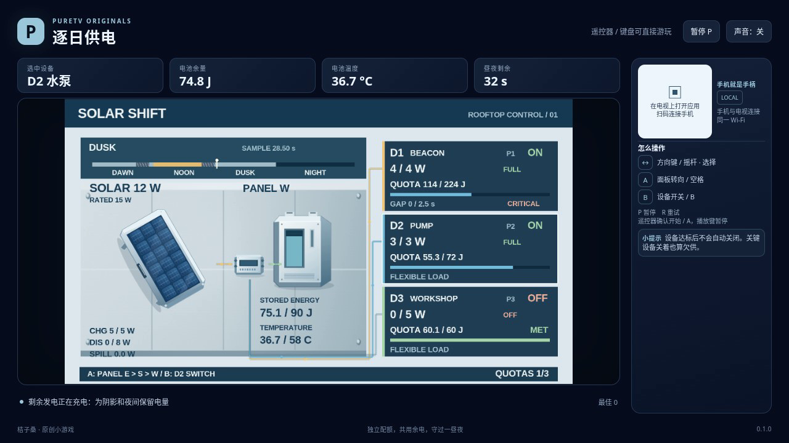

# 逐日供电 / Solar Shift

把一个昼夜压缩为60秒：转动太阳板接收日照，在阴影和夜间用有限电池供电，为三台设备分别完成用电配额。设备优先级固定；开关打开不代表一定拿到足额电力。

- 作者：ecojust / 桔子桑
- 包名：`com.ecojust.solarshifttv`
- 版本：`0.1.0`
- 电视系统：Android 8.0 / API 26 及以上
- 图标：[logo.svg](logo.svg)

发布产物：[APK](solar-shift-0.1.0.apk) · [实际游玩视频](docs/gameplay-0.1.0.mp4) · [验证记录](docs/verification.json)

## 操作

手机与电视接入同一局域网，扫描电视上的二维码。摇杆选择设备：上或左选择上一台，下或右选择下一台，到末端不会绕回。

**A 始终转动全局太阳板**，按东、南、西循环，与当前选中哪台设备无关。**B 切换当前选中设备的供电开关**。两键每次按下只操作一次，按住不会连续触发。三台设备开始时全部打开，太阳板朝东；一直不操作不能通关。

键盘使用方向键或 WASD 选设备，空格或 Enter 为 A，B 为开关，P 暂停，R 重试。电视遥控器使用方向键、确认键和菜单键；手机 START 开始或暂停。开始与结算菜单可用左右方向选关，B 切换声音。

## 完成一昼夜

晨光、正午、夕照和夜间按公开时间表变化。太阳板对准当前日照方向时发电最多，偏向相邻方向减半，朝相反方向不发电；阴影和夜间都不发电。这是阶段化的游戏仿真，不是对真实建筑阴影或太阳轨迹的计算。

电力按设备卡片上的固定优先级依次分配。太阳能不足时，电池补足差额，但每秒放电功率和现有电量都会限制实际供电；低优先级设备可能只得到部分电力。发电超过设备实际需求时，电池在充电功率和容量范围内储能，存不下的电量会弃用。同一时刻不会一边充电一边放电。

每台设备分别累计**实际得到的能量**，单位为焦耳（J），不是打开开关的时长。给一台设备超额供电，不能替代另一台的配额。配额完成后设备也不会自动关机，继续打开仍会消耗电力。

关键设备必须持续获得足额功率。任何不足，包括手动关闭，都会累积它自己的连续欠供时间；恢复足额供电才归零。达到该设备的欠供上限即失败。电池的大功率充放电还会升温，散热会降温；温度达到上限也会失败。画面上的流量来自实际供电和充放电，开关状态与供电状态分开显示。

需要生存到第60秒并满足全部三台设备的独立配额，才完成这一昼夜。提前满足配额不会提前结算；最后一个时间段仍先计算真实供电、温度与欠供，如果同时发生过热或欠供，失败优先。昼夜结束但有配额未完成也会失败。

三关分别是海边信标、山谷泵站和夜间诊所，日照遮挡、电池容量、功率限制和设备任务各有不同。第三关有两台关键设备。暂停冻结日照、能量、温度和配额；R 重新开始当前关卡，恢复初始开关、电量、温度和完整时间。终局状态冻结。

## 源码与验证范围

完整单位、分配顺序、热更新、时间边界及公开参数见 [模型契约](docs/model-contract.md)。电量遵循“初始储能＋累计太阳能＝剩余储能＋各设备实际用能＋弃电”的账本；设备各自的用能配额独立判断。评分只奖励实际配额进度与获胜后的剩余储能，不奖励开关次数、弃电或超额供给。

设计可行性探索使用不导入生产模型的设计用算术脚本，控制见证不写入模型或公开控制器。它不是正式规则测试、浏览器通关或实录证据。规则夹具、普通模型输入、独立核验和实际浏览器记录分别记载，实际完成范围见验证记录。

[独立核验记录](docs/independent-solar-review.json) 首次通过3个审查组。[能量与温度算法](tests/solar-interval-oracle.mjs) 用整数1/240J账本和分段温度递推公式，与生产模型的逐帧浮点积分交叉核对；[只读审查脚本](tests/independent-solar-review.mjs) 复算已有三胜三败的277个公开快照、真实操作和各设备配额，没有再次执行模型或控制器。另有3个纯算术小例检查该算法，不计为真实游戏局数。

本作采用简化的能量与温度模型。软件模型和浏览器检查不代表实体电视、手机已经测试。手机手柄与 Android 宿主组件见 [game-kit](../../game-kit/README.md)。源码与原创素材遵循仓库 [MIT 许可证](../../../LICENSE)。
