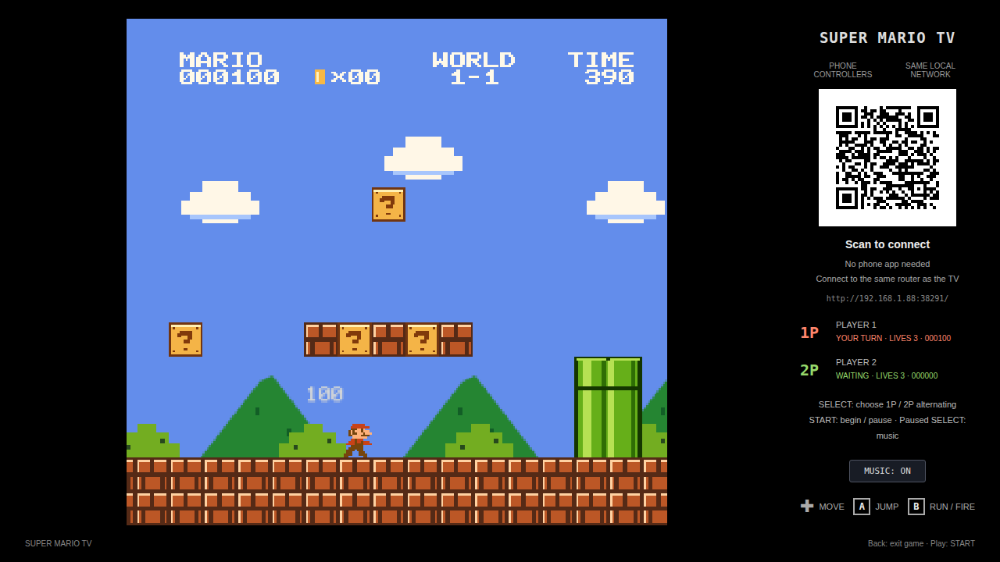
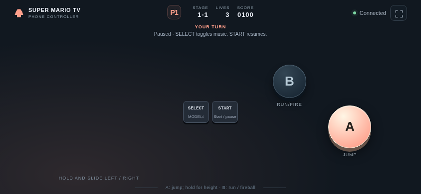
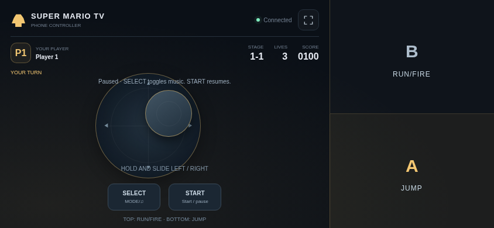

# Super Mario TV

[中文](README.md) · [English](README.en.md)

An independent recreation inspired by Super Mario Bros. 1: eight worlds and 32 stages with overworld, underground, underwater and castle courses. Includes block hits, mushroom transformations, fireballs, shells, pipes, flagpoles and bridge axes.

Version **0.5.1** requires Android 8.0 or later. Package: `com.ecojust.supermariotv`. The TV displays the game and a room QR code; phones act as controllers.

<!-- apk-resource:start -->
[Download APK](super-mario-0.5.0.apk?raw=1) · [Checksums](SHA256SUMS.txt) · [Signing and build provenance](resource.json) · [Source code](src/) · [64×64 SVG icon](logo.svg)

The APK in this directory is signed with the pureTV release certificate. Android cannot update an existing installation of the same package if it uses a different signing certificate. Back up its data and uninstall the old package first.
<!-- apk-resource:end -->

## 0.5.1 gameplay review

Adds pole sliding, castle entry, timer-based fireworks and progressive bridge collapse; fixes fireball walls, emerging items and obstructed exits.

Uses the same signing certificate as 0.5.0 and supports an in-place update. See the [fidelity review](../../../docs/game-fidelity-0.5.1.md) for tested behavior and remaining differences.

## Installation and signing

Version 0.5.1 uses the same shared pureTV certificate as 0.5.0, so it updates 0.5.0 in place and keeps local data. Versions signed with the older certificate cannot be updated in place: back up any exportable data before uninstalling them. Uninstalling clears local saves and records; the project has no automatic migration across signing certificates.

## Gameplay changes in 0.5.0

Version 0.5.0 adds real crouch-slide collision, moving lifts that carry their rider, and escalating airborne stomp/rolling-shell rewards with score and 1UP feedback.

## Play

1. Connect the TV and phones to the same LAN and open the game on the TV.
2. Scan its QR code in a phone browser. Use one phone per player.
3. Press SELECT on the title screen to choose the player count, then START.
4. The left joystick stays hidden until touched. Each touch sets its center; drag to move, then release to stop and hide it. The right third of the screen is a full action surface: B on the upper half, A on the lower half. Touch anywhere in a half, including its edges; both actions support simultaneous touches with the stick. START/SELECT stay separate at the bottom left.

The controller disables text selection and long-press browser menus across the play surface.

| Control | Action |
| --- | --- |
| Floating joystick | Move left/right; Down crouches / enters supported pipes |
| A | Jump / swim |
| B | Run / throw fireballs |
| SELECT | Change player count on title; toggle music while paused |
| START | Start, pause / resume |
| TV Back | Confirm exit |

Two players take **alternating turns**, retaining their own lives, score and stage. A lost life passes control to the next player. Phones show whose turn it is; waiting players cannot move the active character. Losing the active controller pauses the game until it reconnects. Manual pause remains paused. High score and music preference are stored on the TV.

## Screenshots

Actual bundled game pages rendered in Chromium with a simulated native room bridge, not physical TV captures.







## Room and exit

Up to two phones connect through a local HTTP/WebSocket server. Each launch creates a new port and random room token in the QR code. No cloud service is required. Losing focus, cancelling a touch or disconnecting releases held buttons.

Leaving with TV Home or confirming exit closes the room, disconnects phones, releases workers and wake locks, destroys the WebView and audio, and ends the app process. Scan the new QR code when reopening. Current game progress is not restored after exit.

## Implementation and verification

Maps, graphics, icons, sound effects and music are independently authored. No original ROM, extracted artwork or original soundtrack is bundled. See the [reference and implementation notes](docs/reference.md) for the exact scope and differences; this is not a claim of frame-perfect or tile-for-tile reproduction. Project-authored code and assets use the [MIT license](LICENSE).

```sh
node --test resource/apps/super-mario/tests/*.test.cjs
node resource/apps/super-mario/tests/controller.mjs
node resource/apps/super-mario/tests/compatibility.mjs
node resource/apps/super-mario/tests/capture.mjs

cd resource/launcher/puretv
./gradlew :super-mario:assembleRelease :super-mario:testDebugUnitTest :super-mario:lintDebug :super-mario:verifyReleaseSize
```

Browser tests use the desktop npm dependencies and Chromium; set `CHROMIUM_PATH` to select a browser. Physical TV and phone verification is still pending.
