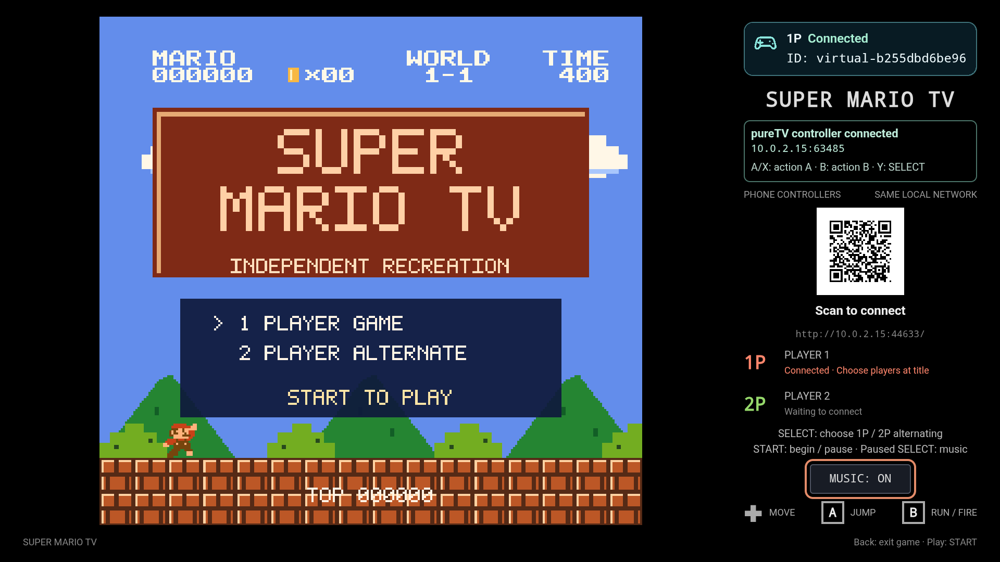
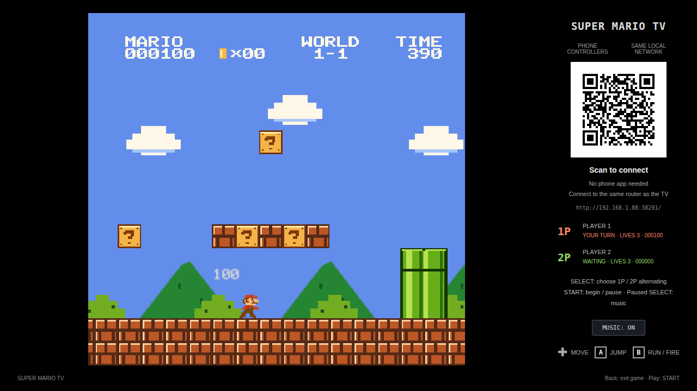
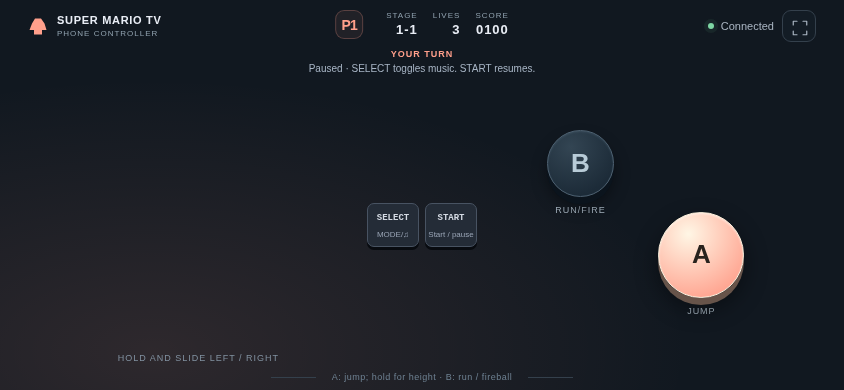
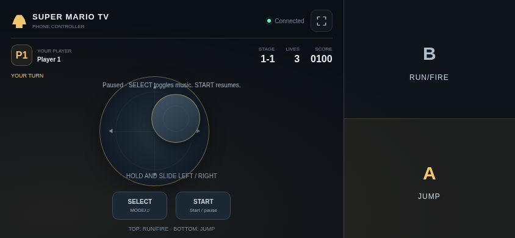

# Super Mario TV

## Android 0.5.5 · Controllers and phone pairing

<!-- apk-resource:start -->
[Download the signed APK](super-mario-0.5.5.apk?raw=1) · [Checksums](SHA256SUMS.txt) · [Package and source](resource.json)
<!-- apk-resource:end -->

Connect a keyboard, pair a pureTV Wi-Fi controller, or scan the TV room’s QR code with a phone on the same network. The connection indicator identifies each player while the game keeps its playing area at the same size. [Controller guide](../../../docs/guide/README.en.md#install-a-game-and-connect-a-controller)

The signed APK upgraded Android 0.5.4 in place on an Android TV emulator. The original controller SDK completed 9 checks and received matching acknowledgements for 101 messages. [Gameplay screenshot](docs/releases/0.5.5/gameplay.png) · [Android gameplay recording](docs/releases/0.5.5/gameplay.mp4?raw=1) · [Verification and limitations](docs/releases/0.5.5/verification.json)

[中文](README.md) · [English](README.en.md)

<!-- controller-client-status:start -->
## Earlier release 0.5.4 · Connected controller identity

<!-- previous-apk-resource:start -->
[Download signed APK](super-mario-0.5.4.apk?raw=1) · [Checksums](SHA256SUMS.txt) · [Signing and source](resource.json) · [Source](src/) · [Icon](logo.svg)
<!-- previous-apk-resource:end -->

Android **0.5.4 / versionCode 6** shows a controller icon, player seat (1P/2P where supported), and the connected device's complete ID in the side area. Disconnected devices disappear. The default TCP port remains **63485**. Current controller firmware does not report RSSI, so signal strength is not displayed.

[Connected screenshot](docs/releases/0.5.4/connected.png) · [Controller-status recording](docs/releases/0.5.4/controller-status.mp4?raw=1) · [Version verification](docs/releases/0.5.4/verification.json) · [Twenty-game update record](../../../docs/controller-client-status/README.md)

The APK uses the existing release certificate. This update verifies connection identity, disconnect/reconnect status and in-place installation in an Android TV emulator; the capture and video show the menu status checks. It does not repeat full gameplay acceptance. Unchanged model evidence is reused by exact hash, with previous reports retained below. Physical TVs, phones, ESP32 devices and upgrades containing existing user saves remain untested.


<!-- controller-client-status:end -->

An independent recreation inspired by Super Mario Bros. 1: eight worlds and 32 stages with overworld, underground, underwater and castle courses. Includes block hits, mushroom transformations, fireballs, shells, pipes, flagpoles and bridge axes.

Version **0.5.4** requires Android 8.0 or later. Package: `com.ecojust.supermariotv`. The TV displays the game and a room QR code; phones act as controllers.

<!-- visual-release:start -->
## Historical: 0.5.2 visual update and verification

The following preserves the **0.5.2** visual changes, source and verification records. These historical results do not verify the current pureTV controller update. That release retained the pureTV certificate used by 0.5.0/0.5.1. See the [0.5.2 visual update record](../../../docs/game-visuals-0.5.2.md) for its per-game changes, verification scope and physical-device test status.

Separate small and large standing, running, jumping and crouching poses were drawn for the 1985 FC/NES Super Mario Bros. reference, with Fire and Luigi palettes. Large forms are no longer vertically stretched small forms. The corresponding NES pixel proportions and 2D scenery remain; these independently drawn poses do not establish frame-exact reproduction of every animation.

See the [reference notes](docs/reference.md) for the implementation scope.

<!-- final-verification -->
The historical frozen source 0752b658aecbb1322cb7294e3176500639db1b54 passed Android CI 40843467072: 280 model/render-behavior regressions, 36 compatibility scenarios, 131 controller scenarios and 18 bilingual integration scenarios. Cozy Island input-runtime checks passed 9/9; both WebGL 1 rendering scripts and the Coast Kart combat suite also passed. Android builds, lint, size checks and staging succeeded; 15 modules executed JUnit tasks, including all 9 games, without an inferred JUnit case count. Signing run 40846148068 verified all nine APKs’ source assets, signatures and resource catalog. Chrome 61 syntax checks and old-API simulation in modern Chromium do not establish physical legacy-WebView compatibility. At that historical release, physical TV/phone acceptance, device FPS and in-place installation/data retention were untested.
<!-- visual-release:end -->

## Historical: 0.5.1 gameplay review

Adds pole sliding, castle entry, timer-based fireworks and progressive bridge collapse; fixes fireball walls, emerging items and obstructed exits.

The historical 0.5.1 release used the same signing certificate as 0.5.0 and supported an in-place update. See the [fidelity review](../../../docs/game-fidelity-0.5.1.md) for tested behavior and remaining differences.

## Installation and signing

Historical version 0.5.3 retained the shared pureTV certificate used by 0.5.0/0.5.1/0.5.2. An in-place `adb install -r` update from 0.5.2 succeeded on an Android TV emulator. This check did not seed existing saves and does not verify retention of saves or other user data. Installations of 0.4.x and earlier signed with the old certificate cannot be updated in place: back up exportable data before uninstalling. Uninstalling clears local saves and records; the project has no automatic cross-certificate migration.

## Gameplay changes in 0.5.0

Version 0.5.0 adds real crouch-slide collision, moving lifts that carry their rider, and escalating airborne stomp/rolling-shell rewards with score and 1UP feedback.

## Play

1. Connect the TV and phones to the same LAN and open the game on the TV.
2. Scan its QR code in a phone browser. Use one phone per player.
3. Press SELECT on the title screen to choose the player count, then START.
4. The left joystick stays hidden until touched. Each touch sets its center; drag to move, then release to stop and hide it. The right third of the screen is a full action surface: B on the upper half, A on the lower half. Touch anywhere in a half, including its edges; both actions support simultaneous touches with the stick. START/SELECT stay separate at the bottom left.

The controller disables text selection and long-press browser menus across the play surface.

| Control | Action |
| --- | --- |
| Floating joystick | Move left/right; Down crouches / enters supported pipes |
| A | Jump / swim |
| B | Run / throw fireballs |
| SELECT | Change player count on title; toggle music while paused |
| START | Start, pause / resume |
| TV Back | Confirm exit |

Two players take **alternating turns**, retaining their own lives, score and stage. A lost life passes control to the next player. Phones show whose turn it is; waiting players cannot move the active character. Losing the active controller pauses the game until it reconnects. Manual pause remains paused. High score and music preference are stored on the TV.

## Historical screenshots (0.5.2)

Actual bundled game pages rendered in Chromium with a simulated native room bridge, not physical TV captures.







## Room and exit

Up to two phones connect through a local HTTP/WebSocket server. Each launch creates a new port and random room token in the QR code. No cloud service is required. Losing focus, cancelling a touch or disconnecting releases held buttons.

Leaving with TV Home or confirming exit closes the room, disconnects phones, releases workers and wake locks, destroys the WebView and audio, and ends the app process. Scan the new QR code when reopening. Current game progress is not restored after exit.

## Implementation and verification

Maps, graphics, icons, sound effects and music are independently authored. No original ROM, extracted artwork or original soundtrack is bundled. See the [reference and implementation notes](docs/reference.md) for the exact scope and differences; this is not a claim of frame-perfect or tile-for-tile reproduction. Project-authored code and assets use the [MIT license](LICENSE).

```sh
node --test resource/apps/super-mario/tests/*.test.cjs
node resource/apps/super-mario/tests/controller.mjs
node resource/apps/super-mario/tests/compatibility.mjs
node resource/apps/super-mario/tests/capture.mjs

cd resource/launcher/puretv
./gradlew :super-mario:assembleRelease :super-mario:testDebugUnitTest :super-mario:lintDebug :super-mario:verifyReleaseSize
```

Browser tests use the desktop npm dependencies and Chromium; set `CHROMIUM_PATH` to select a browser. Physical TV and phone verification is still pending.

## pureTV Wi-Fi controller

Connect the TV and controller to the same LAN, open the game, then press the controller Search key (GPIO 23). The TV shows its actual TCP address and discovery state. Default port: **63485**; a fallback is chosen only if that port is already occupied. The port stays fixed while the app runs. With multiple game services on the network, close the others before searching.

The D-pad moves left/right, crouches or enters supported pipes; **A/X** jump/swim and **B** runs/fires fireballs. **Y (SELECT)** changes the player count at the title and toggles music while paused. **START** begins, pauses or resumes. Two Wi-Fi controllers occupy separate seats; two-player mode takes alternating turns under the original rules. Phone QR controllers and TV remote controls remain available.

Disconnecting or switching controller sources pauses gameplay. Release held keys, then press START again; reconnecting or synchronizing held buttons does not perform an action. Temporary focus loss retains the listener while isolating game input. Home or switching apps still exits the game and closes services through the existing exit flow.

<!-- controller-client-status-history:start -->
<details>
<summary>Historical 0.5.3 download and acceptance record</summary>

The following describes the previous release; its tests and media do not validate the new controller-ID UI. [Original README at the previous source](https://github.com/ecojust/pureTV/blob/9af9f197855eb7a0ce7174c0e6295c8974b3250d/resource/apps/super-mario/README.en.md).

[Download APK](super-mario-0.5.3.apk?raw=1) · [Checksums](docs/controller-status-baseline/0.5.3/SHA256SUMS.txt) · [Signing and build provenance](docs/controller-status-baseline/0.5.3/resource.json) · [Source code](src/) · [64×64 SVG icon](logo.svg)

This APK is signed with the existing pureTV release certificate and has passed an in-place update from the previous version. See the controller update for that historical version’s Android controller acceptance results. Android cannot update an existing installation of the same package if it uses a different signing certificate. Back up its data and uninstall the old package first.

## 0.5.3 pureTV controller update

Version **0.5.3 / versionCode 5** adds pureTV Wi-Fi controller input on default TCP port **63485**, while retaining phone QR and TV remote controls. The signed APK passed all 9/9 controller checks on an Android TV emulator and an in-place `adb install -r` update from the previous version. Upgrading with pre-existing saves and retaining user data were not tested.

See the [historical twenty-game acceptance record](../../../docs/readme-controller-support/README.md) and [rollout status](../../../docs/readme-controller-support/rollout.json) for actual results and limitations. Earlier CI reports, videos and screenshots below remain historical evidence.

That historical version’s acceptance resources: [menu screenshot](docs/releases/0.5.3/menu.png) · [actual APK recording](docs/releases/0.5.3/gameplay.mp4?raw=1) · [verification record](docs/releases/0.5.3/verification.json). Images and recordings come from an Android TV emulator; no physical television has been tested. The verification record gives the exact acceptance scope and results; emulator checks do not establish physical-TV compatibility or save-data retention during an upgrade.

</details>
<!-- controller-client-status-history:end -->
