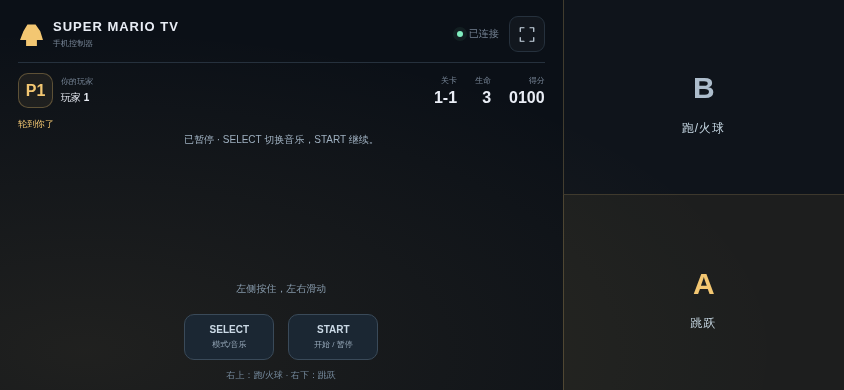
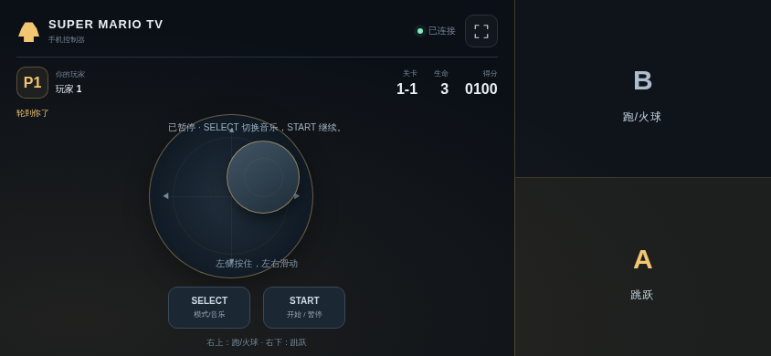

# 超级玛丽 TV

<!-- apk-resource:start -->
[下载 APK](super-mario-0.5.2.apk?raw=1) · [校验值](SHA256SUMS.txt) · [签名及构建来源](resource.json) · [源码](src/) · [64×64 SVG 图标](logo.svg)

此目录内 APK 使用 pureTV 发布证书签名。若设备中存在使用旧证书的同包应用，Android 无法直接覆盖安装；需先备份数据并卸载旧包。
<!-- apk-resource:end -->

[中文](README.md) · [English](README.en.md)

以《超级马力欧兄弟 1》为参考的独立重写：8 个世界、32 关，地面、地下、水下与城堡；包含顶砖、蘑菇变身、火球、龟壳、管道、旗杆与桥斧。

当前版本 **0.5.1**，适用于 Android 8.0 及以上电视，包名 `com.ecojust.supermariotv`。电视显示游戏与房间二维码，手机扫码作为手柄。
<!-- visual-release:start -->
## 0.5.2 视觉更新（待发布）

源码版本为 **0.5.2**，整组验收、Android CI 和签名发布尚未完成；现有下载仍指向已发布的 **0.5.1**。本轮沿用现有 pureTV 发布证书。已经确认的改动、验证结果及待验收项目见[0.5.2 视觉更新记录](../../../docs/game-visuals-0.5.2.md)。

按 1985 年 FC/NES《Super Mario Bros.》分别绘制小形态、大形态的站立／跑步／跳跃／蹲伏姿态，以及火焰和路易吉配色，避免把小形态直接拉高充当大形态。保留对应 NES 像素比例与二维场景；这些是独立绘制的姿态，不代表全部角色动画已逐帧复刻。

具体还原范围见[参考说明](docs/reference.md)。
<!-- visual-release:end -->

## 0.5.1 还原度升级

补全滑旗、进堡、计时烟花和逐段塌桥；修复火球撞墙、道具出砖及部分关底地形。

沿用 0.5.0 证书，可直接覆盖更新；本轮核对结果与剩余差距见[还原度复核](../../../docs/game-fidelity-0.5.1.md)。

## 安装与签名

0.5.1 沿用 0.5.0 的 pureTV 统一发布证书，可以覆盖安装 0.5.0 并保留本机数据。使用旧证书的更早版本不能直接覆盖，请先备份可导出的数据再卸载；卸载会清除本机存档和记录，本项目没有跨证书自动迁移工具。

## 0.5.0 玩法升级

加入真实蹲滑碰撞、移动台承载，以及连续踩敌／龟壳连杀递增奖励与分数、1UP 浮字。

## 开始游玩

1. 手机和电视连接同一局域网，在电视上打开游戏。
2. 手机浏览器扫描二维码加入。单人一部手机；双人各用一部手机。
3. 标题画面按 SELECT 选择人数，按 START 开始。
4. 左侧摇杆默认隐藏，手指按下的位置就是中心；拖动控制，松开停止并隐藏。右侧屏幕三分之一为完整动作区：上半 B、下半 A，区域内含边缘的任意位置都可触发，可与摇杆同时使用。START／SELECT 独立位于左侧底部。

游戏操作区禁止文字选择与长按浏览器菜单，避免误触“搜一搜”等功能。

| 控件 | 功能 |
| --- | --- |
| 左侧浮动摇杆 | 左右移动；下蹲／进入支持的管道 |
| A | 跳跃／游泳 |
| B | 加速跑／发射火球 |
| SELECT | 标题切换人数；暂停时开关音乐 |
| START | 开始、暂停／继续 |
| 电视返回键 | 退出确认 |

双人模式采用**轮流游玩**：各自保留生命、积分和关卡，失命后交给下一名玩家。手机会显示当前轮次，等待中的手机不会控制当前角色。当前操作者断线会自动暂停，重新连接后继续；手动暂停不会被重连取消。最高分和音乐偏好保存在电视本机。

## 画面

以下截图来自实际游戏页面在 Chromium 中的渲染，房间连接由测试桥接模拟，不是电视实机截图。






## 房间与退出

最多两部手机通过本地 HTTP/WebSocket 服务连接；二维码包含本次启动的端口和随机令牌。游戏不依赖云端服务。手机失焦、触控中断或断线会释放按键。

按电视 Home 离开或确认退出，会关闭房间、断开手机、释放线程与唤醒锁、销毁 WebView 和音频并结束应用进程。重新打开需扫描新的二维码；本局进度不会跨退出保存。

## 实现与验证

关卡路线、画面、图标、音效和音乐由项目独立制作，未包含原作 ROM、提取图像或原声音轨。规则和地图的具体重建范围见[参考说明](docs/reference.md)；不宣称与原作逐帧或逐格一致。项目自写代码和素材使用 [MIT](LICENSE)。

```sh
node --test resource/apps/super-mario/tests/*.test.cjs
node resource/apps/super-mario/tests/controller.mjs
node resource/apps/super-mario/tests/compatibility.mjs
node resource/apps/super-mario/tests/capture.mjs

cd resource/launcher/puretv
./gradlew :super-mario:assembleRelease :super-mario:testDebugUnitTest :super-mario:lintDebug :super-mario:verifyReleaseSize
```

浏览器测试使用 desktop 的 npm 依赖和 Chromium，可通过 `CHROMIUM_PATH` 指定浏览器。尚未完成电视／手机实机验证。
