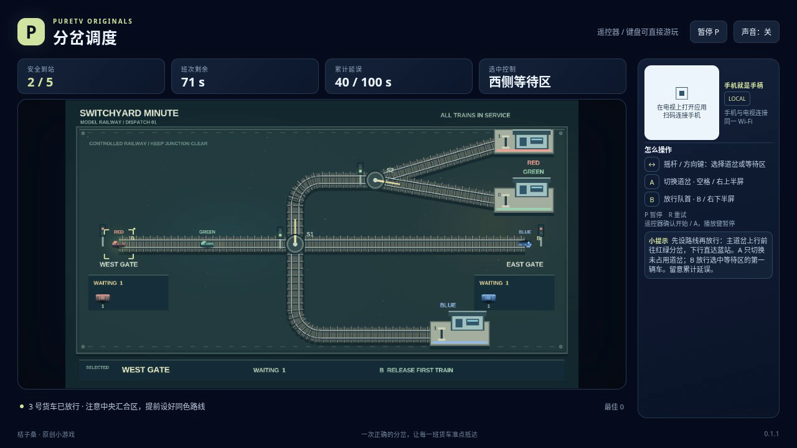

# 分岔调度 / Switchyard Minute

管理一座小型铁路站场，把不同颜色的货车送到对应站台。列车会按时刻表进入两侧等待区；观察在途车辆，安排放行，再选择道岔改变线路。列车占用中的道岔不能切换，过早放行可能造成追尾或迎面冲突。

- 作者：ecojust / 桔子桑
- 包名：`com.ecojust.switchyardminutetv`
- 版本：`0.1.1`
- 电视系统：Android 8.0 / API 26 及以上
- 图标：[logo.svg](logo.svg)

[下载安装包](switchyard-minute-0.1.1.apk) · [实际游玩视频](docs/gameplay-0.1.1.mp4) · [验证记录](docs/verification.json)



## 操作

手机与电视接入同一局域网，扫描电视画面中的二维码。左侧任意位置拖动摇杆选择道岔或等待区；右侧上半区切换所选道岔，下半区放行所选等待区的列车。选择等待区后，可以查看排队车辆的颜色和等待情况。

键盘方向键或 WASD 选择，空格对应 A，B 放行，Enter 开始，P 暂停，R 重试。电视遥控器方向键选择，确认键对应 A，菜单键对应 B。开始与结算菜单可用左右方向选择班次，手机 START 开始或暂停。

全部班列正确进站即可完成调度；列车碰撞、进入错误站台或累计等待超过限制则失败。等待区出口被占用时不能再次放行；出口空闲也不代表前方整条线路都安全，需要结合列车位置和道岔状态安排顺序。

## 实现与验证

规则模型与画面分离，行车采用固定步长与沿轨道移动的碰撞检查。轨道、站台与列车共用合批绘制组件。每款游戏独立打包，手机手柄和 Android 宿主使用 [game-kit](../../game-kit/README.md)。

```bash
node --test resource/apps/switchyard-minute/tests/game-model.test.cjs
```

0.1.1 修复侧栏提示裁切与滚动问题，并从打包配置显示版本号。本次重新完成 18 组规则测试、10 项共享浏览器回归和 11 项补充交互检查，核对了 960×540 与 1280×720 的菜单、暂停和真实胜利页面。规则测试覆盖道岔锁定、门口间距、时刻表、碰撞、错站、延误和重试。原版 50,000 组运动线段的独立碰撞交叉核对保留在历史验证记录中，本次维护未重新执行。

新录像使用 0.1.1 的实际打包资源，在 Chromium 中通过普通键盘输入完成首个班次的 5/5 辆列车调度，全部进入对应站台且未发生碰撞、错站或延误超限；时长 60.6 秒、2.54 MB。此次未连接实体电视或手机，浏览器帧率不代表电视性能。

源码与原创素材遵循仓库 [MIT 许可证](../../../LICENSE)。

## 历史版本

[0.1.0 APK](switchyard-minute-0.1.0.apk) · [0.1.0 录像](docs/gameplay-0.1.0.mp4) · [0.1.0 验证记录](docs/verification-0.1.0.json)。这些文件保留原始内容，仅代表历史版本。后续原 APK 检查发现 960×540 侧栏提示存在裁切，两个测试尺寸均需要滚动；旧场景与弹窗几何检查未覆盖完整侧栏。当前界面验收与录像以 0.1.1 为准。
