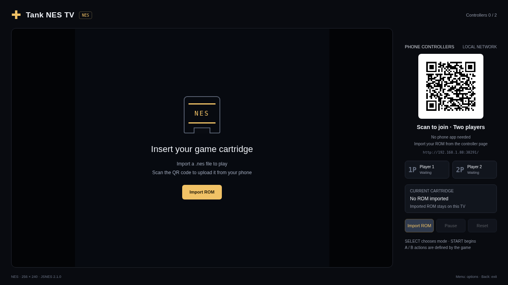

# Tank NES TV

[中文](README.md) · [English](README.en.md)

[Download APK](tank-nes-0.1.0.apk?raw=1) · [Checksums](SHA256SUMS.txt) · [Version and signing](resource.json)

Run an imported NES ROM on your TV and use phones as LAN controllers. This is a separate application from the independently rewritten game, so both can be installed together. Version `0.1.0` uses package `com.ecojust.tanknestv` and requires Android 8.0 or later.

**The APK does not include a Battle City ROM.** Import your own corresponding `.nes` file on first use. The ROM supplies the game rules, levels, graphics and sound; this application supplies the emulator, TV display and phone controls.

## Start playing

1. Install the APK and connect the TV and phone to the same local network.
2. Open the app and scan the room QR code on the TV.
3. Import the corresponding `.nes` file from the phone page and wait for transfer and loading to finish. The TV’s Import ROM action can also open the system file picker.
4. Use the left joystick and right A / B buttons. SELECT chooses modes in the original game's menu; START begins play.
5. Scan the same QR code with a second phone to join as P2. Both phones control the game running on the TV.

A successfully imported ROM is stored in this app's private directory and loaded again on the next launch. Each app keeps its own file. Remembering a ROM is not a saved game or a save state.

| Control | Function |
| --- | --- |
| Joystick | NES directional pad |
| A / B | NES A / B buttons; behavior depends on the game |
| SELECT | NES SELECT, usually menu selection |
| START | NES START, usually start or in-game pause |
| TV Back | Exit confirmation |

This image shows the actual bundled interface running in Chromium with a test native-room bridge. It is not a physical-TV capture or a screenshot of the original game.

## Room and exit behavior

Phone controls and ROM uploads use the TV's local HTTP / WebSocket server, without a cloud relay. The QR code includes a random room token; use the newly displayed code after reopening the app. Disconnecting a phone or putting its page in the background releases held controls.

Moving the app to the background closes the room and pauses emulation and audio. Confirming exit also destroys the WebView, stops worker threads and terminates this application's process. The imported ROM remains available for the next launch.

## Emulator, build and provenance

The emulator is [JSNES 2.1.0](https://github.com/bfirsh/jsnes), licensed under Apache-2.0. Its bundled JavaScript is transformed with esbuild 0.25.12 for Chrome 61 compatibility, without intentional changes to emulator behavior. The integration code uses this repository's MIT license. The emulator license does not cover imported game files.

Shared implementation and build instructions are in [shared/](shared/). Both apps share the same emulator and controller implementation while storing separate ROMs. A full playthrough with the original game ROM on physical TV hardware has not been verified. See the [shared implementation notes](shared/README.md) for formats, test coverage and limitations.
