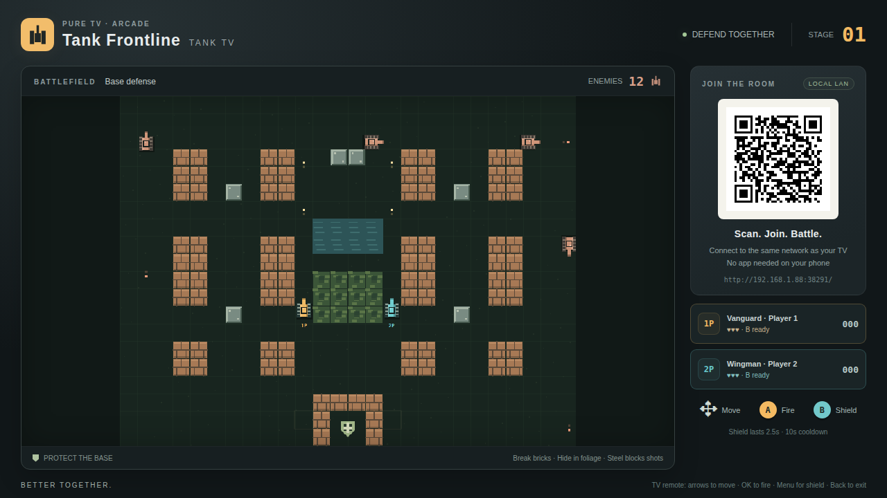
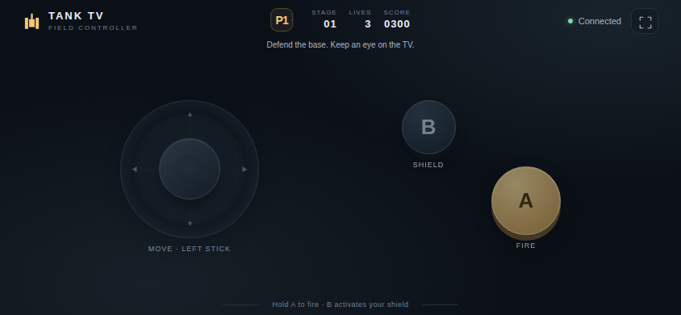

# Tank TV

<!-- apk-resource:start -->
[Download APK](tank-0.1.0.apk?raw=1) · [Checksums](SHA256SUMS.txt) · [Signing and build provenance](resource.json) · [Source code](src/)

The APK in this directory is signed with the pureTV release certificate.
<!-- apk-resource:end -->

[中文](README.md) · [English](README.en.md)

Defend your base on the TV and use your phone as a controller. Tank TV is an original tank defense game for one or two players sharing a local network. The TV displays the battlefield and a room QR code; each phone joins through its browser without installing another app. The game, levels and controller page are bundled in the APK and do not depend on an Internet service.

Requires Android 8.0 or later. Package: `com.ecojust.tanktv`; version: `0.1.0`. The TV interface follows the system language, while the controller follows the browser language. Both support Chinese and English. This project uses original graphics and code, without commercial game ROMs, assets or trademarks.

## Play

1. Install the APK on your TV using pureTV Manager or ADB, then open Tank TV.
2. Connect your phone and TV to the same local network. A wired TV connection is supported when the phone uses the same router's Wi-Fi.
3. Scan the QR code on the right side of the TV and open the room in your phone's browser. The first phone joins as P1; a second phone joins as P2.
4. Press **A** to begin. Landscape orientation is recommended; portrait mode also works.

| Control | Action |
| --- | --- |
| Left joystick | Move and aim the tank |
| Right A button | Start and fire; hold for continuous fire |
| Right B button | Activate a temporary shield, then wait for its cooldown |
| TV Back button | Show exit confirmation |

Protect the base and defeat incoming enemy tanks. Shells can destroy brick walls, steel and water constrain movement, and trees provide visual cover. A destroyed tank loses a life and respawns. Two players share the battlefield and control their own tanks.





## Local connections

The TV app runs an HTTP and WebSocket room server on a port assigned at startup. The QR code contains the current TV address, port and random room token. Use the code currently shown by the app after each launch. Controller input is not sent to a pureTV cloud service.

Up to two players can connect at once. Temporary disconnections clear held controls; a returning phone attempts to resume its previous player slot. Switching the phone to the background or locking its screen also releases the joystick and buttons. Pressing Home closes the room. Confirming exit closes the server, disconnects every controller, destroys the game page and terminates this app’s process. Reopening creates a new room.

If the phone cannot connect, check that both devices share the same local network and that the router does not isolate guest or Wi-Fi clients. Open the local HTTP address in a phone browser with local-network access. There is no public Internet relay.

## Build and verify

Run from the repository root:

```bash
node --test resource/apps/tank/tests/game.test.cjs
npm ci --prefix desktop
cd desktop && npx playwright install chromium && cd ..
node resource/apps/tank/tests/controller.mjs
node resource/apps/tank/tests/capture.mjs
cd resource/launcher/puretv
./gradlew :tank:assembleDebug :tank:testDebugUnitTest :tank:lintDebug :tank:verifyReleaseSize
```

APKs are generated under `resource/apps/tank/build/outputs/apk/`. Release builds enable code and resource shrinking and enforce a 5 MiB size limit. Published resource APKs are signed with the pureTV release certificate. Android tests cover the room server and lifecycle, Node tests cover game rules, and browser tests cover phone input.

Set `TANK_UI_CAPTURE_DIR` and run `tests/capture.mjs` to export Chinese and English game previews. These capture the actual bundled page in Chromium using test data for the native room bridge; they are not measurements of physical TV performance or phone network latency. Resource updates can use the Android CI staging process followed by `tools/prepare-app-resources.py --app tank`; see [resource maintenance](../../../docs/resource-maintenance.md).
