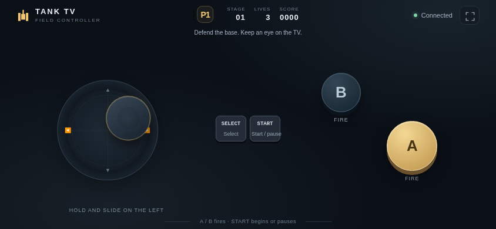

# Tank TV

<!-- apk-resource:start -->
[Download APK](tank-0.3.1.apk?raw=1) · [Checksums](SHA256SUMS.txt) · [Signing and build provenance](resource.json) · [Source code](src/) · [64×64 SVG icon](logo.svg)

The APK in this directory is signed with the pureTV release certificate.
<!-- apk-resource:end -->

[中文](README.md) · [English](README.en.md)

The planned **0.5.0** release independently reimplements the 1985 NES Battle City rules, 35 stages and presentation. Install and play without importing a ROM. Physical-TV and frame-by-frame comparisons are incomplete.

The rewrite retains QR pairing and two phone controllers over the local network, with a native 256×240 display and 208×208 battlefield. It does not load or execute a ROM. The 35 maps, 20-enemy stage sequences, four enemy classes, six power-ups, upgrades, co-op tallies and Construction mode have source references. AI, some collisions and animation timings still need frame-by-frame comparison. See [rules and maps](docs/reference.md) and [artwork and audio](docs/reference-art-audio.md) for evidence and limitations.

Requires Android 8.0 or later; package `com.ecojust.tanktv`. The room UI and phone controllers support Chinese and English. In-game menus retain the original English labels.

## 0.5.0 release preparation and installation

All nine games are being prepared as version 0.5.0 with a new game release certificate. Package IDs stay unchanged, so Android cannot use the new certificate to replace an installation signed with the old one. Back up any data your device can export before uninstalling the old app and installing 0.5.0. Uninstalling clears local game saves and records. This project has no automatic save migration tool and cannot guarantee recovery of old saves.

Publication is complete only when the 0.5.0 APK, checksums and `resource.json` have all been updated.

## Floating joystick and compatibility

The phone controller now uses a floating joystick. It stays hidden until you touch the left control area, and that touch becomes the center for the current gesture. Drag in any direction to move; release to stop and hide the stick. Each new touch establishes a new center. Movement and A/B support simultaneous touches. Cancelling a touch, rotating or hiding the page, and losing the connection clear movement to prevent stuck input. The older TV WebView startup fix from 0.3.0 is retained.

## Controller changes in 0.5.0

The right third of the phone screen is an edge-to-edge action area. Tap anywhere in it to fire; the left stick also selects stages in either direction. The left area retains the floating joystick. START and SELECT sit separately at the bottom left. Touches are independent, and cancellation, focus loss or disconnect clears held input. Selection, dragging and long-press context menus are suppressed across the controller.

## Play

1. Install the app and connect the TV and phones to the same router.
2. Scan the TV's QR code; up to two phones can join.
3. Use **SELECT** to choose 1 PLAYER, 2 PLAYERS or CONSTRUCTION; confirm with **START**.
4. On the initial stage selector, the stick changes the stage (keyboard A/B also work) and START begins. During play, START pauses or resumes.

| Control | Action |
| --- | --- |
| Left touch area | Touch anywhere to set the joystick center; drag to move and turn; release to stop and hide |
| Entire right third (A) | Fire on each press anywhere in the area; holding does not autofire |
| SELECT | Change menu selection |
| START | Start, confirm, pause or resume |
| TV Back | Exit confirmation |

Defend the base and defeat the enemy wave. Helmet, clock, shovel, star, grenade and tank are collectible power-ups; B no longer creates a custom shield. Stars increase shell speed, simultaneous shell capacity and steel-breaking ability. Friendly fire temporarily freezes the other tank, and player shells can destroy the base.

These images show this rewritten version running its actual bundled game page in Chromium with simulated room data. They are not physical-TV captures.


The stick stays hidden until you hold and drag on the left, appearing at the initial touch point:



## Local connections

The TV app runs an HTTP and WebSocket room server on a port assigned at startup. The QR code contains the current TV address, port and random room token. Use the code currently shown by the app after each launch. Controller input is not sent to a pureTV cloud service.

Up to two players can connect at once. Temporary disconnections clear held controls; a returning phone attempts to resume its previous player slot. Switching the phone to the background or locking its screen also releases the joystick and buttons. Pressing Home closes the room. Confirming exit closes the server, disconnects every controller, destroys the game page and terminates this app’s process. Reopening creates a new room.

If the phone cannot connect, check that both devices share the same local network and that the router does not isolate guest or Wi-Fi clients. Open the local HTTP address in a phone browser with local-network access. There is no public Internet relay.

## Build and verify

Run from the repository root:

```bash
node --test resource/apps/tank/tests/game.test.cjs
npm ci --prefix desktop
cd desktop && npx playwright install chromium && cd ..
node resource/apps/tank/tests/compatibility.mjs
node resource/apps/tank/tests/controller.mjs
node resource/apps/tank/tests/capture.mjs
cd resource/launcher/puretv
./gradlew :tank:assembleDebug :tank:testDebugUnitTest :tank:lintDebug :tank:verifyReleaseSize
```

APKs are generated under `resource/apps/tank/build/outputs/apk/`. Release builds enable code and resource shrinking and enforce a 5 MiB size limit. Published resource APKs are signed with the pureTV release certificate. Android tests cover the room server and lifecycle, Node tests cover game rules, and browser tests cover phone input.

Set `TANK_UI_CAPTURE_DIR` and run `tests/capture.mjs` to export Chinese and English game previews. These capture the actual bundled page in Chromium using test data for the native room bridge; they are not measurements of physical TV performance or phone network latency. After publication, this directory will contain the signed 0.5.0 package with full-screen action areas. See [resource.json](resource.json) for its source commit, APK checksum and build method, and [resource maintenance](../../../docs/resource-maintenance.md) for catalog maintenance.

## Artwork and licensing

The independently written application code is MIT licensed. Upstream reference images and short audio cues, their supplied license records, and attribution to the original Namco game are documented in the [artwork and audio notes](docs/reference-art-audio.md). The project does not claim authorship of the original designs or extend its code license to all third-party content.
