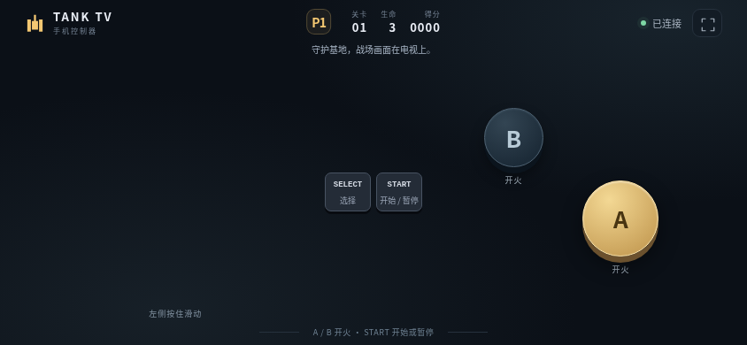

# Tank TV · 经典坦克大战

<!-- apk-resource:start -->
[下载 APK](tank-0.2.0-preview.2.apk?raw=1) · [校验值](SHA256SUMS.txt) · [签名及构建来源](resource.json) · [源码](src/)

此目录内 APK 使用 pureTV 发布证书签名。
<!-- apk-resource:end -->

[中文](README.md) · [English](README.en.md)

当前发布版本为 **`0.2.0-preview.2`**，独立重写 1985 年红白机《Battle City》的玩法、35 关地图与表现。安装后即可游玩，无须导入 ROM；同包名、同签名，可覆盖此前版本。它仍是预览版，尚未完成电视实机和逐帧对照验证。

新版保留电视二维码与手机局域网双人手柄，使用 256×240 原生画面和 208×208 战场。游戏规则独立编写，不加载或运行 ROM。35 关地图、每关 20 辆敌人的顺序、四种敌军、六种道具、星级升级、双人统计与 Construction 均有来源对照；AI、部分碰撞和动画时序仍需进一步逐帧核对。详细依据与局限见[规则和关卡](docs/reference.md)、[图像与声音](docs/reference-art-audio.md)。

适用于 Android 8.0 及以上电视，包名 `com.ecojust.tanktv`。电视房间界面与手机手柄支持中英文，游戏内部保留原作英文菜单。

## 本次修复

修复旧版电视 WebView 中的游戏黑屏及扫码后玩家状态不更新；移除较新 JavaScript 语法和 API 依赖。房间状态独立于游戏绘制更新，启动或绘制失败时会显示可读的错误提示。新增旧语法、缺失 API、故障提示、玩家加入／断开和退出清理的回归测试。

## 开始游玩

1. 安装本次测试构建并打开应用，将手机和电视连接到同一路由器。
2. 扫描电视右侧二维码，最多两部手机加入房间。
3. 用 **SELECT** 选择 1 PLAYER、2 PLAYERS 或 CONSTRUCTION，用 **START** 确认。
4. 首次选关画面可用 A/B 增减关卡，按 START 开始；游戏中 START 暂停／继续。

| 控件 | 功能 |
| --- | --- |
| 摇杆 | 移动及转向 |
| A / B | 按下射击；长按不自动连射 |
| SELECT | 菜单选择 |
| START | 开始、确认、暂停／继续 |
| 电视返回键 | 退出确认 |

保护基地，清除敌军。头盔、时钟、铲子、星星、手雷和坦克是地图中拾取的六种道具；B 不再提供自定义护盾。星级影响弹速、并发炮弹与破坏钢墙的能力。玩家炮弹也会摧毁基地，命中队友会暂时冻结队友。

以下图片对应本次重写预览，在 Chromium 中运行实际游戏页面，并使用模拟房间数据；不是电视实机截图。




## 局域网连接

房间由电视上的应用提供 HTTP 和 WebSocket 服务，监听启动时分配的端口。二维码包含当前电视地址、端口和随机房间令牌；每次启动应用以电视当前显示的二维码为准。手机控制请求不会发送到 pureTV 的云端服务器。

最多同时接入两名玩家。短暂断线会清空操作输入，手机恢复连接后尝试回到原来的玩家位置，避免坦克持续移动或开火。手机切到后台或锁屏时也会释放摇杆和按钮。按 Home 离开应用会关闭房间；确认退出游戏时，会关闭房间服务、断开所有手机连接、销毁游戏页面并结束本应用进程。再次打开会创建新房间。

扫码后无法连接时，先检查手机与电视是否在同一局域网，以及路由器是否启用了访客网络或 AP 隔离。二维码中的本地 HTTP 地址需要由能够访问局域网的手机浏览器打开；应用没有公网中转功能。

## 构建与验证

从仓库根目录执行：

```bash
node --test resource/apps/tank/tests/game.test.cjs
npm ci --prefix desktop
cd desktop && npx playwright install chromium && cd ..
node resource/apps/tank/tests/compatibility.mjs
node resource/apps/tank/tests/controller.mjs
node resource/apps/tank/tests/capture.mjs
cd resource/launcher/puretv
./gradlew :tank:assembleDebug :tank:testDebugUnitTest :tank:lintDebug :tank:verifyReleaseSize
```

APK 输出在 `resource/apps/tank/build/outputs/apk/`。Release 开启代码与资源压缩，体积上限为 5 MiB；正式资源 APK 使用 pureTV 发布证书签名。Android 测试验证房间服务及生命周期，Node 测试验证游戏规则，浏览器测试验证手机触控。

设置 `TANK_UI_CAPTURE_DIR` 后运行 `tests/capture.mjs`，可导出中英文游戏页面预览。这些图片由随 APK 打包的真实页面在 Chromium 中渲染，原生桥接使用测试房间数据，不代表电视实机性能或真实手机网络时延。此目录提供修复后的签名预览包，源码提交、APK 校验值及构建方式见 [resource.json](resource.json)；资源目录维护见[资源维护说明](../../../docs/resource-maintenance.md)。

## 素材与许可

应用独立实现使用 MIT 许可；参考图像和短音效的上游来源、许可记录与原作 Namco 署名见[图像与声音说明](docs/reference-art-audio.md)。本项目不将原作设计归为自己的创作，也不把应用代码的 MIT 许可扩展到所有第三方内容。
