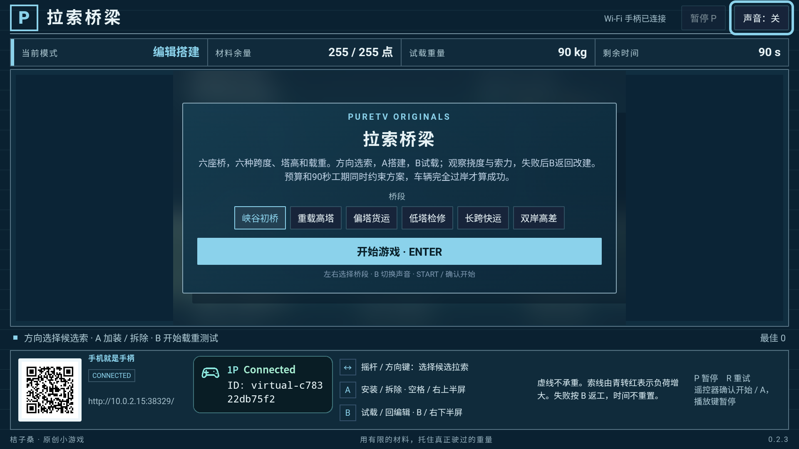
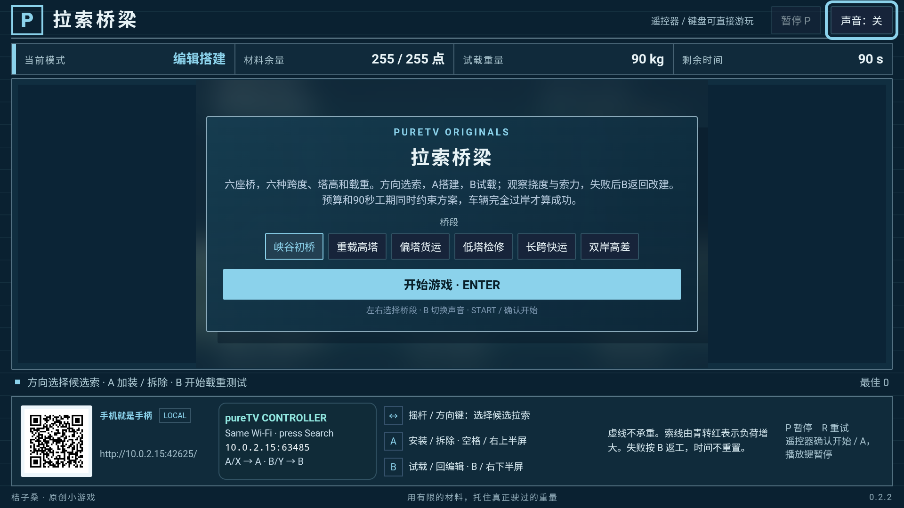

# 拉索桥梁 / Tension Span

<!-- controller-client-status:start -->
## 0.2.3 · 手柄连接标识

<!-- apk-resource:start -->
[下载签名 APK](tension-span-0.2.3.apk?raw=1) · [校验值](SHA256SUMS.txt) · [签名与来源](resource.json) · [源码](src/) · [图标](logo.svg)
<!-- apk-resource:end -->

Android **0.2.3 / versionCode 5**：手柄连接后，侧边显示手柄图标、玩家席位（按游戏人数显示 1P/2P）和设备完整连接 ID；断开后隐藏。默认 TCP 端口仍为 **63485**。当前手柄固件未上报 RSSI，因此不显示信号强弱。

[连接截图](docs/releases/0.2.3/connected.png) · [连接状态专项录像](docs/releases/0.2.3/controller-status.mp4?raw=1) · [版本验证](docs/releases/0.2.3/verification.json) · [20 款更新记录](../../../docs/controller-client-status/README.md)

安装包沿用原发布证书。本轮在 Android TV 模拟器中验证连接身份、断开／重连状态及同证书覆盖安装；截图和录像记录菜单中的连接状态专项，没有重做完整玩法验收。未改规则模型按精确哈希复用历史依据，旧版报告继续保留。尚未验证实体电视、手机、ESP32 或带已有存档的升级与数据保留。


<!-- controller-client-status:end -->

历史 0.2.1：[签名安装包](tension-span-0.2.1.apk) · [六关实际游玩录像](docs/gameplay-0.2.1.mp4) · [旧版验证记录](https://github.com/ecojust/pureTV/blob/bf58393ba8fa8bb3bdf731ab24f9ab09d90f5075/resource/apps/tension-span/docs/verification.json)。这些旧版记录作为未改变规则的回归依据，不代表本轮界面、手柄链路或 Android 实包验收。

历史 0.2.0：[签名安装包](tension-span-0.2.0.apk) · [六关实际游玩录像](docs/gameplay-0.2.0.mp4) · [验证记录](docs/verification-0.2.0.json)

在有限的材料预算内，为悬空桥面选择拉索，再让载重工程车通过峡谷。桥面会随车辆位置下沉，拉索只能承受拉力；超载断索、桥板损坏和车辆坠落都会影响试载结果。失败后可以返回搭建，调整原有方案。

- 作者：ecojust / 桔子桑
- 包名：`com.ecojust.tensionspantv`
- 版本：`0.2.3`（versionCode 5）
- 电视系统：Android 8.0 / API 26 及以上
- 图标：[logo.svg](logo.svg)

已发布的 0.1.0 资源：[下载安装包](tension-span-0.1.0.apk) · [实际游玩视频](docs/gameplay-0.1.0.mp4) · [验证记录](docs/verification-0.1.0.json)。这些历史资源保留原样，不作为 0.2.0 的画面或验证证据。

## 操作

手机与电视接入同一局域网，扫描电视上的二维码。左侧自由起点摇杆选择候选拉索；右侧上半区连接或移除，下半区开始试载或返回搭建。电视遥控器方向键选择，确认键对应 A，菜单键对应 B。

键盘方向键或 WASD 选择，空格连接或移除，B 开始试载或返回搭建。Enter 开始，P 暂停或继续，R 重试。开始和结算界面可用左右键选择其他关卡；手机 START 开始或暂停。

试载过程中不能增删拉索。试载失败后按 B 恢复试载前的搭建方案，再调整连接；材料预算和整局剩余时间不会因此重置。车辆完全驶出终点才算完成。

## 六座桥

| 桥段 | 变化 | 载重 | 材料预算 |
| --- | --- | --- | --- |
| 峡谷初桥 | 对称塔锚，建立基本支撑 | 90 kg | 255 |
| 重载高塔 | 高塔和更重的车辆 | 110 kg | 285 |
| 偏塔货运 | 两侧塔高不对称 | 120 kg | 260 |
| 低塔检修 | 低塔改变拉索角度，预算更紧 | 100 kg | 220 |
| 长跨快运 | 最大跨度，车辆更快 | 140 kg | 330 |
| 双岸高差 | 塔锚向内偏移，高低差更大 | 130 kg | 270 |

0.2.0 保留前三座桥，新增三种可独立搭建的工程条件。界面改为蓝图测绘桌：顶部显示材料、载重和工期，中间桥梁标出净跨与挠度，底部横向排列连接与操作说明。

## 实现与验证

采用固定小步积分的简化竖向桥梁模型：桥面节点的水平位置固定，桥板传递竖向弹力和阻尼；塔锚与岸端视为固定于地基的约束，不计算塔身、地基或完整梁弯矩。拉索根据当前长度计算张力及其竖向分力，松弛时不提供压缩支撑。内移塔锚下方的支墩表示塔锚基础，没有为桥面添加额外支承节点。

车辆在有支承时按规定水平速度行驶，总重等分为两份静态轮载，再按各轮所在位置分摊到相邻节点。水平轮距与轮心的竖直半径偏移属于小斜率近似；不模拟悬挂、动态轮载、单轮支点翻转或碰撞。任一轮失去桥面支承即视为试载支承失效，之后继承最后支承位姿的平动与角速度，显示只受重力的抛落；离桥后的实际轮距保持不变。这是搭建与试载游戏，不是完整车桥动力学或土木有限元模型。

桥板、工程车、轮毂和塔锚使用原创素材，在初始化时烘焙到同一张图集。桥面、拉索和车轮按模型状态绘制，运行时复用纹理与批次。

```bash
node --test resource/apps/tension-span/tests/game-model.test.cjs
node resource/apps/tension-span/tests/independent-physics-review.mjs --output /absolute/scratch/physics.json
node resource/apps/tension-span/tests/browser-checks.mjs --assets /absolute/build/assets --output /absolute/scratch/browser
```

24 组规则测试覆盖六关正常输入通关、预算、单边拉索、载荷、断裂、编辑快照恢复，以及离桥速度连续性、轮距连续性和重力抛落。独立审查包含六种几何下 30,000 组受力与积分对照，并验证两套不同方案各自通过六关，以及同一局失败、返回修改、再次试载通关的流程；这些对照验证上述近似模型的实现，不等于现实工程认证。浏览器专项检查六关菜单、普通输入以及 960×540 / 1280×720 的文字边界和滚动。

共享 QA 使用 `tests/automation.mjs`；六关连续录像使用 `tests/recording-automation.mjs` 和 `tests/recipe.json`，通过实际方向键和 Enter 切换关卡，首关还演示失败后返工。自动器只读取公开快照，通过普通输入推进。浏览器验证不代表实体电视或手机测试，也不将视频导出帧率当作实体设备帧率。

## 0.2.1 源码修正

失去支承时保留车辆已有的水平、竖直与角速度，去除突然减速、竖直速度归零和固定旋转。离桥时冻结实际轮距，避免车轮与车身突然缩小；内移塔锚补画固定基础。六座桥的布局、材料预算与载荷规则保持原样。这些 0.2.1 修正继续包含在 0.2.2 中；0.2.1 六关录像与旧版验证见上方历史入口，0.2.0 原版与证据也继续保留。

构建与手机手柄组件见 [game-kit](../../game-kit/README.md)。源码与原创素材遵循仓库 [MIT 许可证](../../../LICENSE)。

## pureTV Wi-Fi 手柄

从 0.2.2 起，电视游戏提供 pureTV TCP 手柄服务，默认端口 **63485**。电视和手柄连同一个局域网，在游戏显示连接地址后按手柄 GPIO23 搜索键；同网仅保留一个目标游戏服务，固件才会自动选中。若端口被占用，以游戏显示的实际端口为准。

- 方向键：对应游戏内方向操作和菜单选关。
- START：开始、暂停或继续。
- A / X：连接 / 移除。
- B / Y：测试 / 返回。

断线或切换控制来源会暂停并清除旧输入；重新连接后松开按键，再按 START 继续。临时失焦时保留TCP连接并隔离输入，真正退出游戏时关闭服务。遥控器、键盘和扫码手机入口继续可用。

虚拟手柄联调：`python3 puretv-joystick/bridge.py 电视IP --port 63485`，再打开 `http://127.0.0.1:8767/`。使用备用端口时替换命令中的端口。验证范围见[20款游戏接入记录](../../../docs/readme-controller-support/README.md)。

<!-- controller-client-status-history:start -->
<details>
<summary>历史 0.2.2 安装包与验收记录</summary>

以下为旧版发布记录，其测试与画面不代表本次连接 ID 界面验收。[原提交中的完整说明](https://github.com/ecojust/pureTV/blob/9af9f197855eb7a0ce7174c0e6295c8974b3250d/resource/apps/tension-span/README.md)。

**0.2.2 · pureTV 手柄更新：** [签名安装包](tension-span-0.2.2.apk) · [Android 实包手柄回归录像](docs/releases/0.2.2/gameplay.mp4) · [版本验证](docs/releases/0.2.2/verification.json) · [当时接入记录](../../../docs/readme-controller-support/README.md)

新增 pureTV Wi-Fi 手柄支持，默认端口 **63485**，显示真实连接状态，断线时暂停并清除输入。保留原六关及规则，遥控器和扫码手机仍可使用。

该历史版 APK 已签名，并在 Android TV API 36 模拟器中完成同证书覆盖安装验证，通过全部 8 项手柄验收，覆盖开始、实际游戏操作、暂停恢复、断线重连、九键输入及逐消息 ACK。下图和上方录像来自该历史版本实际 APK；录像记录手柄回归过程，不是六关通关录像。尚未进行实体电视、手机或 ESP32 测试。



</details>
<!-- controller-client-status-history:end -->
