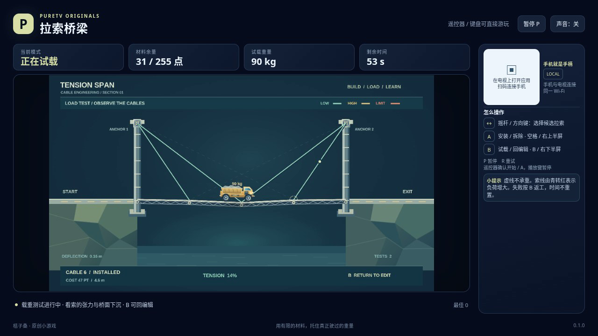

# 拉索桥梁 / Tension Span

在有限的材料预算内，为悬空桥面选择拉索，再让载重工程车通过峡谷。桥面会随车辆位置下沉，拉索只能承受拉力；超载断索、桥板损坏和车辆坠落都会影响试载结果。失败后可以返回搭建，调整原有方案。

- 作者：ecojust / 桔子桑
- 包名：`com.ecojust.tensionspantv`
- 版本：`0.1.0`
- 电视系统：Android 8.0 / API 26 及以上
- 图标：[logo.svg](logo.svg)

[下载安装包](tension-span-0.1.0.apk) · [实际游玩视频](docs/gameplay-0.1.0.mp4) · [验证记录](docs/verification.json)



## 操作

手机与电视接入同一局域网，扫描电视上的二维码。左侧自由起点摇杆选择候选拉索；右侧上半区连接或移除，下半区开始试载或返回搭建。电视遥控器方向键选择，确认键对应 A，菜单键对应 B。

键盘方向键或 WASD 选择，空格连接或移除，B 开始试载或返回搭建。Enter 开始，P 暂停或继续，R 重试。开始和结算界面可用左右键选择其他关卡；手机 START 开始或暂停。

试载过程中不能增删拉索。试载失败后按 B 恢复试载前的搭建方案，再调整连接；材料预算和整局剩余时间不会因此重置。车辆完全驶出终点才算完成。

## 实现与验证

采用固定小步积分的简化竖向桥梁模型：桥面节点的水平位置固定，桥板传递竖向弹力和阻尼；车轮载荷按实际接触位置分摊到相邻节点。拉索根据当前长度计算张力及其竖向分力，松弛时不提供压缩支撑。它用于游戏中的试载与搭建，不是完整土木有限元模型。

桥板、工程车、轮毂和塔锚使用原创素材，在初始化时烘焙到同一张图集。桥面、拉索和车轮按模型状态绘制，运行时复用纹理与批次。

```bash
node --test resource/apps/tension-span/tests/game-model.test.cjs
node resource/apps/tension-span/tests/independent-physics-review.mjs
```

21 组规则测试覆盖各关正常输入通关、预算、单边拉索、载荷、断裂和编辑快照恢复。独立审查包含 30,000 组受力与积分对照，并验证两套不同方案各自通过三关，以及同一局失败、返回修改、再次试载通关的流程。最终测试、签名包和录像结果保存在 `docs/verification.json`。录像使用打包资源在 Chromium 中实际运行；此次未连接实体电视或手机，不将浏览器结果当作实体设备帧率。

构建与手机手柄组件见 [game-kit](../../game-kit/README.md)。源码与原创素材遵循仓库 [MIT 许可证](../../../LICENSE)。
