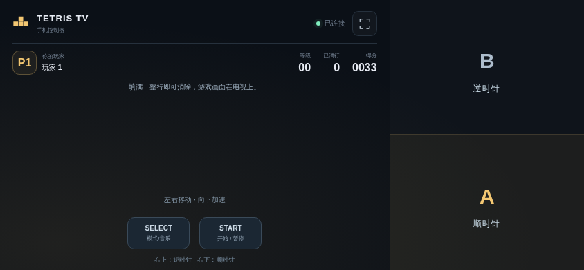
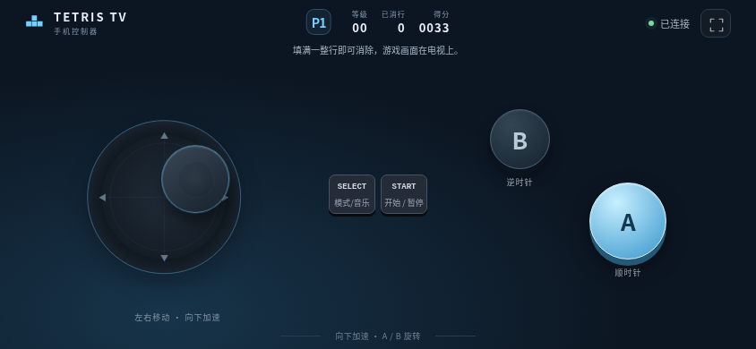

# 俄罗斯方块 TV

<!-- apk-resource:start -->
[下载 APK](tetris-0.5.2.apk?raw=1) · [校验值](SHA256SUMS.txt) · [签名及构建来源](resource.json) · [源码](src/) · [64×64 SVG 图标](logo.svg)

此目录内 APK 使用 pureTV 发布证书签名。若设备中存在使用旧证书的同包应用，Android 无法直接覆盖安装；需先备份数据并卸载旧包。
<!-- apk-resource:end -->

[中文](README.md) · [English](README.en.md)

独立重写经典红白机俄罗斯方块：10×20 棋盘、七种四连块、经典方向旋转、软降、消行计分、等级加速和 NEXT 预览。

当前版本 **0.5.2**，适用于 Android 8.0 及以上电视，包名 `com.ecojust.tetristv`。电视显示棋盘与房间二维码，手机扫码作为手柄；不需要导入 ROM。
<!-- visual-release:start -->
## 0.5.2 视觉更新与验证

当前发布版本为 **0.5.2**，本目录提供对应签名安装包。本轮沿用 0.5.0／0.5.1 的 pureTV 发布证书，可覆盖更新并保留本机数据。逐款改动、检查范围和实机验证状态见[0.5.2 视觉更新记录](../../../docs/game-visuals-0.5.2.md)。

按 Nintendo NES《Tetris》重画灰色迷宫背景和经典单人布局：左侧统计、中间棋盘、右侧分数／NEXT／LEVEL，保留对应方块样式和等比显示。双人扩展仍使用独立双棋盘；顶部元数据已避开边框。这是独立重画，未宣称逐像素复刻。

具体还原范围见[参考说明](docs/reference.md)。

<!-- final-verification -->
最终源码 0752b658aecbb1322cb7294e3176500639db1b54 已通过 Android CI 40843467072：280 项模型／渲染行为回归、36 个兼容场景、131 个手柄场景及 18 个双语集成场景；Cozy Island 输入运行时 9／9、两款 WebGL 1 渲染脚本及 Coast Kart 道具攻防专项也通过。Android 构建、lint、体积和 staging 成功，15 个模块实际执行 JUnit 任务（含全部 9 款游戏），不推断未输出的 JUnit 用例数。签名运行 40846148068 已核验九款 APK 的源码资源、签名与资源目录。Chrome 61 语法和现代 Chromium 旧 API 模拟不等于真实旧 WebView 验收；真实电视／手机、设备 FPS、覆盖安装和数据保留均未测试。
<!-- visual-release:end -->

## 0.5.1 还原度升级

修正软降节奏、跨块重新下拉、横移与旋转处理顺序，以及消行动画节拍。

沿用 0.5.0 证书，可直接覆盖更新；本轮核对结果与剩余差距见[还原度复核](../../../docs/game-fidelity-0.5.1.md)。

## 安装与签名

0.5.2 沿用 0.5.0／0.5.1 的 pureTV 统一发布证书，可以覆盖安装这些版本并保留本机数据。使用旧证书的 0.4.x 及更早安装不能直接覆盖，请先备份可导出的数据再卸载；卸载会清除本机存档和记录，本项目没有跨证书自动迁移工具。

## 开始游玩

1. 将手机和电视连接同一局域网，在电视上打开游戏。
2. 手机浏览器扫描电视二维码；单人一部手机，双人分别扫描加入。
3. 在标题画面按 SELECT 选择人数，按 START 开始。双人模式需要两名玩家都连接。
4. 左侧摇杆默认隐藏，按下的位置就是本次中心；拖动控制，松开停止并隐藏。右侧屏幕三分之一都是动作区，可在区域内任意位置操作。START／SELECT 独立位于左侧底部；操作区禁止文字选择和长按菜单。

| 控件 | 功能 |
| --- | --- |
| 左侧浮动摇杆 | 左右移动，下拉软降；标题左右选等级；A-TYPE 上下跨 10 级，B-TYPE 上下选障碍高度 |
| 右侧下半区 A | 顺时针旋转；标题切换 A-TYPE／B-TYPE |
| 右侧上半区 B | 逆时针旋转；标题切换 A-TYPE／B-TYPE |
| SELECT | 标题画面切换单／双人；游戏或暂停时开关音乐 |
| START | 开始、暂停／继续 |
| 电视返回键 | 退出确认 |

保留经典无踢墙旋转和等级速度规则；没有现代 HOLD、幽灵方块或一键硬降。A-TYPE 标题可选 0–19 起始等级；新增 B-TYPE 固定等级挑战，选择 0–9 级和 0–5 档初始障碍高度，消除 25 行即通关。B-TYPE 双人使用相同障碍布局，一人通关后另一人可继续。双人模式提供两块独立棋盘与相同的方块序列，分别消行、计分，不发送垃圾行；这是新增的局域网比拼模式。

最高分保存在电视本机。从旧证书版本迁移到 0.5.0 需要卸载，原有记录会被清除，无法自动迁移。

## 画面

以下截图由实际游戏页面在 Chromium 中渲染，使用模拟房间连接；不是电视实机截图。






## 房间与退出

最多两部手机通过本地 HTTP/WebSocket 房间连接。二维码包含本次启动的端口与随机房间令牌，不经过云端中转。手机切到后台、触控中断或断线会释放按键；参与游戏的玩家断线时暂停棋盘，重连后恢复。

按电视 Home 离开会关闭房间；确认退出会关闭端口与服务线程、断开手机、销毁 WebView 和音频并结束应用进程。重新打开后请扫描新的二维码。

## 构建与验证

```sh
# 仓库根目录
node --test resource/apps/tetris/tests/*.test.cjs
node resource/apps/tetris/tests/controller.mjs
node resource/apps/tetris/tests/compatibility.mjs
node resource/apps/tetris/tests/capture.mjs

cd resource/launcher/puretv
./gradlew :tetris:assembleRelease :tetris:testDebugUnitTest :tetris:lintDebug :tetris:verifyReleaseSize
```

浏览器测试需要 desktop 的 npm 依赖及 Chromium，可用 `CHROMIUM_PATH` 指定浏览器。Gradle 默认生成未签名 release APK，公开目录中的安装包使用 pureTV 发布证书签名。

玩法依据与独立实现的差异见[参考说明](docs/reference.md)。画面、图标、音效和 8-bit 配乐由项目独立制作，不包含原作 ROM、图像提取或原声音轨；项目自写代码与素材使用 [MIT](LICENSE)。尚未完成电视／手机实机及逐帧对照验证。
