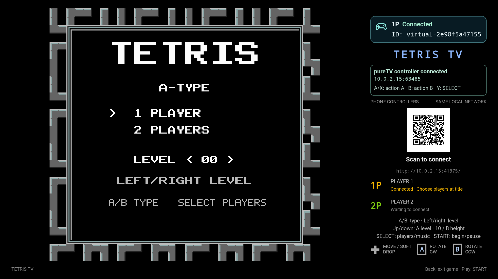
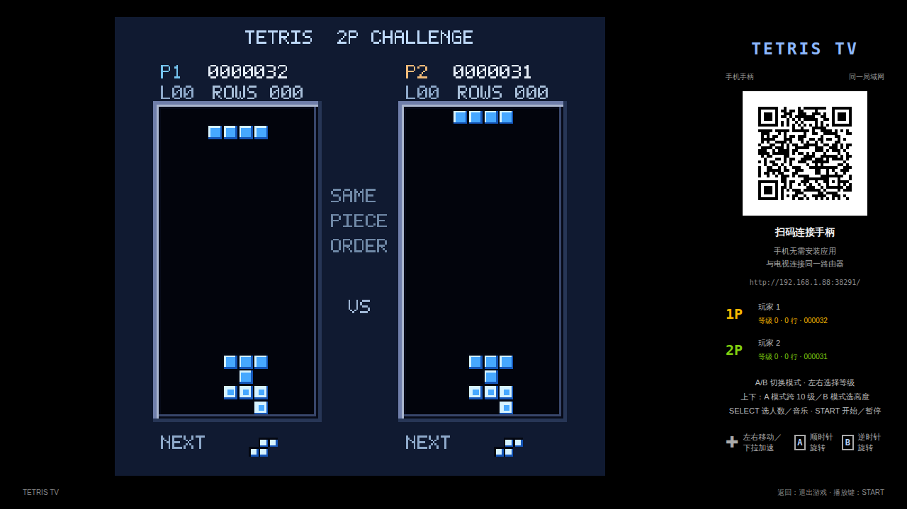
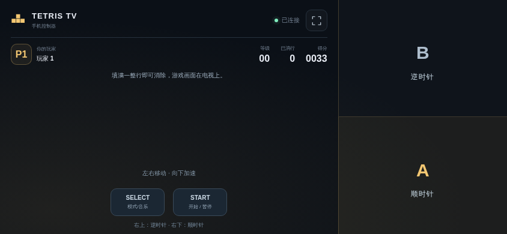
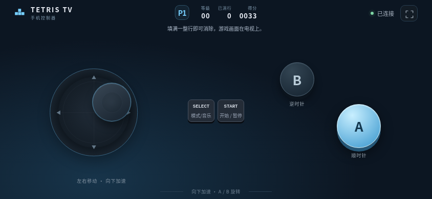

# 俄罗斯方块 TV

[中文](README.md) · [English](README.en.md)

<!-- controller-client-status:start -->
## 0.5.4 · 手柄连接标识

<!-- apk-resource:start -->
[下载签名 APK](tetris-0.5.4.apk?raw=1) · [校验值](SHA256SUMS.txt) · [签名与来源](resource.json) · [源码](src/) · [图标](logo.svg)
<!-- apk-resource:end -->

Android **0.5.4 / versionCode 6**：手柄连接后，侧边显示手柄图标、玩家席位（按游戏人数显示 1P/2P）和设备完整连接 ID；断开后隐藏。默认 TCP 端口仍为 **63485**。当前手柄固件未上报 RSSI，因此不显示信号强弱。

[连接截图](docs/releases/0.5.4/connected.png) · [连接状态专项录像](docs/releases/0.5.4/controller-status.mp4?raw=1) · [版本验证](docs/releases/0.5.4/verification.json) · [20 款更新记录](../../../docs/controller-client-status/README.md)

安装包沿用原发布证书。本轮在 Android TV 模拟器中验证连接身份、断开／重连状态及同证书覆盖安装；截图和录像记录菜单中的连接状态专项，没有重做完整玩法验收。未改规则模型按精确哈希复用历史依据，旧版报告继续保留。尚未验证实体电视、手机、ESP32 或带已有存档的升级与数据保留。


<!-- controller-client-status:end -->

独立重写经典红白机俄罗斯方块：10×20 棋盘、七种四连块、经典方向旋转、软降、消行计分、等级加速和 NEXT 预览。

当前版本 **0.5.4**，适用于 Android 8.0 及以上电视，包名 `com.ecojust.tetristv`。电视显示棋盘与房间二维码，手机扫码作为手柄；不需要导入 ROM。
<!-- visual-release:start -->
## 历史：0.5.2 视觉更新与验证

以下保留 **0.5.2** 发布时的视觉更新、源码和验收记录；这些旧版结果不代表本轮 pureTV 手柄更新已经通过验收。当时沿用 0.5.0／0.5.1 的 pureTV 发布证书。逐款改动、检查范围和实机验证状态见[0.5.2 视觉更新记录](../../../docs/game-visuals-0.5.2.md)。

按 Nintendo NES《Tetris》重画灰色迷宫背景和经典单人布局：左侧统计、中间棋盘、右侧分数／NEXT／LEVEL，保留对应方块样式和等比显示。双人扩展仍使用独立双棋盘；顶部元数据已避开边框。这是独立重画，未宣称逐像素复刻。

具体还原范围见[参考说明](docs/reference.md)。

<!-- final-verification -->
当时冻结源码 0752b658aecbb1322cb7294e3176500639db1b54 已通过 Android CI 40843467072：280 项模型／渲染行为回归、36 个兼容场景、131 个手柄场景及 18 个双语集成场景；Cozy Island 输入运行时 9／9、两款 WebGL 1 渲染脚本及 Coast Kart 道具攻防专项也通过。Android 构建、lint、体积和 staging 成功，15 个模块实际执行 JUnit 任务（含全部 9 款游戏），不推断未输出的 JUnit 用例数。签名运行 40846148068 已核验九款 APK 的源码资源、签名与资源目录。Chrome 61 语法和现代 Chromium 旧 API 模拟不等于真实旧 WebView 验收；该历史版本当时未测试真实电视／手机、设备 FPS、覆盖安装和数据保留。
<!-- visual-release:end -->

## 历史：0.5.1 还原度升级

修正软降节奏、跨块重新下拉、横移与旋转处理顺序，以及消行动画节拍。

沿用 0.5.0 证书，可直接覆盖更新；0.5.1 的核对结果与剩余差距见[还原度复核](../../../docs/game-fidelity-0.5.1.md)。

## 安装与签名

历史 0.5.3 已沿用 0.5.0／0.5.1／0.5.2 的 pureTV 统一发布证书；当时已在 Android TV 模拟器成功从 0.5.2 执行 `adb install -r` 覆盖安装。该检查未预置存档，不代表已验证升级后存档或用户数据保留。使用旧证书的 0.4.x 及更早安装不能直接覆盖，请先备份可导出的数据再卸载；卸载会清除本机存档和记录，本项目没有跨证书自动迁移工具。

## 开始游玩

1. 将手机和电视连接同一局域网，在电视上打开游戏。
2. 手机浏览器扫描电视二维码；单人一部手机，双人分别扫描加入。
3. 在标题画面按 SELECT 选择人数，按 START 开始。双人模式需要两名玩家都连接。
4. 左侧摇杆默认隐藏，按下的位置就是本次中心；拖动控制，松开停止并隐藏。右侧屏幕三分之一都是动作区，可在区域内任意位置操作。START／SELECT 独立位于左侧底部；操作区禁止文字选择和长按菜单。

| 控件 | 功能 |
| --- | --- |
| 左侧浮动摇杆 | 左右移动，下拉软降；标题左右选等级；A-TYPE 上下跨 10 级，B-TYPE 上下选障碍高度 |
| 右侧下半区 A | 顺时针旋转；标题切换 A-TYPE／B-TYPE |
| 右侧上半区 B | 逆时针旋转；标题切换 A-TYPE／B-TYPE |
| SELECT | 标题画面切换单／双人；游戏或暂停时开关音乐 |
| START | 开始、暂停／继续 |
| 电视返回键 | 退出确认 |

保留经典无踢墙旋转和等级速度规则；没有现代 HOLD、幽灵方块或一键硬降。A-TYPE 标题可选 0–19 起始等级；新增 B-TYPE 固定等级挑战，选择 0–9 级和 0–5 档初始障碍高度，消除 25 行即通关。B-TYPE 双人使用相同障碍布局，一人通关后另一人可继续。双人模式提供两块独立棋盘与相同的方块序列，分别消行、计分，不发送垃圾行；这是新增的局域网比拼模式。

最高分保存在电视本机。从旧证书版本迁移到 0.5.0 需要卸载，原有记录会被清除，无法自动迁移。

## 历史画面（0.5.2）

以下截图由实际游戏页面在 Chromium 中渲染，使用模拟房间连接；不是电视实机截图。







## 房间与退出

最多两部手机通过本地 HTTP/WebSocket 房间连接。二维码包含本次启动的端口与随机房间令牌，不经过云端中转。手机切到后台、触控中断或断线会释放按键；参与游戏的玩家断线时暂停棋盘，重连后恢复。

按电视 Home 离开会关闭房间；确认退出会关闭端口与服务线程、断开手机、销毁 WebView 和音频并结束应用进程。重新打开后请扫描新的二维码。

## 构建与验证

以下命令是可复现的检查入口，不表示本轮已经全部执行通过；本轮实际执行结果见上方验收记录。

```sh
# 仓库根目录
node --test resource/apps/tetris/tests/*.test.cjs
node resource/apps/tetris/tests/controller.mjs
node resource/apps/tetris/tests/compatibility.mjs
node resource/apps/tetris/tests/capture.mjs

cd resource/launcher/puretv
./gradlew :tetris:assembleRelease :tetris:testDebugUnitTest :tetris:lintDebug :tetris:verifyReleaseSize
```

浏览器测试需要 desktop 的 npm 依赖及 Chromium，可用 `CHROMIUM_PATH` 指定浏览器。Gradle 默认生成未签名 release APK，公开目录中的安装包使用 pureTV 发布证书签名。

玩法依据与独立实现的差异见[参考说明](docs/reference.md)。画面、图标、音效和 8-bit 配乐由项目独立制作，不包含原作 ROM、图像提取或原声音轨；项目自写代码与素材使用 [MIT](LICENSE)。尚未完成电视／手机实机及逐帧对照验证。

## pureTV Wi-Fi 手柄

电视和手柄加入同一局域网，打开游戏后按手柄搜索键（GPIO 23）。电视界面显示实际 TCP 地址和发现状态，默认端口 **63485**；仅启动时被占用才选择备用端口，一次运行期间保持不变。同网存在多个游戏服务时，请先关闭其他服务再搜索。

方向键左右移动、下键软降；**A/X** 顺时针旋转，**B** 逆时针旋转，标题时两者均切换 A-TYPE／B-TYPE。**Y（SELECT）** 在标题切换人数，游戏或暂停时切换音乐。**START** 开始、暂停／继续。支持两只 Wi-Fi 手柄分别占据两个玩家席位。扫码手机手柄和电视遥控器仍可使用。

断线或切换控制来源会暂停游戏，松开按键后重新按 START 继续；重连同步和原先按住的键不会自动触发动作。临时失焦时隔离输入并保留监听服务；按 Home 或切换应用仍会按原有流程退出游戏并关闭服务。

<!-- controller-client-status-history:start -->
<details>
<summary>历史 0.5.3 安装包与验收记录</summary>

以下为旧版发布记录，其测试与画面不代表本次连接 ID 界面验收。[原提交中的完整说明](https://github.com/ecojust/pureTV/blob/9af9f197855eb7a0ce7174c0e6295c8974b3250d/resource/apps/tetris/README.md)。

[下载 APK](tetris-0.5.3.apk?raw=1) · [校验值](docs/controller-status-baseline/0.5.3/SHA256SUMS.txt) · [签名及构建来源](docs/controller-status-baseline/0.5.3/resource.json) · [源码](src/) · [64×64 SVG 图标](logo.svg)

该历史版本 APK 已使用原 pureTV 发布证书正式签名，并通过从上一版本覆盖安装的验证；当时 Android 手柄验收结果见下方更新说明。若设备中存在使用旧证书的同包应用，Android 无法直接覆盖安装；需先备份数据并卸载旧包。

## 0.5.3 pureTV 手柄更新

历史版本为 **0.5.3 / versionCode 5**，新增 pureTV Wi-Fi 手柄输入，默认 TCP 端口 **63485**，保留扫码手机手柄和电视遥控器。正式签名 APK 已在 Android TV 模拟器完成 9/9 项手柄验收，并通过从上一版本执行 `adb install -r` 覆盖安装。未做带存档升级或数据保留验证。

实际结果和限制见[当时 20 款游戏验收记录](../../../docs/readme-controller-support/README.md)及[发布进度](../../../docs/readme-controller-support/rollout.json)。下文保留的旧版 CI、录像和截图均为历史依据。

该历史版本验收资源：[菜单截图](docs/releases/0.5.3/menu.png) · [实际 APK 运行录像](docs/releases/0.5.3/gameplay.mp4?raw=1) · [验证记录](docs/releases/0.5.3/verification.json)。截图和录像来自 Android TV 模拟器，未做实体电视测试。验收范围和具体结果见验证记录；模拟器结果不代表实体电视或带存档升级验证。

</details>
<!-- controller-client-status-history:end -->
