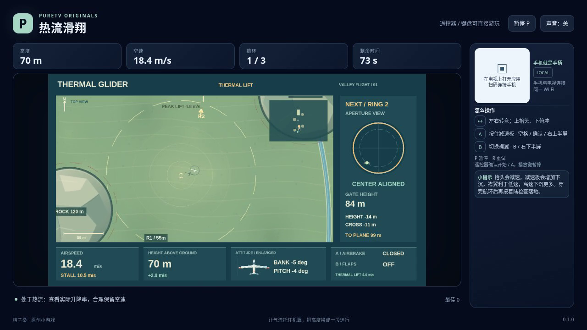

# 热流滑翔 / Thermal Glider

驾驶无引擎滑翔翼穿过山谷中的观测圈，借热气流补充高度，最后平稳降落。抬头会把空速换成高度，俯冲则反向交换；转弯、刹车和失速都会加快能量消耗。

- 作者：ecojust / 桔子桑
- 包名：`com.ecojust.thermalglidertv`
- 版本：`0.1.0`
- 电视系统：Android 8.0 / API 26 及以上
- 图标：[logo.svg](logo.svg)

发布产物：[APK](thermal-glider-0.1.0.apk) · [实际游玩视频](docs/gameplay-0.1.0.mp4) · [验证记录](docs/verification.json)



## 操作

手机与电视接入同一局域网，扫描电视画面的二维码。左侧摇杆左右控制倾斜转向，向上抬头、向下俯冲。右侧上半区 A 按住打开空气刹车，松开收起；下半区 B 切换襟翼，按住不会连续切换。

键盘方向键或 WASD 控制转向和俯仰，按住空格或 Enter 使用空气刹车，B 切换襟翼，P 暂停，R 重试。电视遥控器方向键控制飞行，按住确认键刹车、菜单键切换襟翼。手机 START 开始或暂停；开始与结算菜单可用左右方向选择航线，B 切换声音。

空气刹车增加减速作用和下沉，适合留足高度后使用；较陡俯冲时，重力仍可能让空速上升。展开襟翼改善低速滑翔并降低失速速度，但高速时阻力更大；它不会凭空增加高度或立即改写空速。失速与普通下降不同：速度太低会额外损失高度，需要在撞地前恢复。

热流区域内部的上升气流越靠近中心越强，离开后不保留额外奖励；飞机的净爬升或下降还取决于俯仰和下沉损耗。风会改变地面移动方向和地速，不能只看机头朝向判断能否对准跑道。

三条航线分别有 3、3、4 个观测圈，必须按顺序从正向穿过，并为整个翼展留出空间。最后一次穿圈不等于完成任务：实际接地时，还必须让飞机完整位于跑道内，同时满足空速、地速、下沉速度、倾斜、俯仰、机头方向和地面航迹的限制，且不能处于失速状态。

撞山、在不满足着陆条件时接地、飞出安全区域，或耗尽 90 秒有效时间，都会结束本局。暂停不推进飞行或重复领取热流；重试会恢复飞机、航线、配置与时间。

## 源码与验证

本作采用确定性的质点滑翔近似。空速动能与高度势能之间的交换、热流输入、刹车和下沉损耗有独立能量账本；水平风只改变地面位移。碰撞与穿圈按每个模拟步的整段路径检查，避免高速运动漏过山体或重复领取观测圈。

精确规则见 [模型契约](docs/model-contract.md)。

```bash
node --test resource/apps/thermal-glider/tests/game-model.test.cjs
node resource/apps/thermal-glider/tests/independent-flight-review.mjs
node resource/apps/thermal-glider/tests/independent-pilot-review.mjs
```

[独立飞行报告](docs/independent-flight-review.json)核对能量、热流边界、整段碰撞、穿环顺序和接地合取条件，并用另一套只读取公开航线与风场的反馈控制完成三条新局。合成接地夹具与完整模型飞行分别标明，不作为浏览器录像。

[操作脚本独立报告](docs/independent-pilot-review.json)比较相同公开观察与不同私有数据下的按键结果，检查实例隔离、暂停、重试、襟翼按放和错误输入；这些小型受控观察不执行生产模型，也不宣称通关。

独立模型验证、操作脚本检查、实际浏览器录像和布局检查分别记录；它们不代表实体电视或手机实测。最终验证记录随发布产物提供。

手机手柄与 Android 宿主组件见 [game-kit](../../game-kit/README.md)。源码与原创素材遵循仓库 [MIT 许可证](../../../LICENSE)。
