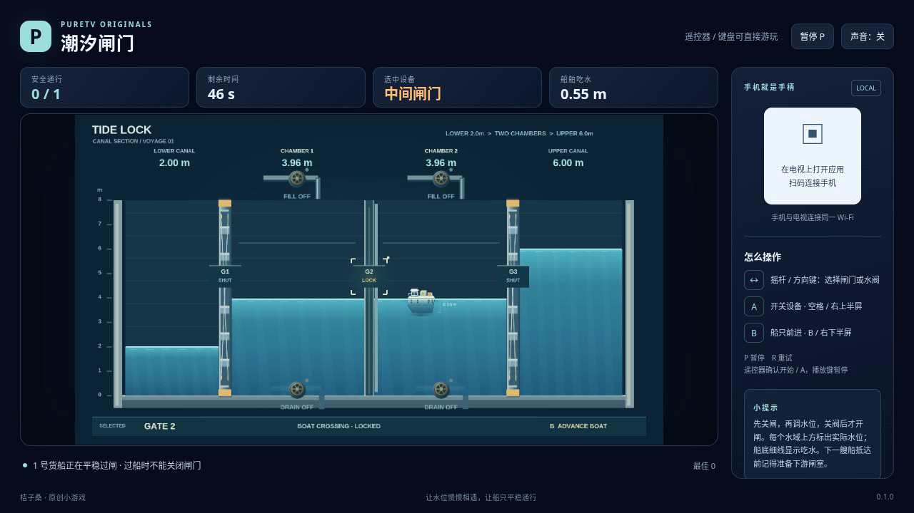

# 潮汐闸门 / Tide Lock

通过两级船闸，把货船从低水位入口送到高水位出口。调节闸室的进水、排水阀，让相邻水面接近后再开启闸门。船体正在过门时不能关门；过量灌水会溢流，排水过多会使船搁浅。

- 作者：ecojust / 桔子桑
- 包名：`com.ecojust.tidelocktv`
- 版本：`0.1.0`
- 电视系统：Android 8.0 / API 26 及以上
- 图标：[logo.svg](logo.svg)

[下载安装包](tide-lock-0.1.0.apk) · [实际游玩视频](docs/gameplay-0.1.0.mp4) · [验证记录](docs/verification.json)



## 操作

手机与电视接入同一局域网，扫描电视画面中的二维码。左侧任意位置拖动摇杆选择闸门或阀门；右侧上半区切换所选设备，下半区请求当前货船前进。

键盘方向键或 WASD 选择，空格对应 A，B 请求前进，Enter 开始，P 暂停，R 重试。电视遥控器方向键选择，确认键对应 A，菜单键对应 B。开始与结算菜单可用左右方向选择关卡，手机 START 开始或暂停。

先确认船所在区域及下一道门两侧的水位。需要升降水位时关闭闸门，操作相应进排水阀；水位接近后关闭阀门，再开闸、前进。全部货船离开末闸才算完成，过门或进入下一闸室不会提前计为送达。

## 实现与验证

采用固定步长的闸室水量模型，记录进排水和外部水池交换；阀门关闭后不会凭空增加水量。船体沿闸道移动，位置与水面、底板和闸门状态关联。画面采用船闸剖面与原创烘焙素材，便于观察水位、阀门及船只状态。

```bash
node --test resource/apps/tide-lock/tests/game-model.test.cjs
node resource/apps/tide-lock/tests/independent-water-review.mjs
```

20 组规则测试覆盖水位差开门边界、闸阀互锁、水量守恒、过船、溢流、搁浅、超时和重试。独立核对包含 50,000 组门网、5,000 组进排水组合，以及三关的正常输入通关；后续船只仍需实际操作闸阀，没有自动重置水位。该简化水量模型忽略船只排水体积。

构建与手机手柄组件见 [game-kit](../../game-kit/README.md)。最终浏览器操作、录像与签名包验证结果保存在本目录中。录像使用打包资源在 Chromium 中实际运行；此次未连接实体电视或手机。

源码与原创素材遵循仓库 [MIT 许可证](../../../LICENSE)。
