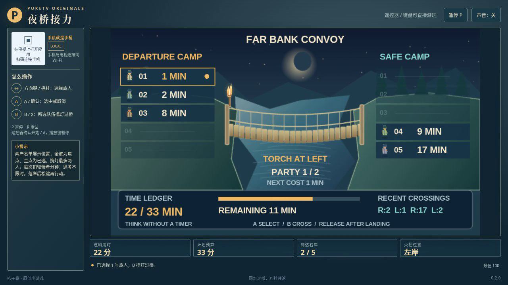

# 夜桥接力 / Torch Bridge

0.2.0：[签名安装包](torch-bridge-0.2.0.apk) · [六关实际游玩录像](docs/gameplay-0.2.0.mp4) · [验证记录](docs/verification.json)

本版共六关，新增三关。浏览器普通输入验证已完成；尚未进行实体电视或手机测试。



一盏火把、一座最多容纳两人的桥，以及速度各不相同的旅人。你需要安排他们往返，把所有人送到右岸，并让总耗时不超过预算。

| 夜桥 | 各旅人的过桥时间（逻辑分钟） | 预算 |
| --- | --- | --- |
| 初灯渡口 | 1、2、5、10 | 19 分钟 |
| 雾桥同行 | 1、3、6、8、12 | 31 分钟 |
| 午夜接力 | 1、2、4、7、11、16 | 37 分钟 |
| 独行引路 | 1、5、7、13 | 27 分钟 |
| 远岸护送 | 1、2、8、9、17 | 33 分钟 |
| 长夜商队 | 1、4、6、13、18、23 | 57 分钟 |

0.2.0 将原三关扩为六关。新增“独行引路”需要比较单个快者陪同与双快者中转，“远岸护送”面对两个接近的慢速旅人，“长夜商队”需在六人队伍中分配回程。三组新关卡的独立最优排程分别为 27、33、57 分钟；后三关预算等于最优值，需要精确排程，原三关保留两分钟余量。

界面采用左右营地、中央峡谷吊桥与底部时间账本；手机连接与操作说明放在左侧旅行栏，游戏画面不再被固定右侧大面板挤压。

**思考不限时。** 这里的分钟是排程成本，不是现实倒计时；每次 0.4 秒的过桥动画也不会另加分钟。

## 操作

- 左／上：选择名单中的上一位旅人；右／下：下一位，到两端停止。
- A：选择或取消当前旅人。键盘空格、Z、Enter，遥控器确认，或手机右上区域。
- B：所选队伍携灯过桥。键盘 X，或手机右下区域。
- P / Escape / START 暂停；R / SELECT 重试。

只能选择火把所在岸的一或两人。每次前进或返回，都按这队中**较慢者**的时间计算，落岸后一次结算。两侧营地名单直接显示每位旅人的位置，中央吊桥呈现正在行进的队伍与火把。金框是当前旅人，金点表示已选中；底部时间账本显示已用预算和最近四次往返。

过桥动画期间不能再选人或出发；落岸后松开按键再继续。空队伍、超过两人或选择另一岸的人都不会扣分钟。火把必须随人返回，没有自动回送或撤销。

全员在预算内到达右岸即获胜，恰好用完预算也可以。如果落岸后已经用尽预算而仍有人在左岸，或全员到岸却超出预算，则失败。允许开始一次超预算过桥，落岸时会如实结算失败。

## 公开规则与验证

所有速度、位置、火把位置、已用分钟和本次费用始终可见；生产资产不包含最优路线或求解器。精确的状态、动画及取消输入约定见 [原版模型契约](docs/model-contract.md)（规则沿用，新增关卡见上表）。测试目录的独立最短路搜索会从公开速度计算路线，通过正常操作验证六关通关、恰好预算通关及自然失败。

```bash
node resource/apps/torch-bridge/tests/model-test.cjs
```

原创夜河、吊桥、旅人和火把素材由代码绘制，采用 [MIT 许可证](LICENSE)。浏览器键盘与软件渲染证据不等同于实体电视、手机或模拟器验证。
