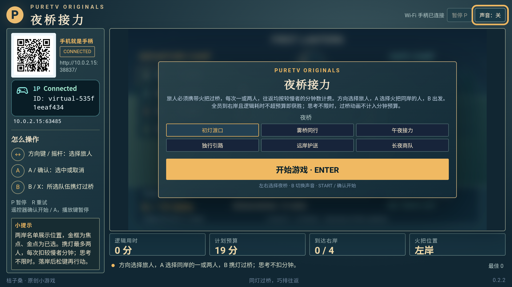
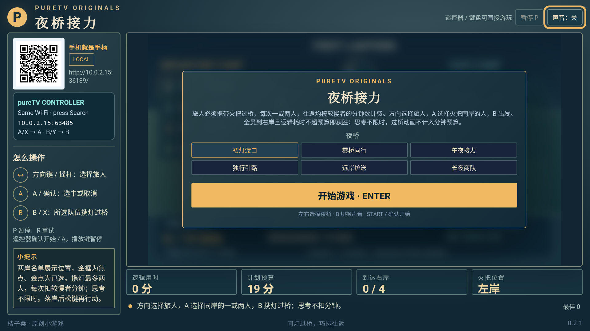

# 夜桥接力 / Torch Bridge

<!-- controller-client-status:start -->
## 0.2.2 · 手柄连接标识

<!-- apk-resource:start -->
[下载签名 APK](torch-bridge-0.2.2.apk?raw=1) · [校验值](SHA256SUMS.txt) · [签名与来源](resource.json) · [源码](src/) · [图标](logo.svg)
<!-- apk-resource:end -->

Android **0.2.2 / versionCode 4**：手柄连接后，侧边显示手柄图标、玩家席位（按游戏人数显示 1P/2P）和设备完整连接 ID；断开后隐藏。默认 TCP 端口仍为 **63485**。当前手柄固件未上报 RSSI，因此不显示信号强弱。

[连接截图](docs/releases/0.2.2/connected.png) · [连接状态专项录像](docs/releases/0.2.2/controller-status.mp4?raw=1) · [版本验证](docs/releases/0.2.2/verification.json) · [20 款更新记录](../../../docs/controller-client-status/README.md)

安装包沿用原发布证书。本轮在 Android TV 模拟器中验证连接身份、断开／重连状态及同证书覆盖安装；截图和录像记录菜单中的连接状态专项，没有重做完整玩法验收。未改规则模型按精确哈希复用历史依据，旧版报告继续保留。尚未验证实体电视、手机、ESP32 或带已有存档的升级与数据保留。


<!-- controller-client-status:end -->

历史 0.2.0：[签名安装包](torch-bridge-0.2.0.apk) · [六关实际游玩录像](docs/gameplay-0.2.0.mp4) · [旧版验证记录](https://github.com/ecojust/pureTV/blob/bf58393ba8fa8bb3bdf731ab24f9ab09d90f5075/resource/apps/torch-bridge/docs/verification.json)。这些旧版记录作为未改变规则的回归依据，不代表本轮界面、手柄链路或 Android 实包验收。

一盏火把、一座最多容纳两人的桥，以及速度各不相同的旅人。你需要安排他们往返，把所有人送到右岸，并让总耗时不超过预算。

| 夜桥 | 各旅人的过桥时间（逻辑分钟） | 预算 |
| --- | --- | --- |
| 初灯渡口 | 1、2、5、10 | 19 分钟 |
| 雾桥同行 | 1、3、6、8、12 | 31 分钟 |
| 午夜接力 | 1、2、4、7、11、16 | 37 分钟 |
| 独行引路 | 1、5、7、13 | 27 分钟 |
| 远岸护送 | 1、2、8、9、17 | 33 分钟 |
| 长夜商队 | 1、4、6、13、18、23 | 57 分钟 |

0.2.0 将原三关扩为六关。新增“独行引路”需要比较单个快者陪同与双快者中转，“远岸护送”面对两个接近的慢速旅人，“长夜商队”需在六人队伍中分配回程。三组新关卡的独立最优排程分别为 27、33、57 分钟；后三关预算等于最优值，需要精确排程，原三关保留两分钟余量。

界面采用左右营地、中央峡谷吊桥与底部时间账本；手机连接与操作说明放在左侧旅行栏，游戏画面不再被固定右侧大面板挤压。

**思考不限时。** 这里的分钟是排程成本，不是现实倒计时；每次 0.4 秒的过桥动画也不会另加分钟。

## 操作

- 左／上：选择名单中的上一位旅人；右／下：下一位，到两端停止。
- A：选择或取消当前旅人。键盘空格、Z、Enter，遥控器确认，或手机右上区域。
- B：所选队伍携灯过桥。键盘 X，或手机右下区域。
- P / Escape / START 暂停；R / SELECT 重试。

只能选择火把所在岸的一或两人。每次前进或返回，都按这队中**较慢者**的时间计算，落岸后一次结算。两侧营地名单直接显示每位旅人的位置，中央吊桥呈现正在行进的队伍与火把。金框是当前旅人，金点表示已选中；底部时间账本显示已用预算和最近四次往返。

过桥动画期间不能再选人或出发；落岸后松开按键再继续。空队伍、超过两人或选择另一岸的人都不会扣分钟。火把必须随人返回，没有自动回送或撤销。

全员在预算内到达右岸即获胜，恰好用完预算也可以。如果落岸后已经用尽预算而仍有人在左岸，或全员到岸却超出预算，则失败。允许开始一次超预算过桥，落岸时会如实结算失败。

## 公开规则与验证

所有速度、位置、火把位置、已用分钟和本次费用始终可见；生产资产不包含最优路线或求解器。精确的状态、动画及取消输入约定见 [原版模型契约](docs/model-contract.md)（规则沿用，新增关卡见上表）。测试目录的独立最短路搜索会从公开速度计算路线，通过正常操作验证六关通关、恰好预算通关及自然失败。

```bash
node resource/apps/torch-bridge/tests/model-test.cjs
```

原创夜河、吊桥、旅人和火把素材由代码绘制，采用 [MIT 许可证](LICENSE)。浏览器键盘与软件渲染证据不等同于实体电视、手机或模拟器验证。

## pureTV Wi-Fi 手柄

从 0.2.1 起，电视游戏提供 pureTV TCP 手柄服务，默认端口 **63485**。电视和手柄连同一个局域网，在游戏显示连接地址后按手柄 GPIO23 搜索键；同网仅保留一个目标游戏服务，固件才会自动选中。若端口被占用，以游戏显示的实际端口为准。

- 方向键：对应游戏内方向操作和菜单选关。
- START：开始、暂停或继续。
- A / X：选择旅人。
- B / Y：携灯过桥。

断线或切换控制来源会暂停并清除旧输入；重新连接后松开按键，再按 START 继续。临时失焦时保留TCP连接并隔离输入，真正退出游戏时关闭服务。遥控器、键盘和扫码手机入口继续可用。

虚拟手柄联调：`python3 puretv-joystick/bridge.py 电视IP --port 63485`，再打开 `http://127.0.0.1:8767/`。使用备用端口时替换命令中的端口。验证范围见[20款游戏接入记录](../../../docs/readme-controller-support/README.md)。

<!-- controller-client-status-history:start -->
<details>
<summary>历史 0.2.1 安装包与验收记录</summary>

以下为旧版发布记录，其测试与画面不代表本次连接 ID 界面验收。[原提交中的完整说明](https://github.com/ecojust/pureTV/blob/9af9f197855eb7a0ce7174c0e6295c8974b3250d/resource/apps/torch-bridge/README.md)。

**0.2.1 · pureTV 手柄更新：** [签名安装包](torch-bridge-0.2.1.apk) · [Android 实包手柄回归录像](docs/releases/0.2.1/gameplay.mp4) · [版本验证](docs/releases/0.2.1/verification.json) · [当时接入记录](../../../docs/readme-controller-support/README.md)

新增 pureTV Wi-Fi 手柄支持，默认端口 **63485**，显示真实连接状态，断线时暂停并清除输入。保留原六关及规则，遥控器和扫码手机仍可使用。

该历史版 APK 已签名，并在 Android TV API 36 模拟器中完成同证书覆盖安装验证，通过全部 8 项手柄验收，覆盖开始、实际游戏操作、暂停恢复、断线重连、九键输入及逐消息 ACK。下图和上方录像来自该历史版本实际 APK；录像记录手柄回归过程，不是六关通关录像。尚未进行实体电视、手机或 ESP32 测试。



</details>
<!-- controller-client-status-history:end -->
