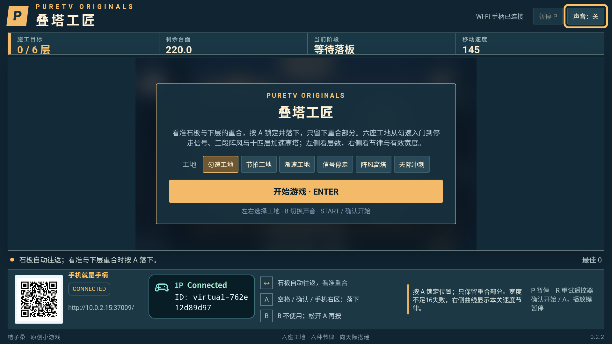
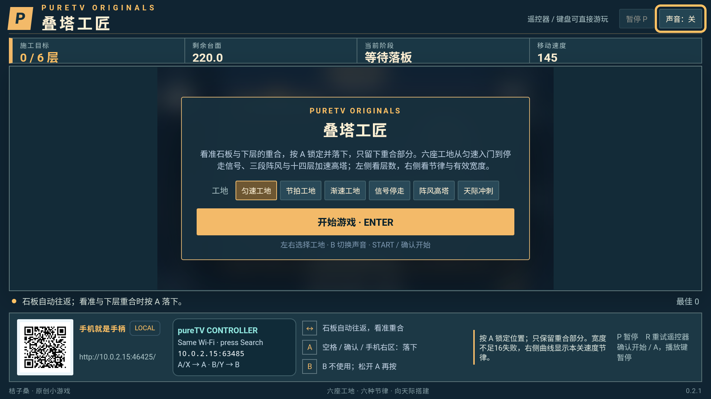

# 叠塔工匠 / Tower Overlap

## Android 0.2.3 · 手柄与手机连接

<!-- apk-resource:start -->
[下载签名 APK](tower-overlap-0.2.3.apk?raw=1) · [校验值](SHA256SUMS.txt) · [安装包与源码](resource.json)
<!-- apk-resource:end -->

可用键盘、pureTV Wi-Fi 手柄，或用同一局域网内的手机扫描电视房间二维码。连接标识区分玩家，连接与断开时保留游戏画布尺寸。[连接手柄指南](../../../docs/guide/README.md#安装游戏与连接手柄)

此签名 APK 已从 0.2.2 在 Android TV 模拟器完成覆盖安装。原版手柄 SDK 通过 8 项检查，实际发出的 59 条消息全部收到同序号确认。[游戏截图](docs/releases/0.2.3/gameplay.png) · [Android 玩法录像](docs/releases/0.2.3/gameplay.mp4?raw=1) · [验证记录与测试范围](docs/releases/0.2.3/verification.json)

<!-- controller-client-status:start -->
## 历史版本 0.2.2 · 手柄连接标识

<!-- previous-apk-resource:start -->
[下载签名 APK](tower-overlap-0.2.2.apk?raw=1) · [校验值](SHA256SUMS.txt) · [签名与来源](resource.json) · [源码](src/) · [图标](logo.svg)
<!-- previous-apk-resource:end -->

Android **0.2.2 / versionCode 4**：手柄连接后，侧边显示手柄图标、玩家席位（按游戏人数显示 1P/2P）和设备完整连接 ID；断开后隐藏。默认 TCP 端口仍为 **63485**。当前手柄固件未上报 RSSI，因此不显示信号强弱。

[连接截图](docs/releases/0.2.2/connected.png) · [连接状态专项录像](docs/releases/0.2.2/controller-status.mp4?raw=1) · [版本验证](docs/releases/0.2.2/verification.json) · [20 款更新记录](../../../docs/controller-client-status/README.md)

安装包沿用原发布证书。本轮在 Android TV 模拟器中验证连接身份、断开／重连状态及同证书覆盖安装；截图和录像记录菜单中的连接状态专项，没有重做完整玩法验收。未改规则模型按精确哈希复用历史依据，旧版报告继续保留。尚未验证实体电视、手机、ESP32 或带已有存档的升级与数据保留。

<!-- controller-client-status:end -->

历史 0.2.0：[签名安装包](tower-overlap-0.2.0.apk) · [六关实际游玩录像](docs/gameplay-0.2.0.mp4) · [旧版验证记录](https://github.com/ecojust/pureTV/blob/bf58393ba8fa8bb3bdf731ab24f9ab09d90f5075/resource/apps/tower-overlap/docs/verification.json)。这些旧版记录作为未改变规则的回归依据，不代表本轮界面、手柄链路或 Android 实包验收。

0.2.0 将工地扩充为六关，并重做为中央塔楼、左侧楼层标尺和右侧落点／节律仪表；手机连接与操作说明位于画面下方的横向施工台。

石板在塔楼上方自动往返。看准与下层重合的位置，按 A 落下；石板会锁定水平位置，经过 **0.3 秒有效游戏时间**后落地。只有重合的部分留下，多余边缘切落。下一块石板与留下的台面同宽，并从另一侧驶入。

- 完全错开下层，立即失败。
- 重合宽度大于0但不足 **16 单位**，也会失败；正好16可以继续。
- 完成指定楼层数即获胜，初始底座不计入楼层。
- 没有倒计时，也没有自动对齐。

| 工地 | 初始宽度 | 基础速度 | 目标楼层 | 移动节律 |
| --- | --- | --- | --- | --- |
| 匀速工地 | 220 | 145 单位/秒 | 6 | 匀速 |
| 节拍工地 | 200 | 170 单位/秒 | 8 | 每0.8秒在1.2倍与0.8倍速度之间切换 |
| 渐速工地 | 180 | 195 单位/秒 | 10 | 每1.2秒从0.7倍线性加速到1.3倍，再减速回来 |
| 信号停走 | 205 | 175 单位/秒 | 8 | 每1.8秒循环：先停0.35秒，再以1.2倍速度行进；观察停走信号抓准落点 |
| 阵风高塔 | 190 | 180 单位/秒 | 12 | 每1.5秒循环：0.45秒慢行、0.45秒急行、0.6秒回稳，倍率为0.55／1.6／0.9 |
| 天际冲刺 | 170 | 185 单位/秒 | 14 | 每2秒从0.55倍线性加速到1.45倍后重新降速；窄底座与更高目标需要连续精确落板 |

每块新石板都会重新开始对应节律；水平边界为宽600单位的工地。碰到边界会反弹，方向无法手动控制。

## 操作

**只需一个动作：A 落下。** 键盘空格、Z、Enter 或遥控器确认；手机右侧整个三分之一区域均为 A。方向和 B 不操纵石板。每次落下后松开再按，长按不会自动连续落下；下落过程中按出的动作也不会排队到下一块石板。

P / Escape / START 暂停，R / SELECT 重新开始。真正暂停会冻结移动和下落时间；取消触控或释放控制本身不会暂停正在进行的动作。

竖虚线标出当前台面两侧，浅色框预览当前水平位置的落点。右侧显示真实重合宽度、台面宽度、当前速度和完整速度曲线，移动指针标出当前节律相位；左侧楼层标尺随目标层数缩放，十四层高塔也保持全部可见。预览不会改变石板位置。若重合太窄，下一层的容错空间会相应减小。

精确运动积分、边界反弹、输入与结算顺序见 [模型契约](docs/model-contract.md)。浏览器验收使用普通墙钟和真实键盘输入；离线时序测试、软件渲染及录像不能代表实体电视或手机表现。代码和原创建筑素材采用 [MIT 许可证](LICENSE)。

## pureTV Wi-Fi 手柄

从 0.2.1 起，电视游戏提供 pureTV TCP 手柄服务，默认端口 **63485**。电视和手柄连同一个局域网，在游戏显示连接地址后按手柄 GPIO23 搜索键；同网仅保留一个目标游戏服务，固件才会自动选中。若端口被占用，以游戏显示的实际端口为准。

- 方向键：菜单选关；游戏中的石板自动往返，无需方向控制。
- START：开始、暂停或继续。
- A / X：落下石板。
- B / Y：不使用。

断线或切换控制来源会暂停并清除旧输入；重新连接后松开按键，再按 START 继续。临时失焦时保留TCP连接并隔离输入，真正退出游戏时关闭服务。遥控器、键盘和扫码手机入口继续可用。

虚拟手柄联调：`python3 puretv-joystick/bridge.py 电视IP --port 63485`，再打开 `http://127.0.0.1:8767/`。使用备用端口时替换命令中的端口。验证范围见[20款游戏接入记录](../../../docs/readme-controller-support/README.md)。

<!-- controller-client-status-history:start -->

历史 0.2.1 安装包与验收记录

以下为旧版发布记录，其测试与画面不代表本次连接 ID 界面验收。[原提交中的完整说明](https://github.com/ecojust/pureTV/blob/9af9f197855eb7a0ce7174c0e6295c8974b3250d/resource/apps/tower-overlap/README.md)。

**0.2.1 · pureTV 手柄更新：** [签名安装包](tower-overlap-0.2.1.apk) · [Android 实包手柄回归录像](docs/releases/0.2.1/gameplay.mp4) · [版本验证](docs/releases/0.2.1/verification.json) · [当时接入记录](../../../docs/readme-controller-support/README.md)

新增 pureTV Wi-Fi 手柄支持，默认端口 **63485**，显示真实连接状态，断线时暂停并清除输入。保留原六关及规则，遥控器和扫码手机仍可使用。

该历史版 APK 已签名，并在 Android TV API 36 模拟器中完成同证书覆盖安装验证，通过全部 8 项手柄验收，覆盖开始、实际游戏操作、暂停恢复、断线重连、九键输入及逐消息 ACK。下图和上方录像来自该历史版本实际 APK；录像记录手柄回归过程，不是六关通关录像。尚未进行实体电视、手机或 ESP32 测试。

<!-- controller-client-status-history:end -->
