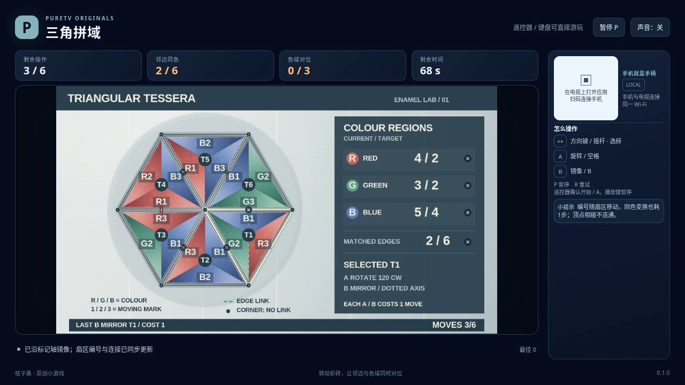

# 三角拼域 / Triangular Tessera

旋转或镜像六块三角彩砖，让每条共享边两侧颜色相同，并让红、绿、蓝三种颜色的连通域数量分别等于目标。彩砖上的编号随操作移动；同色相碰是否连通，取决于它们是否共享一段边界。

- 作者：ecojust / 桔子桑
- 包名：`com.ecojust.triangulartesseratv`
- 版本：`0.1.0`
- 电视系统：Android 8.0 / API 26 及以上
- 图标：[logo.svg](logo.svg)

发布产物：[APK](triangular-tessera-0.1.0.apk) · [实际游玩视频](docs/gameplay-0.1.0.mp4) · [验证记录](docs/verification.json)

## 操作

手机与电视接入同一局域网，扫描电视画面的二维码。摇杆选择彩砖，A 将所选砖顺时针旋转120°，B 沿该砖标示的固定轴镜像。镜像保持轴对面的边扇区位置，交换另外两个扇区。B 不是撤销，也不会翻出另一套隐藏颜色。

键盘使用方向键或 WASD 选择，空格或 Enter 为 A，B 镜像，P 暂停，R 重试。电视遥控器使用方向键、确认键和菜单键；手机 START 开始或暂停。开始与结算菜单可用左右方向选择关卡，B 切换声音。游戏中 A、B 每次按下只触发一次，按住不会连续操作。

## 色域与步数

每块三角砖分成三个带固定编号的彩色扇区。每个扇区保留编号和颜色，操作只改变所在槽位。同一块砖内，同色扇区共享从中心到顶点的线段，因此相连；相邻砖之间，只有共享整条边且两侧颜色相同才相连。只碰到一个顶点不算相连，六块砖共同接触的中心点也不会把所有同色区域接通。朝向棋盘外缘的扇区同样计入色域。

六条内部共享边都必须匹配，红、绿、蓝的色域数也必须各自精确等于目标。仅把所有边接上仍可能留下错误的色域分配。三个固定关卡分别允许6、7、8次操作。

**每次旋转或镜像都消耗一步，包括交换了两个同色扇区的操作。** 编号能显示这种实际变化。连续镜像两次会恢复原来的完整编号布局，但已经消耗的两步和时间不会退还。没有撤销或免费复原操作。

每次操作后立即核对当前布局，两项检查同时满足便自动获胜；最后一步恰好完成也能过关。用完步数仍未完成则失败。90秒有效时间耗尽优先于输入和成功判定。

暂停不消耗有效时间。分数取决于当前已匹配的边、已达到目标的颜色种类以及获胜奖励，不会因来回操作而累积。终局后布局与计时冻结；R 重新开始当前固定关卡。

## 源码与验证范围

精确几何、编号排列、公共字段、输入顺序及关卡初态见 [模型契约](docs/model-contract.md)。生产模型只保存公开布局与规则，不包含参考解、自动拼图或强制胜利入口。

本款六砖结构有一项可证明的关系：色域总数等于14减去已匹配共享边数。三个目标的色域总数都是8，因此所有颜色的目标都满足时，共享边也必然全部匹配；反过来，所有边匹配并不足以保证各颜色的目标正确。界面分别显示两项检查，不把它们描述为双向独立条件。

[独立规则报告](docs/independent-tessera-review.json) 的4组检查使用整数坐标的正长共享线段重建连通图，并完整枚举每关2916种颜色布局、计入46656种物理编号姿态。独立求得三关最少4、5、6步；仅旋转或仅镜像都无法完成。每关都有预算内“全边匹配但色域分配错误”的公开证书，第一关另以普通方向和 A/B 输入实际到达并确认没有获胜。

独立审查还重算了既有三胜三败记录中的公开快照，核对扇区编号、色域、动作回执与收费，没有重新运行这六局。三局胜利都先镜像两次恢复完整编号布局并消耗两步，再在最后一个允许操作上完成。几何小夹具和枚举结果不作为浏览器通关或录像时长证据。

复核脚本为 [independent-tessera-review.mjs](tests/independent-tessera-review.mjs)，数学模块为 [independent-tessera-math.mjs](tests/independent-tessera-math.mjs)。运行主脚本时需要通过 `--ordinary-report` 提供既有六局的原始报告及同目录逐局快照；它核验原始证据，不会自行重跑操作脚本。报告保留这些输入文件的 SHA-256。

[独立操作脚本报告](docs/independent-pilot-review.json) 使用另造的公开观察夹具，完成4组隔离检查：16次观察、4次导出函数调用、3次诊断，以及另计的3次工厂调用，总计26次。私有字段读取和状态写入均为0；其中一次观察故意交换同色扇区的编号，确认即使颜色与色域数相同，错误的物理编号也会被拒绝。这些合成观察没有执行生产模型，也不作为几何正确性或真实通关证据。

独立几何检查、普通模型输入、操作脚本合成观察与浏览器实录分别记录。完成范围以实际验证报告为准；模型或浏览器检查不代表实体电视、手机已经测试。

手机手柄与 Android 宿主组件见 [game-kit](../../game-kit/README.md)。源码与原创素材遵循仓库 [MIT 许可证](../../../LICENSE)。
