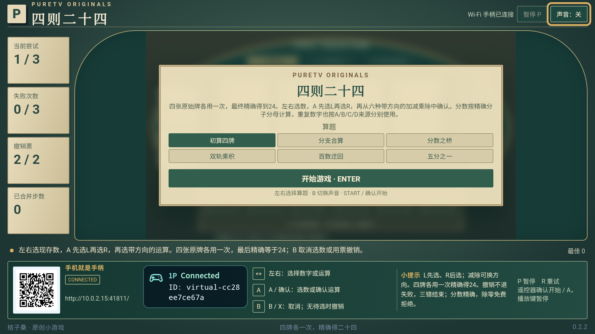
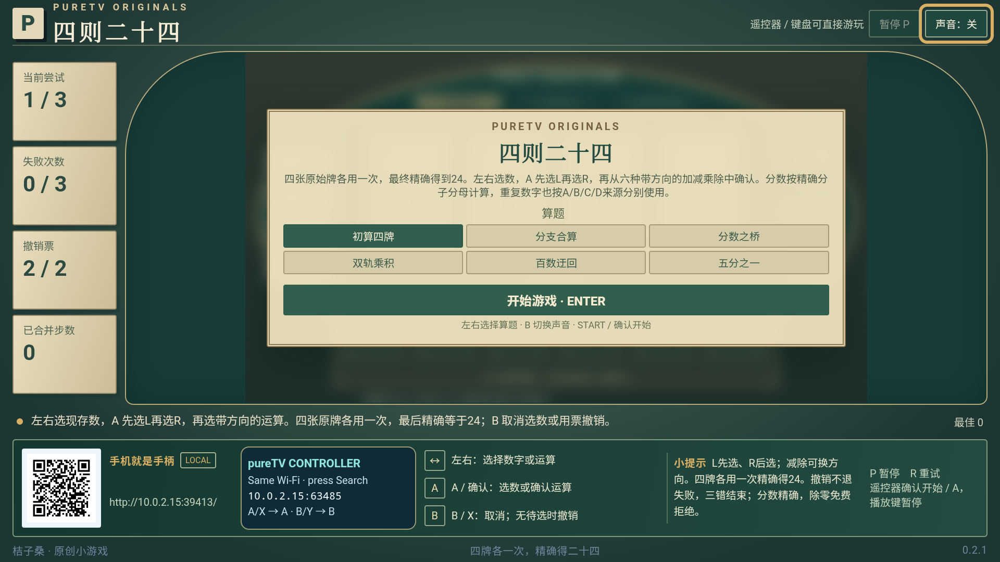

# 四则二十四 / Twenty Four

<!-- controller-client-status:start -->
## 0.2.2 · 手柄连接标识

<!-- apk-resource:start -->
[下载签名 APK](twenty-four-0.2.2.apk?raw=1) · [校验值](SHA256SUMS.txt) · [签名与来源](resource.json) · [源码](src/) · [图标](logo.svg)
<!-- apk-resource:end -->

Android **0.2.2 / versionCode 4**：手柄连接后，侧边显示手柄图标、玩家席位（按游戏人数显示 1P/2P）和设备完整连接 ID；断开后隐藏。默认 TCP 端口仍为 **63485**。当前手柄固件未上报 RSSI，因此不显示信号强弱。

[连接截图](docs/releases/0.2.2/connected.png) · [连接状态专项录像](docs/releases/0.2.2/controller-status.mp4?raw=1) · [版本验证](docs/releases/0.2.2/verification.json) · [20 款更新记录](../../../docs/controller-client-status/README.md)

安装包沿用原发布证书。本轮在 Android TV 模拟器中验证连接身份、断开／重连状态及同证书覆盖安装；截图和录像记录菜单中的连接状态专项，没有重做完整玩法验收。未改规则模型按精确哈希复用历史依据，旧版报告继续保留。尚未验证实体电视、手机、ESP32 或带已有存档的升级与数据保留。

<!-- controller-client-status:end -->

历史 0.2.0：[签名安装包](twenty-four-0.2.0.apk) · [六关实际游玩录像](docs/gameplay-0.2.0.mp4) · [旧版验证记录](https://github.com/ecojust/pureTV/blob/bf58393ba8fa8bb3bdf731ab24f9ab09d90f5075/resource/apps/twenty-four/docs/verification.json)。这些旧版记录作为未改变规则的回归依据，不代表本轮界面、手柄链路或 Android 实包验收。

四张公开整数牌各用一次，通过加、减、乘、除得到**精确的 24**。0.2.0 保留原三题并扩为六关：

| 关卡 | 原牌 | 侧重点 |
| --- | --- | --- |
| 初算四牌 | 1、2、3、4 | 基础组合与来源识别 |
| 分支合算 | 2、4、7、8 | 先后顺序与分支运算 |
| 分数之桥 | 3、3、8、8 | 必须使用分数中间值 |
| 双轨乘积 | 3、4、6、8 | 两组运算结果再组合 |
| 百数迂回 | 4、4、10、10 | 先放大数值再精确回收 |
| 五分之一 | 1、5、5、5 | 重复牌来源与必要分数 |

第三和第六题均由独立穷举证明不存在全整数中间值解。界面重新设计为绿毡算牌桌：原牌档案在左、当前数牌居中、尝试与撤销票在右、六种运算在底部同一排；外层是竖向计分纸与底部手机操作席。

左右循环选择当前数，A 先选 L，再选另一个 R，再选六种运算：L+R、L−R、R−L、L×R、L÷R、R÷L。上下不使用。运算后剩余数保持顺序，新结果放在末尾。L/R 标签明确显示先后方向。

每个结果保存规范化的整数分子／正分母，约分后精确计算；零统一为 0/1。不靠小数误差判断 24。除以 0 会免费拒绝并保留选择。A/B/C/D 分别对应左侧原牌，表达式和来源掩码保证同一原牌不重复使用，即使两张牌数值相同也各自独立。没有使用完全部四牌时，出现 24 也不算获胜。

B 优先免费取消当前未确认的选数／运算。没有待定选择时，B 可用全局两张撤销票恢复上一次合并，但**不返还累计合并步数或失败机会**。

四牌用完但结果不是 24，记一次失败并保留结果供查看。A 可重置原牌开始下一次尝试，清空旧撤销历史；B 仍可花票撤销最后一步继续下一次尝试，但失败次数保留。三次错误完整结果失败，第三次尝试正确仍可获胜。重置不补撤销票，没有倒计时或另设移动额度。

生产只保存公开原牌与精确运算规则，不含答案或通关路线。测试专用 BigInt 搜索验证可解与分数必要性，普通输入覆盖六关通关、所有运算方向、负分数、来源守恒、除零、撤销、自然三次失败及第三次成功。合成精度边界夹具另行标明。

键盘：左右 / A、D 选项；空格 / Z / Enter 确认；X / B 取消或撤销；P / Escape 暂停；R 重试。手机左摇杆左右选，右上确认，右下取消／撤销。开始、恢复或输入取消后先松开，长按不重复。

[原版公开模型契约](docs/model-contract.md)（核心运算规则沿用，新增牌组见上表）。运行模型检查：`node resource/apps/twenty-four/tests/model-test.cjs`。原创算牌、运算按键、目标印章与算台采用 [MIT 许可证](LICENSE)。软件浏览器验证不代替实体电视／手机测试。

## pureTV Wi-Fi 手柄

从 0.2.1 起，电视游戏提供 pureTV TCP 手柄服务，默认端口 **63485**。电视和手柄连同一个局域网，在游戏显示连接地址后按手柄 GPIO23 搜索键；同网仅保留一个目标游戏服务，固件才会自动选中。若端口被占用，以游戏显示的实际端口为准。

- 方向键：对应游戏内方向操作和菜单选关。
- START：开始、暂停或继续。
- A / X：确认或重置。
- B / Y：取消或撤销。

断线或切换控制来源会暂停并清除旧输入；重新连接后松开按键，再按 START 继续。临时失焦时保留TCP连接并隔离输入，真正退出游戏时关闭服务。遥控器、键盘和扫码手机入口继续可用。

虚拟手柄联调：`python3 puretv-joystick/bridge.py 电视IP --port 63485`，再打开 `http://127.0.0.1:8767/`。使用备用端口时替换命令中的端口。验证范围见[20款游戏接入记录](../../../docs/readme-controller-support/README.md)。

<!-- controller-client-status-history:start -->

历史 0.2.1 安装包与验收记录

以下为旧版发布记录，其测试与画面不代表本次连接 ID 界面验收。[原提交中的完整说明](https://github.com/ecojust/pureTV/blob/9af9f197855eb7a0ce7174c0e6295c8974b3250d/resource/apps/twenty-four/README.md)。

**0.2.1 · pureTV 手柄更新：** [签名安装包](twenty-four-0.2.1.apk) · [Android 实包手柄回归录像](docs/releases/0.2.1/gameplay.mp4) · [版本验证](docs/releases/0.2.1/verification.json) · [当时接入记录](../../../docs/readme-controller-support/README.md)

新增 pureTV Wi-Fi 手柄支持，默认端口 **63485**，显示真实连接状态，断线时暂停并清除输入。保留原六关及规则，遥控器和扫码手机仍可使用。

该历史版 APK 已签名，并在 Android TV API 36 模拟器中完成同证书覆盖安装验证，通过全部 8 项手柄验收，覆盖开始、实际游戏操作、暂停恢复、断线重连、九键输入及逐消息 ACK。下图和上方录像来自该历史版本实际 APK；录像记录手柄回归过程，不是六关通关录像。尚未进行实体电视、手机或 ESP32 测试。

<!-- controller-client-status-history:end -->
