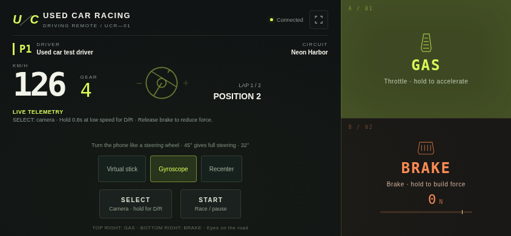
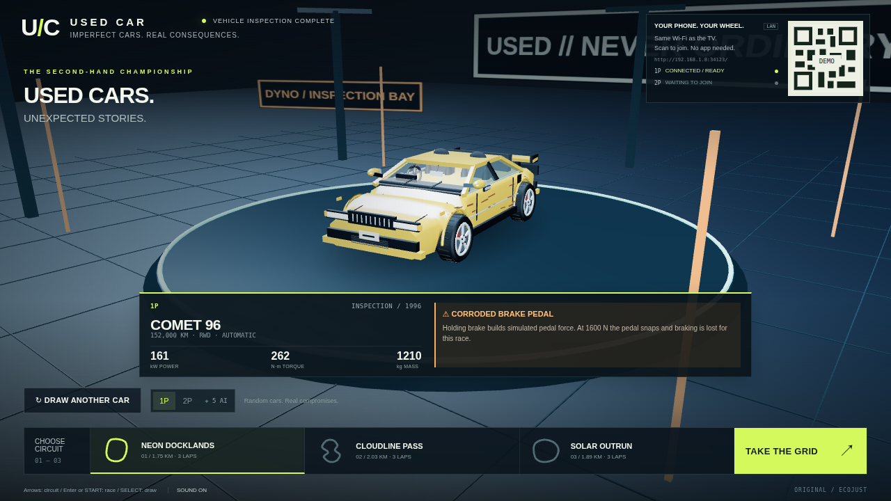
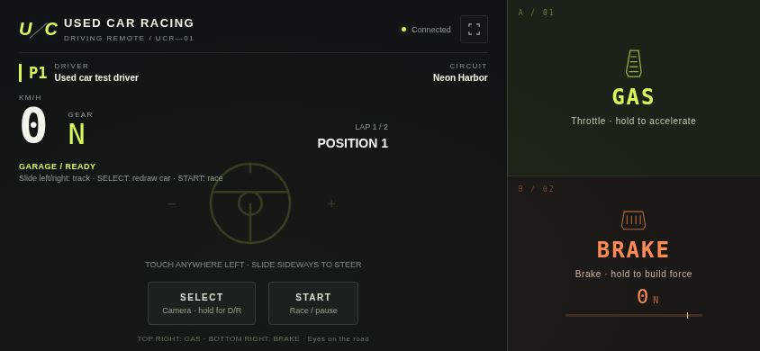
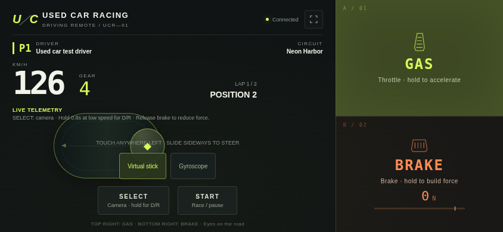

# Used Car Racing TV

<!-- apk-resource:start -->
[Download APK](used-car-racing-0.1.0.apk?raw=1) · [Checksums](SHA256SUMS.txt) · [Signing and build provenance](resource.json) · [Source code](src/) · [64×64 SVG icon](logo.svg)

The APK in this directory is signed with the pureTV release certificate. Android cannot update an existing installation of the same package if it uses a different signing certificate. Back up its data and uninstall the old package first.
<!-- apk-resource:end -->

[中文](README.md) · [English](README.en.md)

**Used Car Racing TV / 极品二手车** is an original 3D racing game. Each race starts with a randomly assigned used car and condition report. The inspection garage displays the model, power, weight, drivetrain and faults. One or two players use LAN phone controllers; AI drivers fill the remaining places in a six-car field.

This source update targets **0.1.1**, package `com.ecojust.usedcartv`, for Android 8.0 or newer TVs. See [resource.json](resource.json) for the downloadable APK’s actual version, signature and verification results.

## Playing

1. Connect the TV and phones to the same LAN, then launch the game on the TV.
2. Scan the room QR code, using one phone per player, up to two players.
3. Inspect the assigned car and faults, choose a track and player count, then start.
4. The large left area steers. The right third of the phone is divided into upper throttle and lower brake regions; steering and pedals work together. Text selection and long-press menus are suppressed in the controls.

### Choosing how to steer

The **virtual stick** is the default: touch anywhere on the left and slide sideways. It works on the shared local network without internet access.

**Gyroscope** steering lets you turn the phone like a steering wheel:

1. Choose Gyroscope on the LAN controller to open the project’s HTTPS controller page. Its initial load needs internet access and the browser must allow the new page.
2. On that page, tap Gyroscope and allow motion access when the browser requests it. A saved preference does not replace permission for this visit.
3. Hold the phone horizontally in a comfortable, slightly upright position. The first valid pose becomes center; Recenter repeats calibration. A turn of about 45° gives full steering.
4. Continue using the right-hand throttle and brake areas. In the garage, slide on the left to choose a track; motion steering applies during the countdown and race.

Use the virtual stick if permission is denied, no sensor data arrives, the new page is blocked, or the browser suspends the original LAN page in the background. The secure page has a Back to LAN button. Sensor interruption, laying the phone flat or losing focus releases the controls. Motion permissions and background-page support vary between mobile browsers, so gyroscope mode is not guaranteed on every device.

The HTTPS page serves static controller files only. Driving input still reaches the TV through the original LAN page, without a public game server.

Press SELECT in the garage to reroll the assigned cars. During a race, tap SELECT to switch between chase and hood cameras. Below **1.2 m/s**, hold SELECT for about **0.8 seconds** to toggle D forward / R reverse, then apply throttle. START begins or pauses the race.

Keyboard controls: player 1 uses Left/Right to steer, Z for throttle, X for brake and Enter to start/pause. Tap Shift for the camera or hold it at low speed for D/R; R also toggles direction at low speed. Player 2 uses A/D to steer, W for throttle and S for brake.

Braking uses **simulated pedal force**. Holding the brake increases force; releasing it quickly unloads the pedal. A car assigned a weak brake pedal loses its foot brake permanently for the current race when simulated force reaches **1600 N**. The TV displays force and failure status. An ordinary phone does not measure real pedal or finger force; this value is calculated from input and the game model.

Gyroscope controls (actual Chromium page rendering with test orientation and vehicle data):



## Cars and tracks

All six cars are original fictional models. These are their base game parameters before the randomly assigned condition affects power, tires and brakes.

| Model | Body / drivetrain | Power | Peak torque | Mass |
|---|---|---:|---:|---:|
| POCKET 98 | Compact / FWD | 82 kW | 146 N·m | 970 kg |
| EXECUTIVE 04 | Sedan / RWD | 141 kW | 255 N·m | 1460 kg |
| COMET 96 | Coupe / RWD | 161 kW | 262 N·m | 1210 kg |
| NOMAD 07 | Wagon / AWD | 148 kW | 315 N·m | 1630 kg |
| IRON 88 | Muscle / RWD | 205 kW | 425 N·m | 1570 kg |
| STRIDER 02 | Rally / AWD | 173 kW | 305 N·m | 1320 kg |

Each route is a closed circuit raced over three laps. Lengths come from the same centerline data used by rendering and vehicle physics.

| Circuit | Lap length | Actual setting |
|---|---:|---|
| NEON DOCKLANDS | Approx. 1.753 km | A harbor viaduct after rain at night, city buildings, cranes, shipping containers and water; road elevations approx. 3.7–21.0 m |
| CLOUDLINE PASS | Approx. 2.033 km | Winding mountain roads, forest, rocks, distant snowy mountains and a bridge section; elevations approx. 7.5–72.1 m |
| SOLAR OUTRUN | Approx. 1.894 km | Desert highway, solar arrays, power poles, sandstone and sunset; elevations approx. 1.9–16.1 m |

Version 0.1.1 focuses on graphics while retaining the routes, vehicle physics, random mechanical faults and one/two-player race rules. The real WebGL 1 renderer uses bundled Three.js and local graphical assets, with no texture downloads during play.

## Graphics in 0.1.1

The renderer keeps modest geometry complexity and adds 1024² color maps for asphalt, rock and the vehicle atlas, 512² color maps for the remaining environment materials, and 256–512² normal/specular maps for grain, strata, tire tread, lamp lenses and fabric. Paint, rubber, lamp lenses and fabric share a vehicle atlas; body and wheel batches reduce separate draws. The six cars share texture images. Paint, glass and metal use static environment reflections selected for the current setting, avoiding a new reflection render each frame.

In fixed six-car scenes across all three tracks, batching reduces single-player draw calls from 214–218 to 99–104 and combined split-screen calls from 391–403 to 181–195. These compare draw submissions before and after the atlas/batching changes, not TV frame-rate improvements. The [design notes](docs/design.md#合批前后绘制次数) record the environment, baseline and reproduction command.

Roads gain repairs and rubber marks, while buildings and containers use surface-scaled textures. Continuous irregular ridges replace isolated cone mountains; rocks have less regular facets and trees use alpha-tested foliage cards. Clouds, fog and directional light add depth. Route and collision boundaries still use the original road data.

The project’s [generator](../../../tools/generate-used-car-textures.py) bakes the original textures offline and packages them in the APK; see the [asset notice](src/main/assets/TEXTURE-LICENSE.txt). These changes do not use live reflection captures or full-screen post-processing. Actual TV frame rates still require device testing.

## Vehicle and circuit views

These images are produced by the actual game renderer in Chromium to show the vehicles and circuits. They are not concept art or physical-TV photographs.


## Handling model

A fixed small timestep updates engine torque and RPM, automatic gears, tire slip and friction-circle grip limits, braking and load transfer, aerodynamic drag and mechanical faults. Steering, speed and grip combine to determine the response. See the [design and physics notes](docs/design.md).

This is a reduced vehicle-dynamics game designed for phone controls and TVs. Model tests and browser rendering do not establish real-vehicle calibration or physical-TV GPU performance. Published verification records describe the checks actually completed.

## Development

```sh
node --test resource/apps/used-car-racing/tests/*.test.cjs
node resource/apps/used-car-racing/tests/compatibility.mjs
node resource/apps/used-car-racing/tests/rendering.mjs
node resource/apps/used-car-racing/tests/controller.mjs
node resource/apps/used-car-racing/tests/integration.mjs

cd resource/launcher/puretv
./gradlew :used-car-racing:assembleRelease :used-car-racing:testDebugUnitTest :used-car-racing:lintDebug :used-car-racing:verifyReleaseSize
```

Browser checks use npm dependencies from `desktop/`; `CHROMIUM_PATH` selects Chromium. `USED_CAR_UI_CAPTURE_DIR` selects the directory for captures of the actual pages. Releases use the shared pureTV v2 certificate and the independent tag `android-used-car-v0.1.1`.

Original code, cars, tracks, textures and synthesized sound use [MIT](LICENSE). Three.js retains its [upstream MIT license](src/main/assets/THREE-LICENSE.txt). No commercial racing-game ROMs, vehicle models or extracted maps are included. The project draws its own [64×64 SVG icon](logo.svg).

<!-- verified-previews:start -->
## Actual game views

Captured from the real game pages in Chromium with a simulated LAN room; these are not physical-TV photographs.






<!-- verified-previews:end -->
