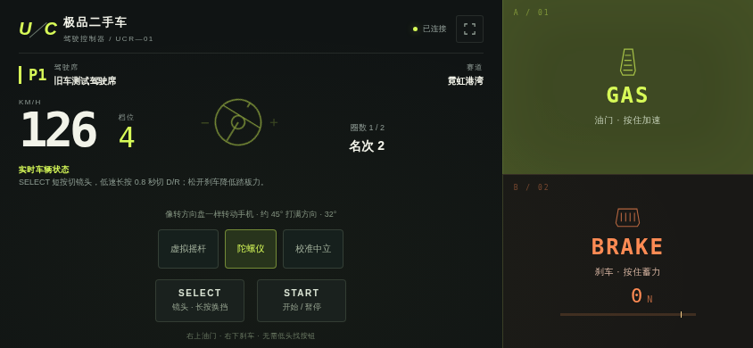
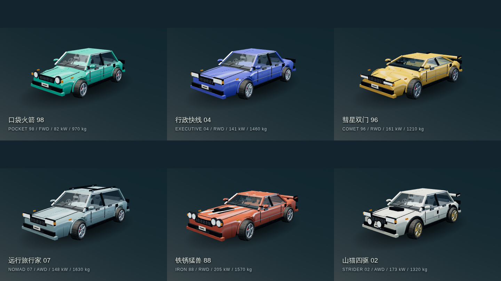
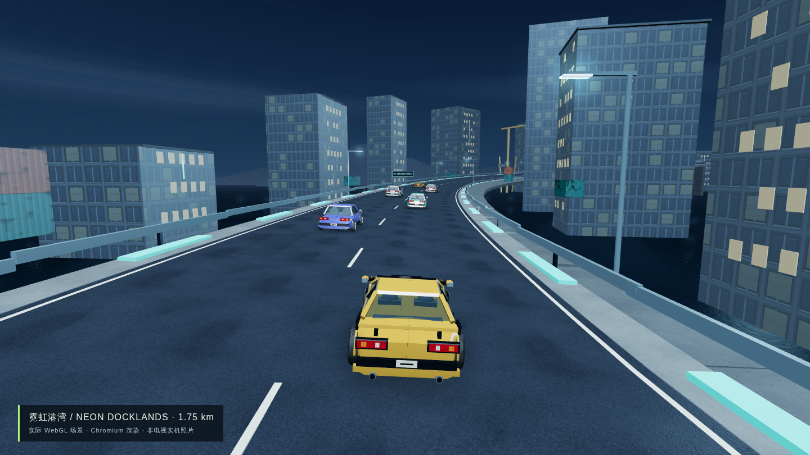
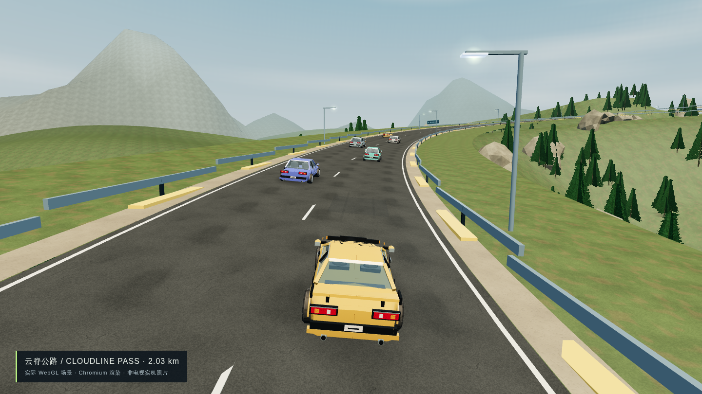
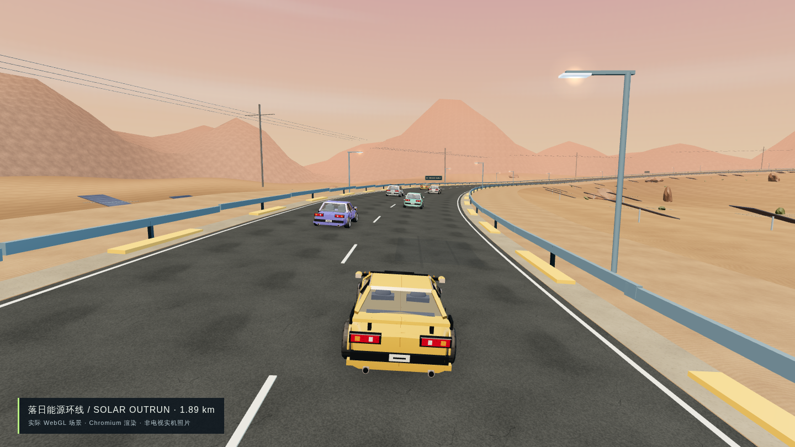
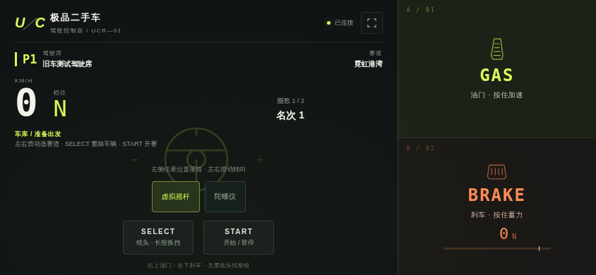
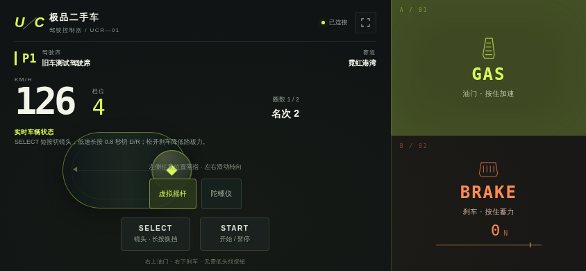

# 极品二手车

<!-- apk-resource:start -->
[下载 APK](used-car-racing-0.1.2.apk?raw=1) · [校验值](SHA256SUMS.txt) · [签名及构建来源](resource.json) · [源码](src/) · [64×64 SVG 图标](logo.svg)

此目录内 APK 使用 pureTV 发布证书签名。若设备中存在使用旧证书的同包应用，Android 无法直接覆盖安装；需先备份数据并卸载旧包。
<!-- apk-resource:end -->

[中文](README.md) · [English](README.en.md)

**极品二手车 / Used Car Racing TV** 是一款原创三维赛车游戏。开局随机获得车辆和车况，检车台展示车型、动力、重量、驱动形式以及故障说明；比赛支持一人或两人手机操控，其余车位由 AI 补齐，总计六车同场。

本次源码更新版本为 **0.1.2**，包名 `com.ecojust.usedcartv`，适用于 Android 8.0 及以上电视。可下载 APK 的实际版本、签名与验证结果以 [resource.json](resource.json) 为准。

## 开始比赛

1. 手机和电视连接同一局域网，在电视上打开游戏。
2. 扫描电视房间二维码；每位玩家使用一部手机，最多两人。
3. 在检车台查看随机车辆及故障，选择赛道和人数，再开始比赛。
4. 手机左侧大区域转向，右侧三分之一分为上方油门、下方刹车；油门、刹车可与转向同时操作。操作区禁止文字选择和长按菜单。

### 选择转向方式

默认使用**虚拟摇杆**：手机左侧任意位置落指，左右滑动转向。电视与手机连接同一局域网即可使用，不需要互联网。

**陀螺仪**可像转方向盘一样转动手机。0.1.2 的安全手柄页面和 WSS 连接由电视 APK 在局域网内提供，不需要公网域名、GitHub Pages 或公网转发。

每部手机首次连接这台电视时，需要先建立证书信任：

1. 在扫码打开的手柄页面选择「陀螺仪」，在自己可信的局域网内按本地设置引导下载电视证书。通过系统证书详情或可信证书查看器，核对**下载证书本身**的完整 SHA-256 指纹与电视屏幕一致；HTTP 引导页中的摘要仅供对照。
2. Android 在系统设置中安装该 CA 证书；iPhone 安装下载的证书描述文件后，还需到「设置 → 通用 → 关于本机 → 证书信任设置」开启该证书的完整信任。具体步骤见[手机证书设置](docs/phone-trust.md)。
3. 返回手柄，点击「已信任，进入安全手柄」，或扫描电视上的「已信任证书」二维码。在同一个手柄页面选择「陀螺仪」，按浏览器提示允许运动传感器权限。
4. 横握手机并稍微立起，保持舒适姿态；首次有效姿态自动设为中立，也可点「校准中立」重新校准。左右转动约 45° 达到最大转向。
5. 随时选择「虚拟摇杆」切回触控转向。两位玩家各自选择模式；右侧油门、刹车始终使用触控。检车台仍通过左侧滑动选择赛道，倒计时及比赛中使用姿态转向。

安装 CA 是**手机系统级证书信任**，与浏览器的**运动传感器授权**是两件事。仅在浏览器证书警告中点「继续访问」不能保证陀螺仪可用。证书应来自自己的电视；不再使用时可按[移除步骤](docs/phone-trust.md#移除信任)撤销信任。

同一电视的 CA 未改变时，后续通常无需重新安装。电视内网 IP 变化会更新服务器证书，保留原 CA；电视清除数据、卸载重装或重建身份导致 CA 改变时，需要重新配对。证书和手柄文件都由电视本地提供，初次设置及比赛均不依赖互联网。

若电视证书损坏、过期或需要重新配对，在电视上按返回键，选择「重新配对手机」并再次确认。操作会结束当前比赛、断开所有手机并生成新证书，但保留游戏本地记录；所有手机需重新安装并信任新证书。见[证书恢复步骤](docs/phone-trust.md#修复电视证书身份)。

权限被拒绝、没有有效传感器数据时可继续使用虚拟摇杆；传感器中断、手机平放或页面失焦时会释放操作。Android 厂商浏览器和 iOS Safari 的证书安装、授权行为仍需实机验证，不能把自动化姿态测试当作所有手机兼容的证明。

检车台按 SELECT 重新抽取车辆。赛中短按 SELECT 切换追车／引擎盖镜头；车速低于 **1.2 m/s** 时，长按 SELECT 约 **0.8 秒** 切换 D 前进／R 倒车，然后使用油门驱动。START 开始或暂停比赛。

键盘调试：1P 使用左右方向键转向、Z 油门、X 刹车、Enter 开始／暂停；Shift 短按切镜头，低速长按切 D/R，R 键也可在低速换向。2P 使用 A/D 转向、W 油门、S 刹车。

刹车采用**虚拟踏板力**：持续按住逐渐蓄力，松开快速释放。抽到“脆弱刹车踏板”的车辆在模拟踏板力达到 **1600 N** 时断裂，本场比赛中永久失去脚刹；画面显示受力和故障状态。普通手机不测量真实脚力或手指压力，这个数值由游戏输入与模型计算。

陀螺仪模式界面（Chromium 实际页面渲染，使用测试姿态与车辆状态）：



## 赛车与赛道

六款车均为原创虚构车型，参数是游戏设定。下表为未计入随机车况的基础数据；抽车后的轮胎、动力和刹车故障会改变实际表现。

| 车型 | 车身 / 驱动 | 功率 | 峰值扭矩 | 质量 |
|---|---|---:|---:|---:|
| 口袋火箭 98 | 紧凑车 / 前驱 | 82 kW | 146 N·m | 970 kg |
| 行政快线 04 | 轿车 / 后驱 | 141 kW | 255 N·m | 1460 kg |
| 彗星双门 96 | 双门跑车 / 后驱 | 161 kW | 262 N·m | 1210 kg |
| 远行旅行家 07 | 旅行车 / 四驱 | 148 kW | 315 N·m | 1630 kg |
| 铁锈猛兽 88 | 肌肉车 / 后驱 | 205 kW | 425 N·m | 1570 kg |
| 山猫四驱 02 | 拉力车 / 四驱 | 173 kW | 305 N·m | 1320 kg |

三条路线都是闭合公路，每场比赛 3 圈。长度按游戏中心线计算，画面和物理使用相同的道路数据。

| 赛道 | 单圈长度 | 实际场景 |
|---|---:|---|
| 霓虹港湾 | 约 1.753 km | 雨后夜间港湾高架、城市楼宇、吊机、集装箱与海面；道路高度约 3.7–21.0 m |
| 云脊公路 | 约 2.033 km | 山路连续弯、树林、岩壁、雪山远景与桥段；道路高度约 7.5–72.1 m |
| 落日能源环线 | 约 1.894 km | 荒漠高速、光伏阵列、电塔、砂岩与落日；道路高度约 1.9–16.1 m |

0.1.2 增加纯局域网 HTTPS 手机手柄，沿用 0.1.1 的画质与合批优化，保留既有路线、车辆动力学、随机故障和一至两人比赛规则。采用实际 WebGL 1 三维渲染，本地打包 Three.js 和全部图形资源，游玩无需联网下载贴图。

## 0.1.1 画质升级

在保留较低几何复杂度的基础上，沥青、岩石及车辆图集使用 1024² 颜色贴图，其余环境材质使用 512² 颜色贴图，结合 256–512² 法线与高光遮罩表现颗粒、层理、胎纹、灯罩刻纹和织物。车漆、橡胶、灯罩和织物合入车辆共享图集，车身与各车轮按材质合批，减少重复绘制；六辆车共享材质图片。车身、玻璃和金属使用随场景切换的静态环境反射，避免每帧重新绘制反射场景。

三条赛道的固定六车场景对比中，单人绘制调用由 214–218 次降至 99–104 次，双人合计由 391–403 次降至 181–195 次；这是图集与合批前后的调用量对比，不代表电视帧率提升比例。环境、基线和复现方法见[绘制验证记录](docs/design.md#合批前后绘制次数)。

路面增加修补与轮胎痕迹，建筑和集装箱按表面尺寸铺设纹理。山体改为连续的不规则山脊，岩石增加棱面，树林使用带透明裁切的枝叶贴片，天空和远景通过云层、雾与侧光形成层次。路线和碰撞边界仍使用原来的道路数据。

贴图由项目自己的[生成脚本](../../../tools/generate-used-car-textures.py)离线烘焙，随 APK 打包，详见[素材声明](src/main/assets/TEXTURE-LICENSE.txt)。这些改进不使用实时反射捕获或全屏后处理；电视上的实际帧率仍需实机验证。

## 车型与路线画面

以下图片由游戏实际三维渲染器在 Chromium 中输出，用于展示车辆和赛道；不是概念图或电视实机拍摄。









## 操控模型

以固定小时间步更新车辆，模拟发动机扭矩和转速、自动变速箱、轮胎侧偏与摩擦圆抓地限制、制动和载荷转移、气动阻力及机械故障。转向输入、车速与抓地力会共同决定车辆响应，见[设计与物理说明](docs/design.md)。

这是面向手机触控与电视的简化车辆动力学游戏；模型测试和浏览器渲染不等同于真实车辆标定，也不能证明电视 GPU 性能。实机测试记录应以发布后的验证结果为准。

## 构建与验证

```sh
node --test resource/apps/used-car-racing/tests/*.test.cjs
node resource/apps/used-car-racing/tests/compatibility.mjs
node resource/apps/used-car-racing/tests/rendering.mjs
node resource/apps/used-car-racing/tests/controller.mjs
node resource/apps/used-car-racing/tests/secure-controller.mjs
node resource/apps/used-car-racing/tests/integration.mjs

cd resource/launcher/puretv
./gradlew :used-car-racing:assembleRelease :used-car-racing:testDebugUnitTest :used-car-racing:lintDebug :used-car-racing:verifyReleaseSize
```

浏览器检查使用 `desktop/` 的 npm 依赖，可通过 `CHROMIUM_PATH` 指定 Chromium。`USED_CAR_UI_CAPTURE_DIR` 指定真实页面截图输出目录。发布使用统一 pureTV v2 证书及独立版本标签 `android-used-car-v0.1.2`。

本地 HTTPS 集成检查还需要完整 JDK（`java` / `javac`）、NSS `certutil`（Linux 的 `libnss3-tools` 包）及真实私网 IPv4 地址。测试临时信任独立测试 CA，结束后移除，不跳过证书验证。CI 另在 Android API 26 和 35 模拟器上验证真实 Keystore 密钥、TLS 握手、身份持久化及明确授权的重新配对。

原创代码、车身模型、赛道、贴图与合成音效使用 [MIT](LICENSE)；Three.js 保留其[上游 MIT 许可](src/main/assets/THREE-LICENSE.txt)。游戏不包含商业赛车游戏的 ROM、车型资产或地图提取文件。[64×64 SVG 图标](logo.svg)由本项目绘制。

<!-- verified-previews:start -->
## 实际画面

截图来自真实游戏页面的 Chromium 渲染与模拟局域网房间，不是电视实机拍摄。





<!-- verified-previews:end -->
