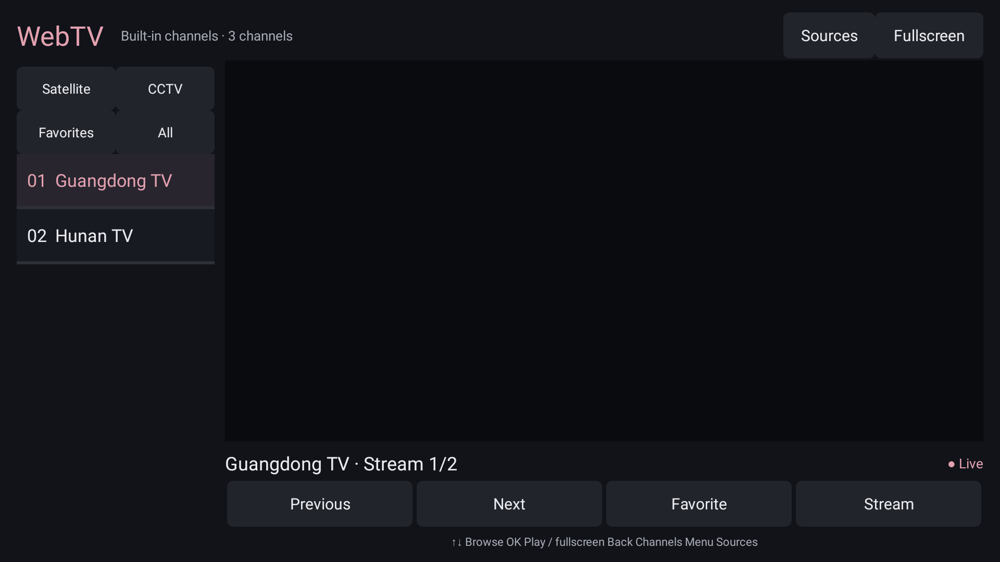

# WebTV

[English](README.en.md) · [中文](README.md)

<!-- apk-resource:start -->
[Download APK](webtv-0.1.1.apk?raw=1) · [Checksums](SHA256SUMS.txt) · [Signing and build provenance](resource.json) · [Source code](src/) · [64×64 SVG icon](logo.svg)

The APK in this directory is signed with the pureTV release certificate.
<!-- apk-resource:end -->

## Preparing 0.5.0 and migrating signatures

The planned release is **0.5.0**, using the new pureTV release certificate shared by the project's own apps and launchers. Android cannot install it over an old version signed with the previous certificate. Back up any data you can export, uninstall the old app, then install 0.5.0. Uninstalling clears local favorites, imported channel lists, cached metadata and settings. There is no automatic migration tool, and not all local data can necessarily be exported.

The package is still being prepared. The download link above remains the previous release until the APK and `resource.json` are updated.

WebTV is a native live-channel player for Android TV 8.0 or later; package: `com.ecojust.webtv`. It uses Android Views, SurfaceView, MediaPlayer and MediaSession, without production third-party dependencies. The interface follows the TV's Chinese or English language setting; imported channel names retain their original text.

## Controls and channel lists

- Choose satellite, CCTV, favorite or all channels on the left. Up/Down changes focus; OK starts playback, and a second OK enters fullscreen.
- In fullscreen, Up/Down switches channels, OK shows controls and Back returns to the channel list. Media play/pause and previous/next keys are supported.
- Save up to 50 favorites and the last selected channel, or switch between available stream addresses.
- Use Menu or the source control to refresh the channel list, import an HTTP(S) M3U URL or a local file through the system picker, or restore the bundled list.
- A successful import replaces the metadata cache; a failed import keeps the previous list. Playback does not provide time shifting or catch-up TV.



## Build and verification

From the repository root:

```sh
cd resource/launcher/puretv
./gradlew :webtv:assembleDebug :webtv:testDebugUnitTest :webtv:lintDebug :webtv:verifyReleaseSize
```

Catalog releases are signed separately; see the [resource maintenance guide](../../../docs/resource-maintenance.md). `WEBTV_UI_CAPTURE_DIR` enables native Chinese and English UI previews during tests. APK size is recorded in `resource.json`; the release limit is 5 MiB.

The app retains one player and releases playback resources in the background. Channel imports are limited to 512 KiB, 300 channels and four addresses per channel. HTTP(S) streams are supported; UDP, RTSP, DRM, account restrictions, custom M3U request headers and EPG are not. The bundled public channel index does not guarantee that every stream works in every region or on every TV. Tests cover parsing, import rollback, remote navigation, timeout handling and resource cleanup; they do not prove sustained physical-TV playback. See the [Chinese documentation](README.md) for source research and detailed resource limits.
