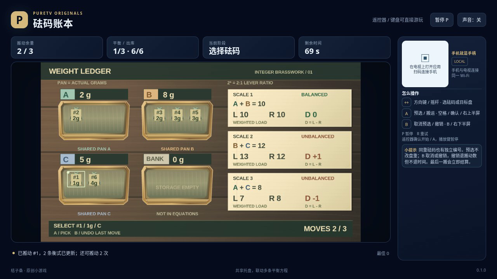

# 砝码账本 / Weight Ledger

把六个砝码分配到三只共用托盘，让三台天平同时平衡。一次搬动会改变多台天平的读数：只顾眼前一台，可能让另一台失衡。

- 作者：ecojust / 桔子桑
- 包名：`com.ecojust.weightledgertv`
- 版本：`0.1.0`
- 电视系统：Android 8.0 / API 26 及以上
- 图标：[logo.svg](logo.svg)

发布产物：[APK](weight-ledger-0.1.0.apk) · [实际游玩视频](docs/gameplay-0.1.0.mp4) · [验证记录](docs/verification.json)



## 操作

手机与电视接入同一局域网，扫描电视画面的二维码。左侧摇杆按画面位置选择砝码；右侧上半区 A 拿取，选择目标托盘后再按 A 放置。下半区 B 在拿取时取消，未拿取时撤销上一次搬动。

键盘方向键或 WASD 选择，空格或 Enter 拿取、放置，B 取消或撤销，P 暂停，R 重试。电视遥控器方向键选择、确认键拿取或放置、菜单键取消或撤销。手机 START 开始或暂停；开始与结算菜单可用左右方向选择关卡，B 切换声音。

每个砝码都有独立编号，相同克数的砝码也是两个不同的实体。拿取只选定要搬动的编号，原盘重量不会提前减少。选择另一个托盘并按 A，才真正移动这个砝码并消耗一步；选择原盘按 A，则免费取消拿取。砝码在托盘内重新排列显示，不算额外搬动。

三关分别允许 3、4、5 次搬动。每台天平两边的式子都公开显示，固定配重与托盘总重共同参与比较。`2×A` 表示 A 盘以 2:1 杠杆比例计入这一边的载荷，并不是多出了一份砝码。库存不参与天平方程；必须把六个砝码全部放入 A、B、C 盘，且三台天平同时平衡，才算完成。

拿取中的 B 只取消本次拿取，不会同时撤销之前的搬动。未拿取时按 B，恢复上一步之前的全部分配、已用步数和砝码选择，不退回已用时间。分数随当前实际分配重新计算，反复拿取、取消或撤销不能积攒分数。

最后允许的一步仍可以通关；若该步之后尚未满足全部条件，立即失败，不能再按 B 撤销。90 秒有效游戏时间耗尽也会结束本局。暂停不消耗有效时间；暂停或连接中断后的输入清理不会自动取消已有的拿取预览，可继续选择，或按 B 取消。R 重试会重新开始当前固定关卡。

## 源码与验证

规则、整数载荷、选择导航、按键优先级、撤销快照与评分公式见 [模型契约](docs/model-contract.md)。生产模型只保存公开砝码、方程和实际历史，没有参考摆法或强制通关接口。

```bash
node --test resource/apps/weight-ledger/tests/game-model.test.cjs
node resource/apps/weight-ledger/tests/independent-weight-review.mjs
node resource/apps/weight-ledger/tests/independent-pilot-review.mjs --output /tmp/weight-ledger-pilot-review
```

[独立规则报告](docs/independent-weight-review.json)采用另写的整数载荷计算与按唯一编号搜索的分配算法，区分重复重量的实体，逐次核对库存守恒、所有天平、移动预算与撤销。普通输入解法会在每次重排后重新读取公开位置，规划方向键选择路径。搜索不导入生产模型的规则助手或操作脚本；合成边界用例与全新模型的普通按键解法分别标注，不作为浏览器录像或实体设备验证。

[操作脚本独立报告](docs/independent-pilot-review.json)使用小型合成账本检查公开观察、私有字段访问、状态写入、独立实例、按键释放及拿取、取消、放置、撤销的观察确认。这些用例执行操作脚本自身的规划器，不执行生产模型，也不作为三关通关证明。软件浏览器的实际游玩、完整录像与布局检查随发布产物提供；实体电视或手机未经测试时不会标记为通过。

手机手柄与 Android 宿主组件见 [game-kit](../../game-kit/README.md)。源码与原创素材遵循仓库 [MIT 许可证](../../../LICENSE)。
