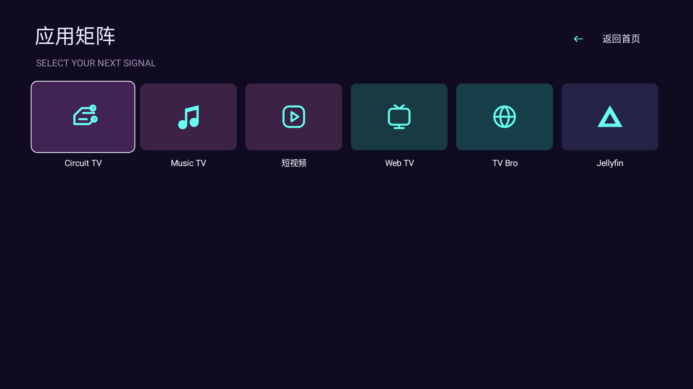

# Circuit TV · 回路

紫色与电光青的回路桌面，不对称大卡片和清晰的霓虹焦点。基于原生 Android TV，使用遥控器方向键和确认键操作。

[下载 CircuitTV-0.1.0.apk](CircuitTV-0.1.0.apk) · [布局示例](layout.example.json) · [源码归档](source.tar.gz) · [元数据](resource.json)




预览由真实 Android 界面通过 Robolectric 原生图形渲染；安装示例应用用于展示，非实体电视截图。实际桌面仅列出电视已安装、可启动的用户应用。

## 使用

在 pureTV Manager 导入 APK，安装并设为当前启动器后，可通过“调整布局”修改用户应用的位置、大小、图标、文字、颜色和背景。当前管理器通过 `content://com.ecojust.circuittv.layout` 动态识别 v5 协议；系统组件只读。Home 向下进入 Apps，Apps 向上或返回键回到首页。控制中心保留输入源、网络、系统设置及常用应用入口。

布局屏幕基准 960 × 540，位置按该尺寸缩放。`layout.example.json` 使用 6 个仓库应用的真实包名；示例只可在相应 APK 已安装后导入。首页前 6 个用户应用默认使用本主题的编排，应用页自动生成全部已安装用户应用。超过协议大小预算时优先压缩背景和缩短显示文案，保留包名与功能。

完整协议见 [layout v5 规范](../../README-development.md)。源码、资源和 APK 位于同一独立目录，包名 `com.ecojust.circuittv`，可与其他启动器共存。

## 构建与验证

使用 JDK 17、Android SDK 35 和 Build Tools 34.0.0，在本目录运行：

```bash
./gradlew --no-daemon assembleDebug assembleRelease lintDebug testDebugUnitTest
```

设置 `LAUNCHER_UI_CAPTURE_DIR` 可导出 `home-render.png` / `apps-render.png`。发布 APK 使用 pureTV 项目签名，签名与 SHA-256 记录于 `resource.json` / `SHA256SUMS.txt`。

图标、背景均为本项目原创程序绘制；字体和依赖许可见 [NOTICE.md](NOTICE.md)。
