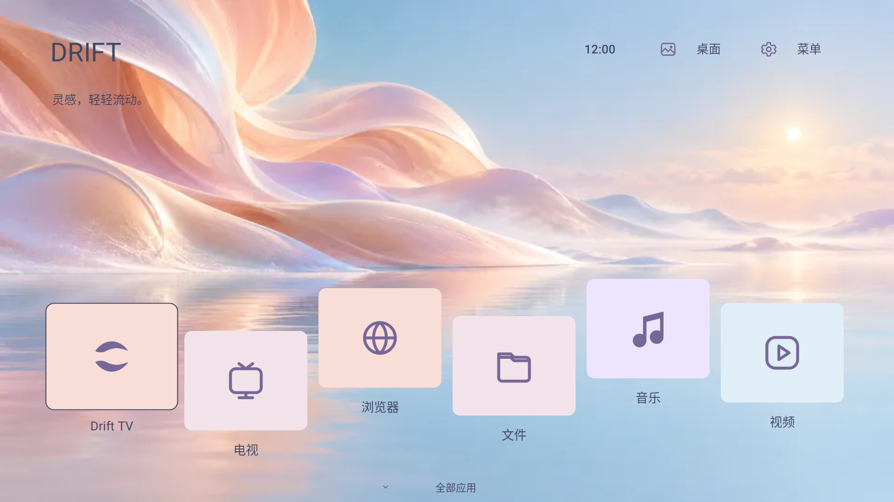
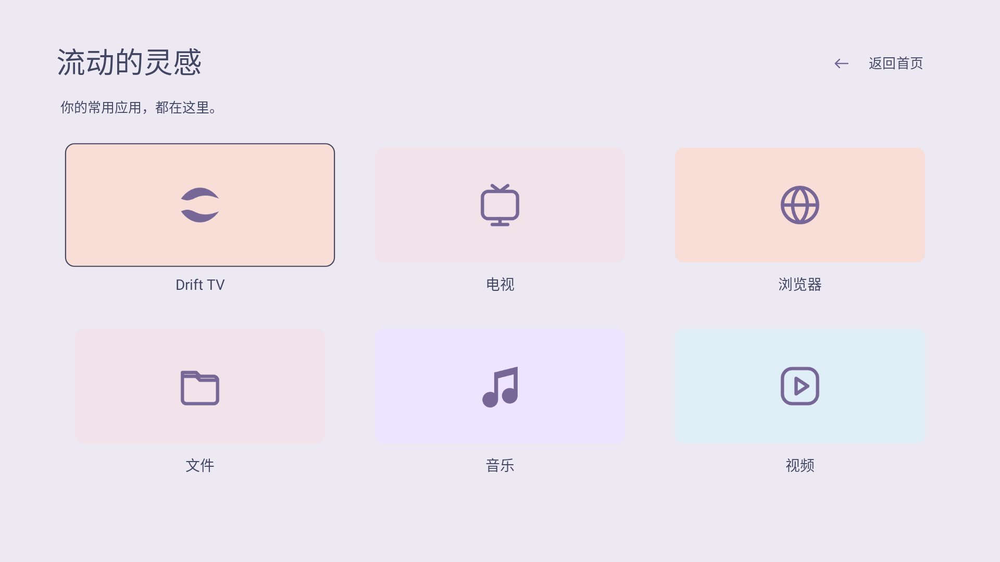

# Drift TV 0.1.0 · 流境

柔和梦境与错落漂浮应用岛，清透粉彩风格。独立包名 `com.ecojust.drifttv`，与其他启动器并存。采用 layout.json v5，画面位置、用户应用、文字、SVG 图标、颜色与页面背景均可由管理器读取和调整。

[下载 APK](DriftTV-0.1.0.apk?raw=1) · [源码归档](source.tar.gz) · [布局示例](layout.example.json) · [协议与接入规范](../../README-development.md#layoutjson-规范与画面对照) · [SHA256](SHA256SUMS.txt)

| 首页 | 应用页 |
| --- | --- |
|  |  |

预览由实际 Android 页面在 Robolectric 原生图形环境中渲染，使用测试应用，并非电视实拍。背景为本项目生成的原创素材，来源说明见 [artwork](artwork/)。

## 使用

使用 Manager 0.3.7 或更新版本导入并安装 APK，激活后点击“调整布局”。首页默认展示最多六个已安装用户应用；应用页列出最多100个可启动用户应用。右上角“菜单”打开控制中心，可访问桌面设置、常用应用、输入源、网络和系统设置。方向键下进入应用页，上或返回按钮回首页。

系统组件固定且只读；用户应用块支持修改位置、大小、文案、SVG、文字色、图标色和背景色。Home / Apps 的背景独立。`layout.example.json` 演示六个仓库应用，导入前需要先安装对应 APK；默认界面不创建未安装应用的入口。

较大的应用目录会使用同一壁纸的紧凑版本并缩短默认卡片文案，以遵守90 KiB协议上限，不会丢弃应用包名。已保存的自定义布局保留；可通过“恢复默认”回到本主题。

## 开发

JDK17、Android SDK35、Build Tools34.0.0，在本目录执行 `./gradlew --no-daemon :app:assembleRelease :app:lintDebug :app:testDebugUnitTest`。原生预览通过 `LAUNCHER_UI_CAPTURE_DIR` 输出。

Provider 为 `content://com.ecojust.drifttv.layout`，使用标准 `status` / `apply` / `reset`。管理器按协议自动识别，不需要注册包名。APK签名、构建来源和校验见 [resource.json](resource.json)。
