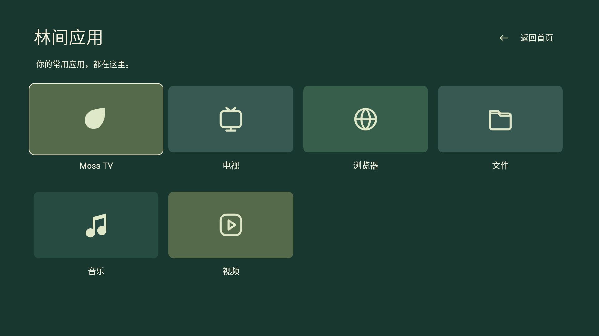

# Moss TV 0.5.0 · 苔原

## 0.5.0 安装说明 / Installation

0.5.0 起统一使用新的 pureTV 发布证书，不能直接覆盖此前使用旧证书的版本。请先备份可导出的布局和数据，再卸载旧版后安装；卸载会清除本机应用数据。本项目不提供自动迁移工具。后续使用同一新证书的版本可以覆盖更新。

Version 0.5.0 uses the new shared pureTV signing certificate and cannot update installations signed with the old certificate. Back up any layouts or data you can export before uninstalling the old app; uninstalling deletes its local data. There is no automatic migration tool. Later releases signed with this same new certificate can update 0.5.0 in place.

森林晨雾与侧栏应用矩阵，静谧自然风格。独立包名 `com.ecojust.mosstv`，与其他启动器并存。采用 layout.json v5，画面位置、用户应用、文字、SVG 图标、颜色与页面背景均可由管理器读取和调整。

[下载 APK](MossTV-0.5.0.apk?raw=1) · [源码归档](source.tar.gz) · [布局示例](layout.example.json) · [协议与接入规范](../../README-development.md#layoutjson-规范与画面对照) · [SHA256](SHA256SUMS.txt)

| 首页 | 应用页 |
| --- | --- |
|  |  |

预览由实际 Android 页面在 Robolectric 原生图形环境中渲染，使用测试应用，并非电视实拍。背景为本项目生成的原创素材，来源说明见 [artwork](artwork/)。

## 使用

使用 Manager 0.3.7 或更新版本导入并安装 APK，激活后点击“调整布局”。首页默认展示最多六个已安装用户应用；应用页列出最多100个可启动用户应用。右上角“菜单”打开控制中心，可访问桌面设置、常用应用、输入源、网络和系统设置。方向键下进入应用页，上或返回按钮回首页。

系统组件固定且只读；用户应用块支持修改位置、大小、文案、SVG、文字色、图标色和背景色。Home / Apps 的背景独立。`layout.example.json` 演示六个仓库应用，导入前需要先安装对应 APK；默认界面不创建未安装应用的入口。

较大的应用目录会使用同一壁纸的紧凑版本并缩短默认卡片文案，以遵守90 KiB协议上限，不会丢弃应用包名。正常使用和后续同证书更新会保留已保存的自定义布局；可通过“恢复默认”回到本主题。本次更换签名的安装要求见上方说明。

## 开发

JDK17、Android SDK35、Build Tools34.0.0，在本目录执行 `./gradlew --no-daemon :app:assembleRelease :app:lintDebug :app:testDebugUnitTest`。原生预览通过 `LAUNCHER_UI_CAPTURE_DIR` 输出。

Provider 为 `content://com.ecojust.mosstv.layout`，使用标准 `status` / `apply` / `reset`。管理器按协议自动识别，不需要注册包名。APK签名、构建来源和校验见 [resource.json](resource.json)。

界面语言跟随 Android 的应用／系统语言：中文使用 `layout.json`，英文及其他非中文语言使用 `layout.en.json`。切换语言会保留已保存的用户应用位置、颜色、操作和背景，只读系统组件采用当前语言的文案。英文布局示例见 [layout.example.en.json](layout.example.en.json)；用户自己填写的应用名称不会自动翻译。
