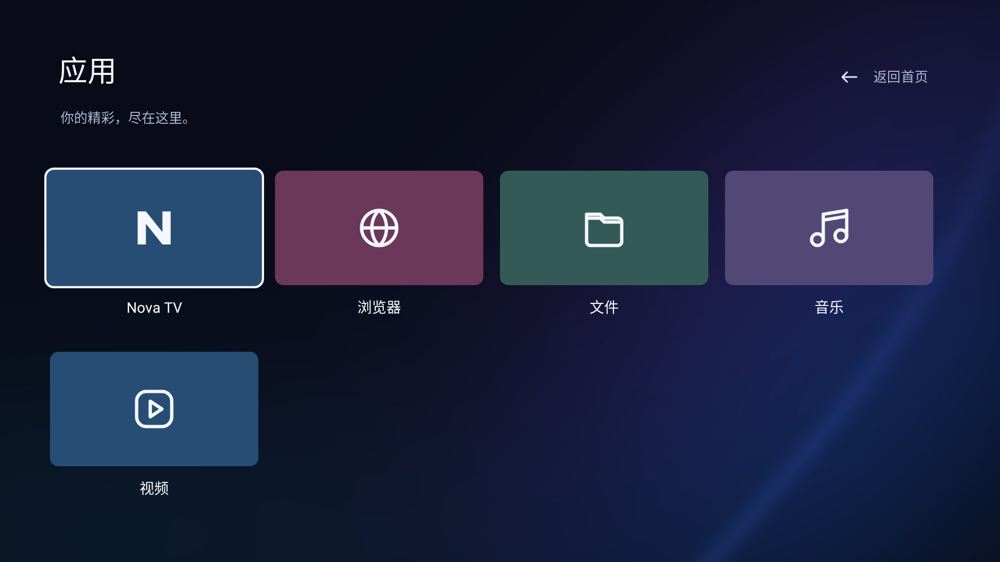

# Nova TV

采用 Apple TV 风格的独立 Android 电视启动器：大幅峡湾景观、底部六列彩色应用卡片、角落时钟，以及遥控器焦点的平滑放大、柔和阴影与细描边。应用标识 `com.ecojust.novatv`，可与 pureTV Launcher 同时安装。

[下载 NovaTV-0.1.2.apk](NovaTV-0.1.2.apk) · [源码归档](source.tar.gz) · [layout.json 示例](layout.example.json) · [layout v5 协议](../../README-development.md#layoutjson-规范与画面对照)

## 界面

| 首页 | 应用页 |
| --- | --- |
|  |  |

截图来自原生 Android 界面在 Robolectric 中的渲染，使用测试应用；不是电视实拍。实际卡片根据电视已安装的用户应用生成。

## 安装与自定义

1. 使用 pureTV Manager 导入 APK，在启动器页面安装并激活 Nova TV。
2. 使用管理器 **0.3.7 或更新版本**中的“调整布局”编辑首页和应用页。可以修改应用、位置、尺寸、文案、SVG、文字颜色、图标颜色和背景。
3. 两个页面可独立设置背景图片。首页默认使用原创生成的峡湾照片，应用页默认使用深色背景；管理器与电视读取同一份 layout v5 内容。
4. 系统组件由启动器定义，管理器中只读。可编辑用户应用必须已经安装且可启动。
5. 首页向下进入应用页，应用页向上返回；可在管理器中调整页面切换规则。

默认首页展示前六个已安装用户应用；应用页展示已安装用户应用。无用户应用时可以先在管理器安装应用。右上角“控制中心”保留网络、输入源、常用应用、桌面与系统设置；遥控器可选择条目，返回键关闭。

从 0.1.0 升级时，已有自定义应用、位置、背景和页面切换规则会保留，系统组件升级到新的紧凑布局。要完整采用新桌面，可在管理器点击“恢复默认”。

默认最多展示 100 个用户应用。应用很多、名称很长时，启动器自动使用同一背景的小图并缩短卡片显示名称，保持协议文件不超过 90 KiB；应用的包名和启动功能不会改变。示例文件使用仓库提供的六款应用，只有电视已安装相应应用后才能直接应用。

## 构建

需要 JDK 17、Android SDK 35 与 Build Tools 34.0.0。在本目录执行：

```sh
./gradlew --no-daemon :app:assembleRelease :app:lintDebug :app:testDebugUnitTest
```

发布 APK 使用仓库发布证书签名，SHA-256 与构建来源见 [resource.json](resource.json) 和 [SHA256SUMS.txt](SHA256SUMS.txt)。许可与上游信息见 [NOTICE.md](NOTICE.md)。

界面语言跟随 Android 的应用／系统语言：中文使用 `layout.json`，英文及其他非中文语言使用 `layout.en.json`。切换语言会保留已保存的用户应用位置、颜色、操作和背景，只读系统组件采用当前语言的文案。英文布局示例见 [layout.example.en.json](layout.example.en.json)；用户自己填写的应用名称不会自动翻译。
