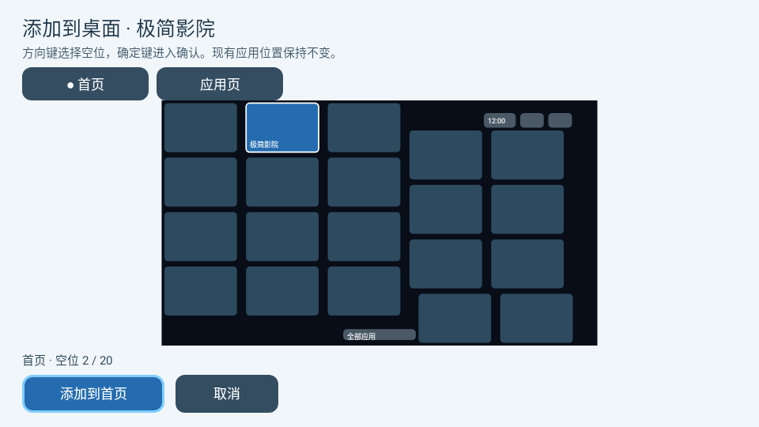
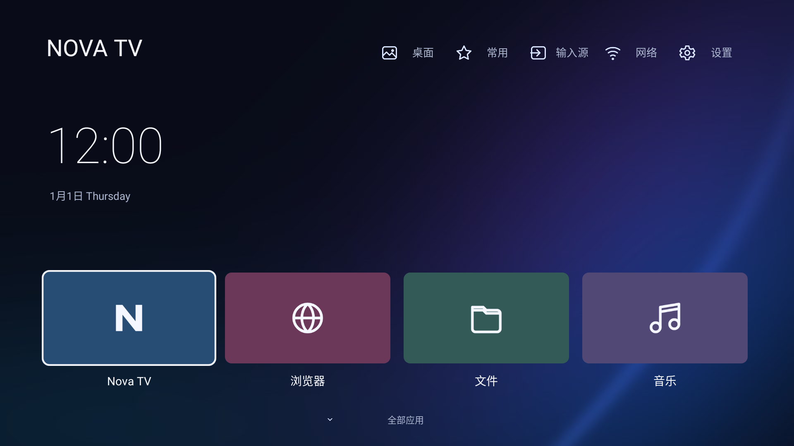
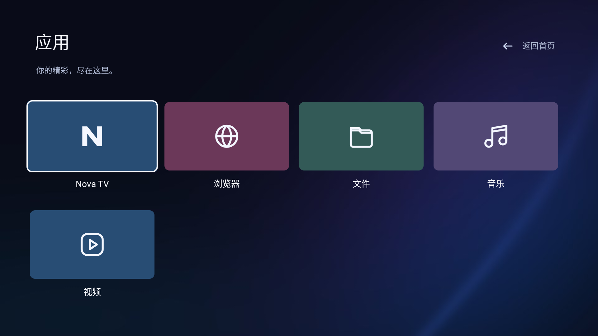

# Nova TV 0.5.1

## 电视上添加应用 / Add apps on TV

0.5.1 新增与 [putrtv商城](../../apps/putrtv-store/) 的添加入口。商城确认安装成功后，选择「添加到桌面」，用遥控器选择首页或应用页的空位并确认；自动读取应用名称与图标，文字默认白色，已有布局不会重排。没有空位、应用已存在或布局无效时会明确提示。

安装此启动器需要 **Android 8 / API 26 或更新版本**。本版沿用0.5.0起的发布证书，可覆盖更新同证书版本并保留布局。

After installation in putrtv Store, choose **Add to home**, select a free position on Home or Apps, and confirm with the remote. The app's name and icon are filled in with white text; existing tiles stay in place. This launcher requires **Android 8 / API 26 or later**, and keeps the signing certificate used since 0.5.0.



此图是实际 Android View 的原生测试渲染，使用模拟应用资料，非实体电视截图。验证结果见[商城与启动器联动验证](../../apps/putrtv-store/docs/VALIDATION.md)。

## 0.5.0 安装说明 / Installation

0.5.0 起统一使用新的 pureTV 发布证书，不能直接覆盖此前使用旧证书的版本。请先备份可导出的布局和数据，再卸载旧版后安装；卸载会清除本机应用数据。本项目不提供自动迁移工具。后续使用同一新证书的版本可以覆盖更新。

Version 0.5.0 uses the new shared pureTV signing certificate and cannot update installations signed with the old certificate. Back up any layouts or data you can export before uninstalling the old app; uninstalling deletes its local data. There is no automatic migration tool. Later releases signed with this same new certificate can update 0.5.0 in place.

采用 Apple TV 风格的独立 Android 电视启动器：大幅峡湾景观、底部六列彩色应用卡片、角落时钟，以及遥控器焦点的平滑放大、柔和阴影与细描边。应用标识 `com.ecojust.novatv`，可与 pureTV Launcher 同时安装。

[下载 NovaTV-0.5.1.apk](NovaTV-0.5.1.apk) · [源码归档](source.tar.gz) · [layout.json 示例](layout.example.json) · [layout v5 协议](../../README-development.md#layoutjson-规范与画面对照)

## 界面

| 首页 | 应用页 |
| --- | --- |
|  |  |

截图来自原生 Android 界面在 Robolectric 中的渲染，使用测试应用；不是电视实拍。实际卡片根据电视已安装的用户应用生成。

## 安装与自定义

1. 使用 pureTV Manager 导入 APK，在启动器页面安装并激活 Nova TV。
2. 使用管理器 **0.3.7 或更新版本**中的“调整布局”编辑首页和应用页。可以修改应用、位置、尺寸、文案、SVG、文字颜色、图标颜色和背景。
3. 两个页面可独立设置背景图片。首页默认使用原创生成的峡湾照片，应用页默认使用深色背景；管理器与电视读取同一份 layout v5 内容。
4. 系统组件由启动器定义，管理器中只读。可编辑用户应用必须已经安装且可启动。
5. 首页向下进入应用页，应用页向上返回；可在管理器中调整页面切换规则。

默认首页展示前六个已安装用户应用；应用页展示已安装用户应用。无用户应用时可以先在管理器安装应用。右上角“控制中心”保留网络、输入源、常用应用、桌面与系统设置；遥控器可选择条目，返回键关闭。

安装后要完整采用默认桌面，可在管理器点击“恢复默认”。本次更换签名无法自动保留旧应用中的布局和数据，安装要求见上方说明。

默认最多展示 100 个用户应用。应用很多、名称很长时，启动器自动使用同一背景的小图并缩短卡片显示名称，保持协议文件不超过 90 KiB；应用的包名和启动功能不会改变。示例文件使用仓库提供的六款应用，只有电视已安装相应应用后才能直接应用。

## 构建

需要 JDK 17、Android SDK 35 与 Build Tools 34.0.0。在本目录执行：

```sh
./gradlew --no-daemon :app:assembleRelease :app:lintDebug :app:testDebugUnitTest
```

发布 APK 使用仓库发布证书签名，SHA-256 与构建来源见 [resource.json](resource.json) 和 [SHA256SUMS.txt](SHA256SUMS.txt)。许可与上游信息见 [NOTICE.md](NOTICE.md)。

界面语言跟随 Android 的应用／系统语言：中文使用 `layout.json`，英文及其他非中文语言使用 `layout.en.json`。切换语言会保留已保存的用户应用位置、颜色、操作和背景，只读系统组件采用当前语言的文案。英文布局示例见 [layout.example.en.json](layout.example.en.json)；用户自己填写的应用名称不会自动翻译。
