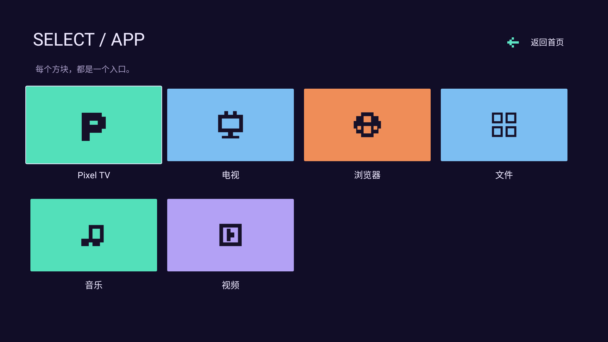

# Pixel TV · 像素

以游戏地图为灵感的像素电视桌面：深紫底、荧光色块、阶梯式路线和原创 8-bit 应用图标。

[下载 PixelTV-0.1.0.apk](PixelTV-0.1.0.apk) · [布局示例](layout.example.json) · [layout v5 协议](../../README-development.md#layoutjson-规范与画面对照)

| 首页 | 应用页 |
| --- | --- |
|  |  |

预览来自实际 Android 界面在 Robolectric 原生图形环境中的渲染，使用测试应用，非电视实拍。默认卡片仅来自当前已安装、可启动的用户应用。

包名 `com.ecojust.pixeltv`，版本 0.1.0。使用 pureTV Manager 0.3.7 或更新版本导入 APK，安装、激活后点击“调整布局”。管理器通过 `<包名>.layout` 自动发现标准接口。支持 Home / Apps 独立背景、位置、尺寸、SVG、文字与图标颜色；系统组件只读。菜单按钮可打开控制中心，提供桌面、网络、输入源、常用应用及系统设置。首页向下进入应用页，应用页向上返回。

示例配置包含资源目录中的六个真实应用包名；实际应用需先安装，启动器不会创建伪装成已安装应用的占位入口。

## 构建

本目录是独立 Gradle 工程，需要 JDK 17、Android SDK 35、Build Tools 34.0.0：

```sh
./gradlew --no-daemon :app:assembleRelease :app:lintDebug :app:testDebugUnitTest
```

设置 `LAUNCHER_UI_CAPTURE_DIR` 可导出原生页面渲染图。发布签名、APK 哈希和构建来源见 resource.json 与 SHA256SUMS.txt；许可证和上游致谢见 [LICENSE](LICENSE) 与 [NOTICE.md](NOTICE.md)。

界面语言跟随 Android 的应用／系统语言：中文使用 `layout.json`，英文及其他非中文语言使用 `layout.en.json`。切换语言会保留已保存的用户应用位置、颜色、操作和背景，只读系统组件采用当前语言的文案。英文布局示例见 [layout.example.en.json](layout.example.en.json)；用户自己填写的应用名称不会自动翻译。
