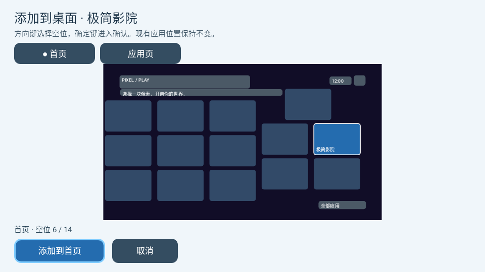
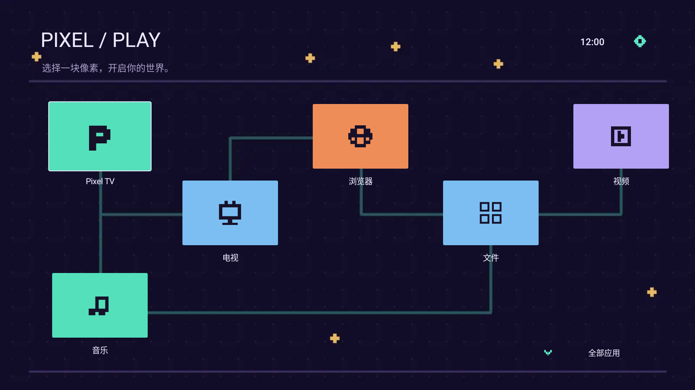
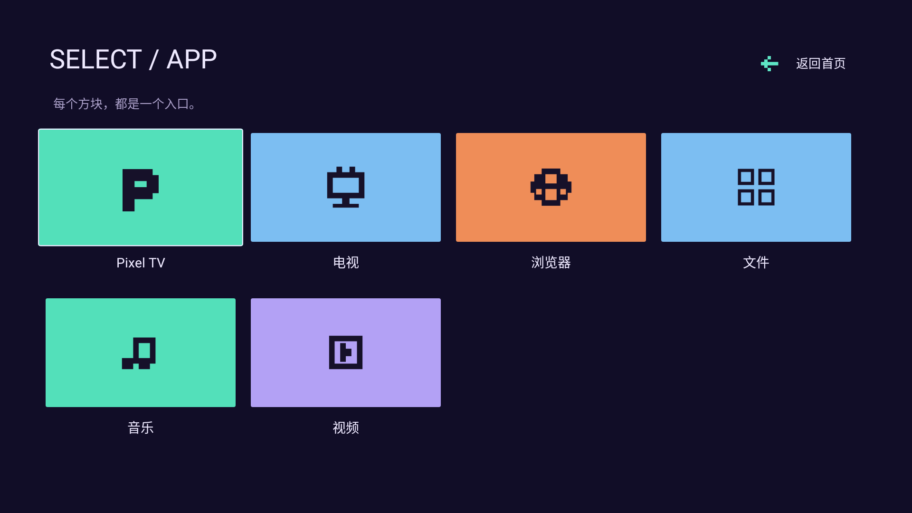

# Pixel TV · 像素 0.5.1

## 电视上添加应用 / Add apps on TV

0.5.1 新增与 [putrtv商城](../../apps/putrtv-store/) 的添加入口。商城确认安装成功后，选择「添加到桌面」，用遥控器选择首页或应用页的空位并确认；自动读取应用名称与图标，文字默认白色，已有布局不会重排。没有空位、应用已存在或布局无效时会明确提示。

安装此启动器需要 **Android 8 / API 26 或更新版本**。本版沿用0.5.0起的发布证书，可覆盖更新同证书版本并保留布局。

After installation in putrtv Store, choose **Add to home**, select a free position on Home or Apps, and confirm with the remote. The app's name and icon are filled in with white text; existing tiles stay in place. This launcher requires **Android 8 / API 26 or later**, and keeps the signing certificate used since 0.5.0.



此图是实际 Android View 的原生测试渲染，使用模拟应用资料，非实体电视截图。验证结果见[商城与启动器联动验证](../../apps/putrtv-store/docs/VALIDATION.md)。

## 0.5.0 安装说明 / Installation

0.5.0 起统一使用新的 pureTV 发布证书，不能直接覆盖此前使用旧证书的版本。请先备份可导出的布局和数据，再卸载旧版后安装；卸载会清除本机应用数据。本项目不提供自动迁移工具。后续使用同一新证书的版本可以覆盖更新。

Version 0.5.0 uses the new shared pureTV signing certificate and cannot update installations signed with the old certificate. Back up any layouts or data you can export before uninstalling the old app; uninstalling deletes its local data. There is no automatic migration tool. Later releases signed with this same new certificate can update 0.5.0 in place.

以游戏地图为灵感的像素电视桌面：深紫底、荧光色块、阶梯式路线和原创 8-bit 应用图标。

[下载 PixelTV-0.5.1.apk](PixelTV-0.5.1.apk) · [布局示例](layout.example.json) · [layout v5 协议](../../README-development.md#layoutjson-规范与画面对照)

| 首页 | 应用页 |
| --- | --- |
|  |  |

预览来自实际 Android 界面在 Robolectric 原生图形环境中的渲染，使用测试应用，非电视实拍。默认卡片仅来自当前已安装、可启动的用户应用。

包名 `com.ecojust.pixeltv`，版本 0.5.0。使用 pureTV Manager 0.3.7 或更新版本导入 APK，安装、激活后点击“调整布局”。管理器通过 `<包名>.layout` 自动发现标准接口。支持 Home / Apps 独立背景、位置、尺寸、SVG、文字与图标颜色；系统组件只读。菜单按钮可打开控制中心，提供桌面、网络、输入源、常用应用及系统设置。首页向下进入应用页，应用页向上返回。

示例配置包含资源目录中的六个真实应用包名；实际应用需先安装，启动器不会创建伪装成已安装应用的占位入口。

## 构建

本目录是独立 Gradle 工程，需要 JDK 17、Android SDK 35、Build Tools 34.0.0：

```sh
./gradlew --no-daemon :app:assembleRelease :app:lintDebug :app:testDebugUnitTest
```

设置 `LAUNCHER_UI_CAPTURE_DIR` 可导出原生页面渲染图。发布签名、APK 哈希和构建来源见 resource.json 与 SHA256SUMS.txt；许可证和上游致谢见 [LICENSE](LICENSE) 与 [NOTICE.md](NOTICE.md)。

界面语言跟随 Android 的应用／系统语言：中文使用 `layout.json`，英文及其他非中文语言使用 `layout.en.json`。切换语言会保留已保存的用户应用位置、颜色、操作和背景，只读系统组件采用当前语言的文案。英文布局示例见 [layout.example.en.json](layout.example.en.json)；用户自己填写的应用名称不会自动翻译。
