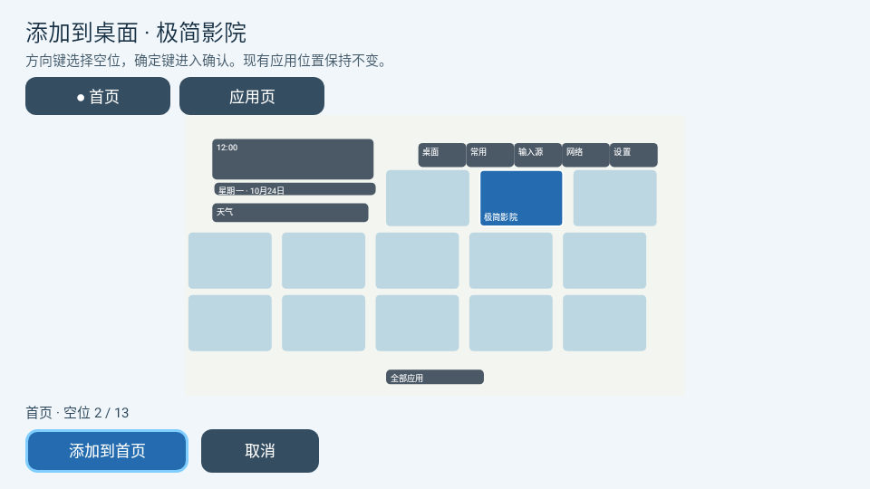
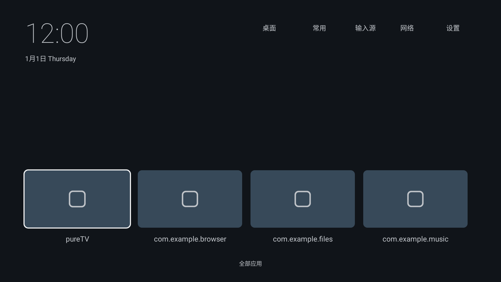
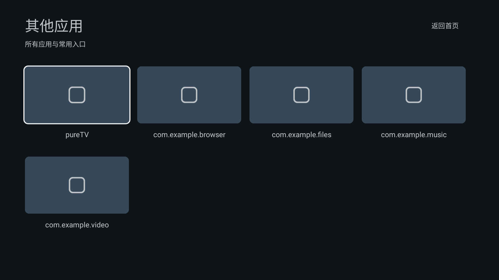

# pureTV Launcher 0.5.2

## 电视上添加应用 / Add apps on TV

0.5.2 新增与 [putrtv商城](../../apps/putrtv-store/) 的添加入口。商城确认安装成功后，选择「添加到桌面」，用遥控器选择首页或应用页的空位并确认；自动读取应用名称与图标，文字默认白色，已有布局不会重排。没有空位、应用已存在或布局无效时会明确提示。

安装此启动器需要 **Android 8 / API 26 或更新版本**。本版沿用0.5.0起的发布证书，可覆盖更新同证书版本并保留布局。

After installation in putrtv Store, choose **Add to home**, select a free position on Home or Apps, and confirm with the remote. The app's name and icon are filled in with white text; existing tiles stay in place. This launcher requires **Android 8 / API 26 or later**, and keeps the signing certificate used since 0.5.0.

此图是实际 Android View 的原生测试渲染，使用模拟应用资料，非实体电视截图。验证结果见[商城与启动器联动验证](../../apps/putrtv-store/docs/VALIDATION.md)。

## 0.5.1 图标更新 / Logo update

采用明黄色底的生肖龙雕刻 Logo，普通、圆形和自适应图标统一更新，并保留龙角、长须和龙爪的安全边距。图案与 pureTV Manager 使用同一原稿，见[品牌图与生成说明](../../../docs/branding/README.md)。0.5.1 沿用 0.5.0 的发布证书，可直接覆盖更新 0.5.0。

The bright yellow zodiac dragon logo now appears in standard, round and adaptive launcher icons, with safe margins around the horns, whiskers and claws. It shares the artwork used by pureTV Manager. Version 0.5.1 retains the signing certificate used by 0.5.0 and can update that version in place.

## 安装说明 / Installation

**0.5.2 已发布 / Released.** 下载包、源码归档和校验信息见本目录。

0.5.0 起统一使用新的 pureTV 发布证书，不能直接覆盖此前使用旧证书的版本。请先备份可导出的布局和数据，再卸载旧版后安装；卸载会清除本机应用数据。本项目不提供自动迁移工具。后续使用同一新证书的版本可以覆盖更新。

Version 0.5.0 uses the new shared pureTV signing certificate and cannot update installations signed with the old certificate. Back up any layouts or data you can export before uninstalling the old app; uninstalling deletes its local data. There is no automatic migration tool. Later releases signed with this same new certificate can update 0.5.0 in place.

作者：ecojust / 桔子桑。包名 `com.ecojust.puretv`。

[下载 APK](pureTV-0.5.2.apk?raw=1) · [对应源码](source.tar.gz) · [layout.json 示例](layout.example.json) · [规范与画面对照](../../README-development.md#layoutjson-协议规范与画面对照) · [SHA256](SHA256SUMS.txt)

支持 layout.json v5：screen 屏幕基准，Home/Apps 独立 users、只读 system、背景和方向键导航。用户块对应已安装 APK，使用包名 action 与原始 SVG 图标；textColor 和 iconColor 分别设置文字与图标颜色。系统组件背景默认透明，SVG 栅格化为位图后显示，兼容 TV 硬件画布。默认块来自已安装用户应用；可由管理器框选、多选对齐／分散／平铺。系统组件只能查看。管理器的屏幕基准只读，顶部用单个按钮添加应用块，action 在右侧选择；显隐 switch 位于组件类型下方。两页支持独立背景，Home 按下进入 Apps、Apps 按上返回，由 JSON 配置。

图片由对应版本的实际 Android 页面在 Robolectric 原生图形环境中渲染，非实机录屏。源代码树、构建记录、APK 哈希与发布证书见 [resource.json](resource.json)。许可证及上游致谢见 [LICENSE](LICENSE) 与 [NOTICE.md](NOTICE.md)。

编辑布局需配套 Manager 0.3.6 或更新版本。旧证书版本的安装要求见上方说明。

正常使用及后续同证书更新会保留已有自定义布局。若要采用默认排版与配色，请在管理器的「调整布局」中选择「恢复默认」。

界面语言跟随 Android 的应用／系统语言：中文使用 `layout.json`，英文及其他非中文语言使用 `layout.en.json`。切换语言会保留已保存的用户应用位置、颜色、操作和背景，只读系统组件采用当前语言的文案。英文布局示例见 [layout.example.en.json](layout.example.en.json)；用户自己填写的应用名称不会自动翻译。
