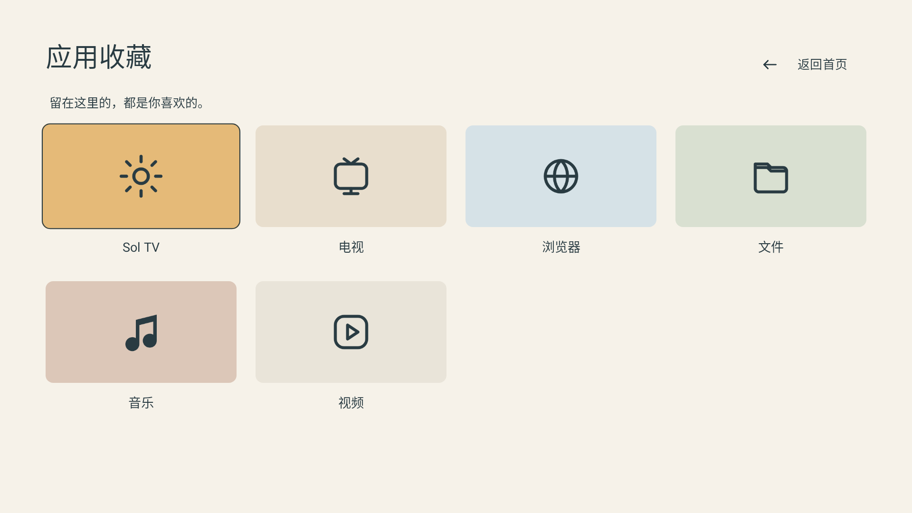

# Sol TV 0.5.0

## 0.5.0 安装说明 / Installation

**0.5.0 发布准备 / Release preparation.** 下载包与校验信息以完成发布后的目录为准。

0.5.0 起统一使用新的 pureTV 发布证书，不能直接覆盖此前使用旧证书的版本。请先备份可导出的布局和数据，再卸载旧版后安装；卸载会清除本机应用数据。本项目不提供自动迁移工具。后续使用同一新证书的版本可以覆盖更新。

Version 0.5.0 uses the new shared pureTV signing certificate and cannot update installations signed with the old certificate. Back up any layouts or data you can export before uninstalling the old app; uninstalling deletes its local data. There is no automatic migration tool. Later releases signed with this same new certificate can update 0.5.0 in place.

北欧日光风格，暖白留白与不对称应用排版。独立包名 `com.ecojust.soltv`，可以与其他启动器同时安装。

[下载 APK](SolTV-0.5.0.apk?raw=1) · [源码归档](source.tar.gz) · [layout.json 示例](layout.example.json) · [协议与接入说明](../../README-development.md#第三方启动器接入与动态检测) · [校验值](SHA256SUMS.txt)

| 首页 | 应用页 |
| --- | --- |
|  |  |

预览来自真实 Android 页面在 Robolectric 原生图形环境中的渲染，使用测试应用；非电视实拍。首页显示前六个已安装用户应用，应用页展示最多 100 个可启动用户应用。完整名称由应用列表返回，超大目录会缩短默认卡片文案以满足 layout 90 KiB 限制，包名与应用数量保持不变。

使用 pureTV Manager 0.3.7 或更新版本安装并激活后，管理器通过 ADB 动态识别布局接口。可修改用户块的应用、位置、尺寸、颜色、文案和 SVG 图标，也可单独设置两个页面背景。系统组件只读；右上角控制中心保留桌面、常用、输入源、网络和系统设置入口。首页按下进入应用页，应用页按上返回，导航由 layout v5 定义。

`layout.example.json` 使用仓库资源中的六个真实应用作为对照示例，导入前需安装对应应用。默认 APK 根据电视实际已安装应用生成卡片，不会自动安装这些应用。

## 构建

需要 JDK 17、Android SDK 35、Build Tools 34.0.0。在本目录运行：

```sh
./gradlew --no-daemon :app:assembleRelease :app:lintDebug :app:testDebugUnitTest
```

源码基于 Nova TV 的 layout v5 原生渲染、ADB Provider 与遥控器导航。发布 APK 使用仓库发布证书签名；版本、SHA256 和对应构建记录见 resource.json。许可证与致谢见 LICENSE、NOTICE.md。

界面语言跟随 Android 的应用／系统语言：中文使用 `layout.json`，英文及其他非中文语言使用 `layout.en.json`。切换语言会保留已保存的用户应用位置、颜色、操作和背景，只读系统组件采用当前语言的文案。英文布局示例见 [layout.example.en.json](layout.example.en.json)；用户自己填写的应用名称不会自动翻译。
